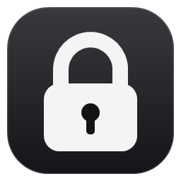
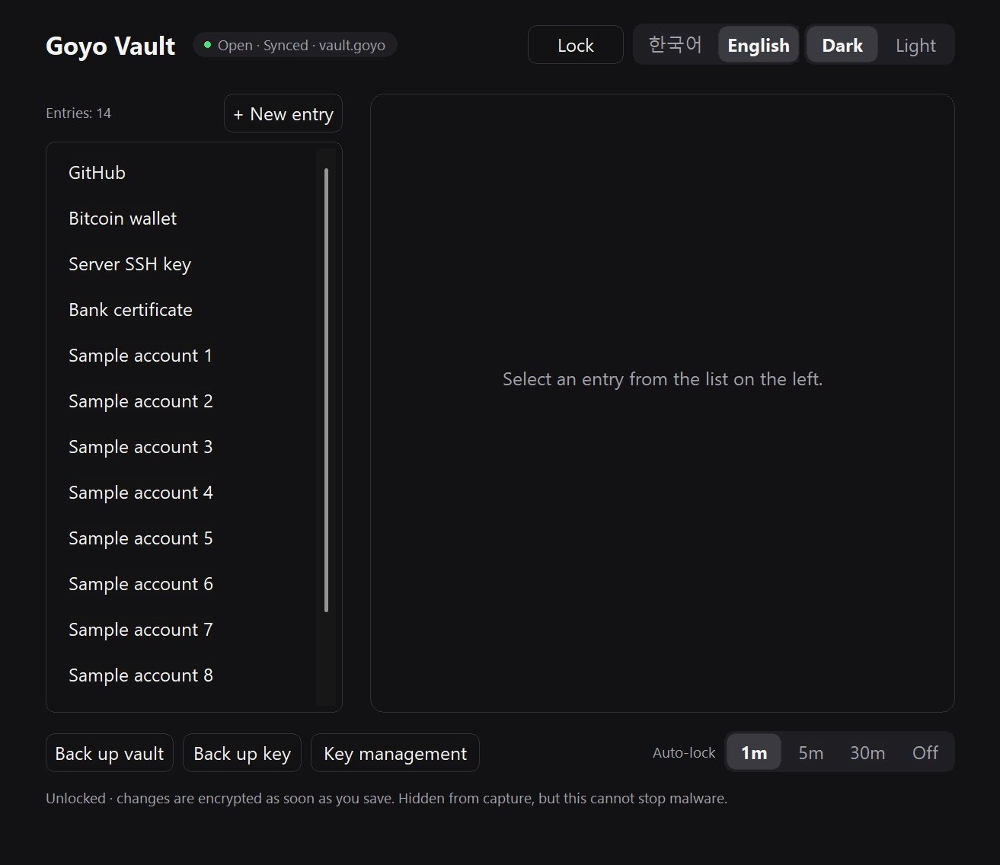
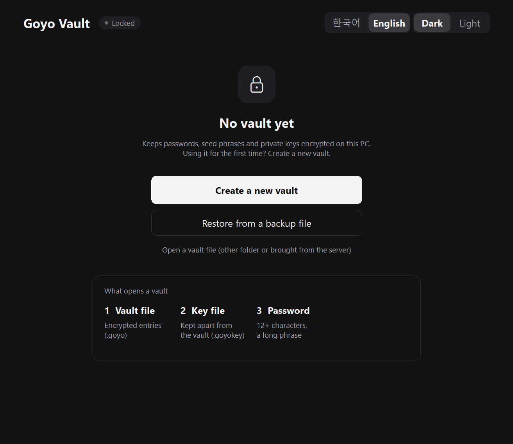
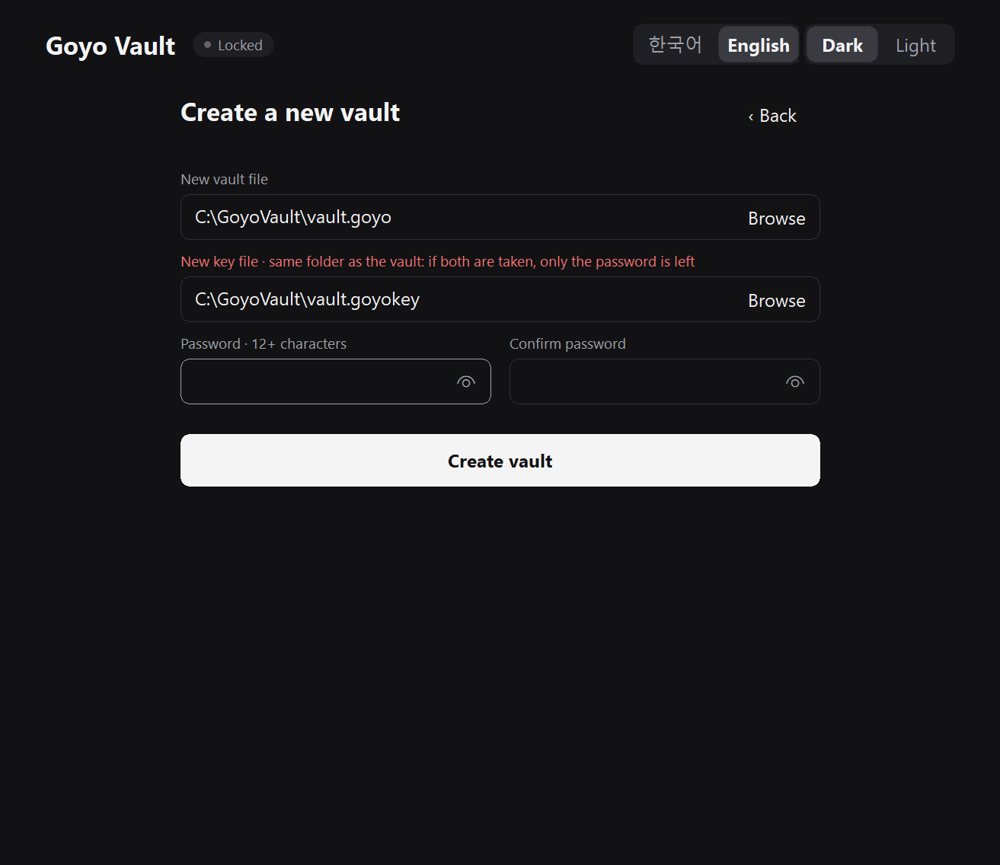
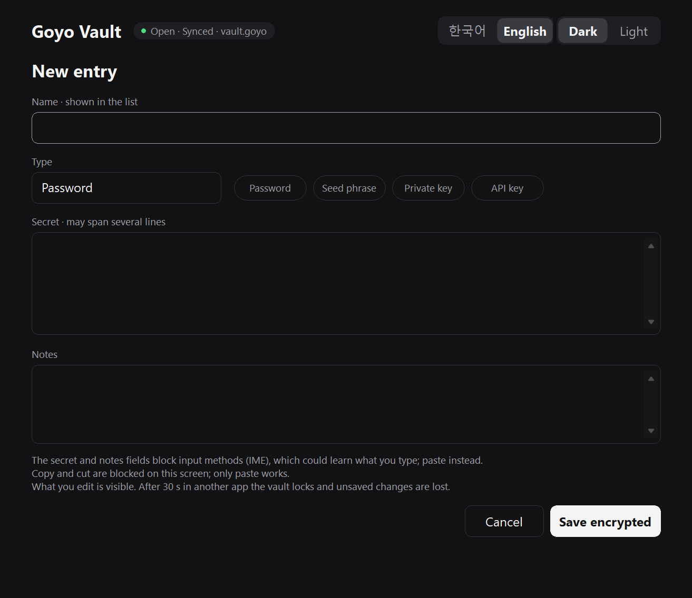
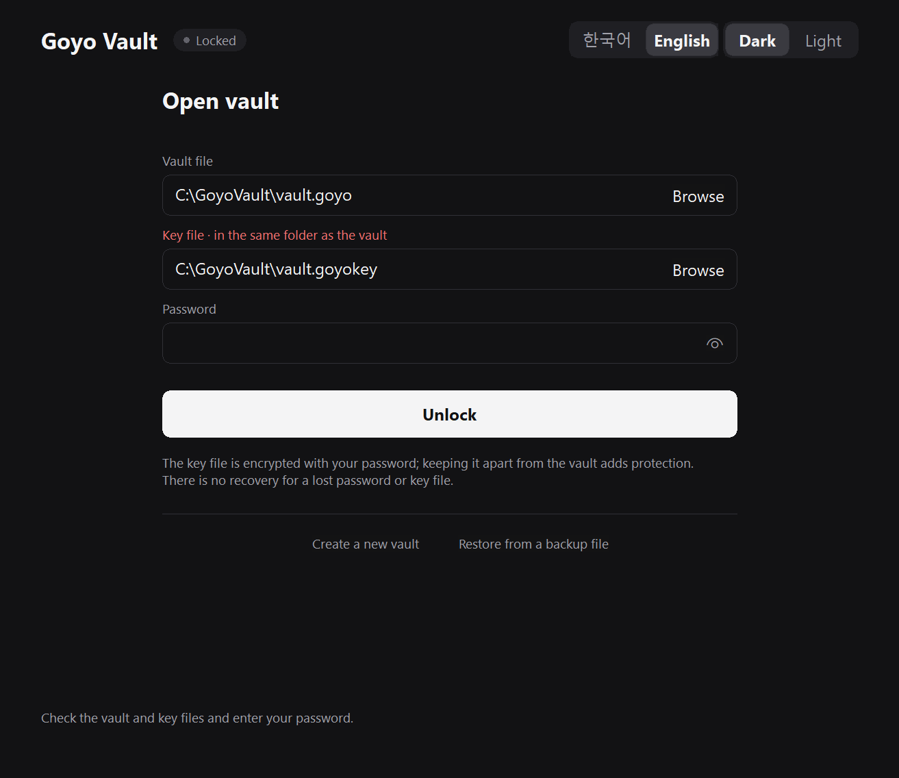
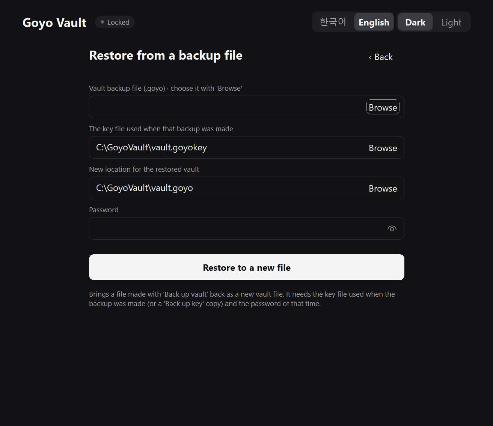
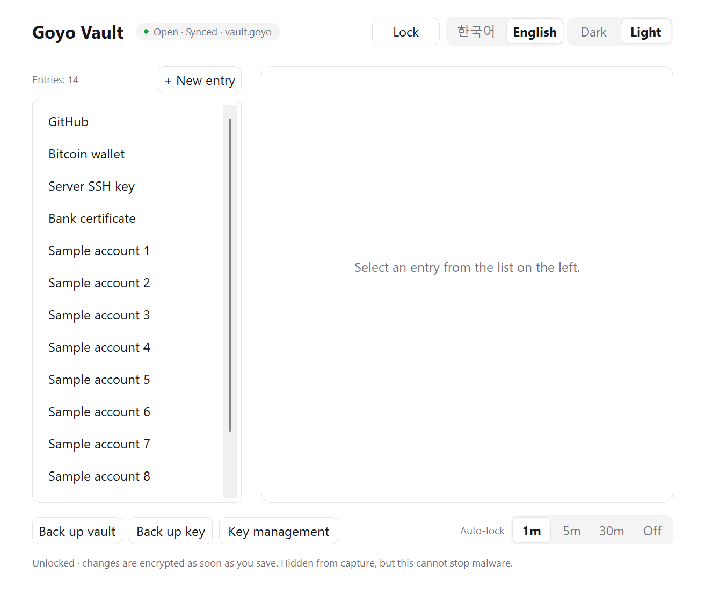

<p align="center"></p>
<h1 align="center">Goyo Vault · 고요 금고</h1>
<p align="center">An offline vault for passwords, seed phrases and private keys that stays on your PC (Windows 11)</p>
<p align="center"><a href="README.md">한국어</a> · <b>English</b></p>



> [!WARNING]
> This is a development release. It has automated tests and AI-assisted code reviews, but **it has not had a professional security audit.** Try creating, backing up and restoring a vault with fake values before you trust it with real secrets.

## What it does

- **The vault app is fully offline:** `goyo-vault.exe` has no network code and starts no other programs. Optionally, the separate tool `goyo-sync.exe` that comes with it syncs **only the encrypted vault file** with your own SSH server; the key file and password are never sent. `goyo-sync.exe` does nothing until you open it and set it up, and the vault app cannot start it. There is no account and no auto-update.
- **Opening a vault takes** the vault file (`.goyo`), a separate key file (`.goyokey`) and your password. Only the two files and the password take part in decryption, so **to someone holding both files, the password is the only barrier**. Keep the key file somewhere else.
- **Secrets stay hidden by default:** show for 15 seconds, copy only after you allow it, and the clipboard is wiped 15 seconds after a copy.
- **Auto-lock** of an open vault, by default after 60 seconds idle or 30 seconds in another app; on the vault screen you can change it to 5 minutes, 30 minutes or off. Locking the screen, sleep and Windows shutdown always lock it.
- **Screen-capture protection:** the window is excluded from the capture paths Windows supports (ordinary screenshots and screen recordings).
- **A single executable, no installer.** Dark and light themes, Korean and English interface.
- **There is no automatic backup.** You make backups yourself; [Backups: what you must do yourself](#backups-what-you-must-do-yourself) lists what and when. With sync, the server keeps the last 200 encrypted versions, but key backups are still up to you.

## Security at a glance

|Area|Specification|What it means|
|---|---|---|
|Encryption|**XChaCha20-Poly1305** (256-bit key, tamper detection)|Changing even one byte of a file makes it refuse to open. No plaintext file is ever written.|
|Password handling|**Argon2id**, 256 MiB memory, 3 passes|Every guess costs 256 MiB of memory and about 0.6 s. A typical desktop using all cores manages about 8 guesses per second.|
|Second key|A **key file** holding a random 256-bit key|Someone with only the vault file cannot open it, even with your password.|
|Randomness|CPU hardware randomness (**RDSEED**)|Keys and nonces all come from hardware randomness.|
|Network|goyo-vault.exe: **none** (checked before each release) · optional goyo-sync.exe: no network code of its own; sends only ciphertext through Windows' built-in ssh.exe|The vault app has no network code. A pre-release check confirms that no network library is in either executable's DLL list.|
|Memory|Keys, passwords and entries are wiped with `zeroize` after use|On lock and exit the app clears the secrets it manages from memory.|
|Screen|Capture exclusion, hidden by default, auto-lock|The window does not appear in screenshots or recordings; a secret shows for 15 seconds only when you ask.|
|Clipboard|Wiped after 15 seconds, excluded from Win+V history and cloud sync|Copying works only after you turn on "allow copy".|
|Other programs|Window messages blocked, memory access restricted, DLL planting blocked|Other programs cannot read the input fields, fake clicks to make the app copy a secret, or read its memory.|
|Transparency|Open source, pinned dependencies, the same source builds the same executable (`/Brepro`)|Anyone can read the code, build it and compare the result with the release.|
|Verification|139 automated tests, a multi-angle AI security audit and re-checks|All findings and fixes are public in [docs/SECURITY_REVIEW.md](docs/SECURITY_REVIEW.md).|

**How long the password holds out if someone gets both files** (estimates, generously assuming one high-end GPU tries 100 passwords per second)

|Password|1 GPU|100 GPUs|
|---|---|---|
|A common password from leak lists|about 1 day|about 17 minutes|
|A human-chosen 12-character password|about 5 years|about 20 days|
|**4 unrelated random words**|out of reach|about 5,800 years|
|5+ random words, or 12 random characters|out of reach|out of reach|

So **with the key file kept elsewhere and a long password (4–6 unrelated words)**, the vault stays closed even if both files are taken.

Some things the app **cannot stop**: malware on the PC (keyloggers, copying your files), someone who has both files and your password, and a camera pointed at the screen. See [Please read](#please-read) and [Security design and limits](#security-design-and-limits) for the details. And again: this is not a professionally audited product.

## Requirements

- Windows 11, 64-bit, on a CPU with the RDSEED instruction. Most Intel CPUs from the 5th generation (Broadwell) on and all AMD Ryzen CPUs have it.

## Install

Goyo Vault does not ship ready-made executables or ZIPs. **Build it yourself from the source in this repository (`github.com/NA-DEGEN-GIRL/goyo-vault`).** Using an executable or ZIP from anywhere else means trusting whoever made it.

1. Install the build tools: [Rust](https://rustup.rs) (stable, `x86_64-pc-windows-msvc`) with Visual Studio Build Tools' "Desktop development with C++", Git and Python 3.
2. In PowerShell, get the source and build the ZIPs.
   ```powershell
   git clone https://github.com/NA-DEGEN-GIRL/goyo-vault.git
   cd goyo-vault
   python scripts/package_release.py
   ```
   The `dist\` folder then holds `GoyoVault-<version>-windows-x64.zip`, with the vault app `goyo-vault.exe` and the sync tool `goyo-sync.exe`. While building, the script runs the executable protection checks, the DLL planting check and the server script's selftest, and makes no ZIP if any of them fails. The first build takes a few minutes to fetch dependencies.
3. The ZIP contains a `GoyoVault` folder. Extract it to **a folder only you use that is not synced**, for example `C:\Users\<you>\GoyoVault`. Avoid:
   - the inside of the ZIP or a temporary folder: cleaning it up deletes your vault (the app warns at start-up);
   - `Documents`/`Desktop` backed up by OneDrive, and Dropbox or Google Drive folders: the key file ends up in the same cloud account as the vault. To use the vault on several PCs, use [Sync (optional)](#sync-optional), which sends only the encrypted vault file;
   - a new folder directly under `C:\`, shared folders and USB sticks others use: someone else could replace the program.
4. Run `GoyoVault\goyo-vault.exe`. Files you built yourself carry no downloaded-from-the-internet mark, so SmartScreen usually does not warn. The program is not code-signed, so with Smart App Control enforcing it may be blocked.

### Updating

In the source folder, get the new version with `git pull`, rebuild the ZIPs with `python scripts/package_release.py`, and extract the new ZIP **to the same place, overwriting the old files.** Only the program and documents change; the vault (`.goyo`), key (`.goyokey`) and theme setting in that folder stay. Back up the vault and key first.

The phone OTP feature has been removed. A vault made earlier with the OTP on (every vault made before 0.5.0 is one) still opens; no OTP code is asked any more, only the key file and the password (and the security key, for a vault that uses them). The OTP never took part in decryption, it was only checked by this app after opening, so its removal does not change how the files are protected. The first time such a vault is opened, each PC shows once: "The OTP feature has been removed. You can delete the 'Goyo Vault' entry in your phone's OTP app. The OTP secret inside the key file is erased at the next key change (such as a password change)." If you use such a vault on several PCs, update every PC to this version before changing keys (a password change, say): 0.9.0 and earlier may refuse a new key file whose OTP mark is gone, or ask for an OTP code they can no longer check. A vault made **without an OTP** in 0.5.0 or later (every vault made now) does not open in 0.4.x or earlier.

From 0.8.0, **a vault with sync turned on, and its backups, open only in 0.8.0 or later.** A vault without sync keeps its format and still opens in 0.7.x and older.

From 0.9.0, **a vault whose key was changed (its password changed, or another PC's new key file received), and its later backups, open only in 0.9.0 or later.** A vault whose key was never changed keeps the 0.8 format and still opens in 0.8. For a synced vault, first update the server script and every PC to 0.9.0, then change the key.

> [!NOTE]
> ZIPs before 0.2.0 extracted to a versioned folder such as `GoyoVault-0.1.0`. If you created a vault there, move the vault and key files into the new `GoyoVault` folder, or open them with **Open a vault file (other folder or brought from the server)**.

## How to use it

### 1. First start



With no vault saved yet, you see this screen ("No vault saved yet").

- **Create a new vault** if this is your first time.
- **Restore from a backup file** to bring a vault back from a backup file made with 'Back up vault'. A vault used on another PC opens with **Open a vault file (other folder or brought from the server)** once its vault file and key file are copied by USB, or, with sync, comes with goyo-sync's **Bring to this PC…**.
- **Open a vault file (other folder or brought from the server)** for a vault on a USB drive or in another folder.

Switch between **Dark** and **Light** in the top-right corner.

### 2. Create a vault



1. Choose where the **New vault file** and **New key file** go. Both default to the program folder, so the key caption warns in red. **Pick another place for the key, such as a USB drive, with Browse.** In the same folder, anyone who copies the folder only has to guess the password. The app remembers the last vault and key it opened (`goyo-vault.paths`), so a key on a USB drive does not need browsing every time.
2. Enter a **password** twice. It needs at least 12 characters; repeated characters and passwords made only of common words, keyboard walks or number runs (`password1234`, `qwerty123456`, `1q2w3e4r5t6y`) are refused. For seed phrases or private keys use **4–6 unrelated words**. Words from common-password lists such as `dragon` or `sunshine` do not count, so pick uncommon ones. The check only filters the obvious; passing it does not make a password safe. If the key file is stolen, a common password falls to one GPU within a day; four random words are out of reach. Press the eye icon at the right of the field to check what you typed for typos; press it again to hide it.
3. Press the create button below; the vault file and the key file are created.

### 3. Save an entry



Press **+ New entry**, fill in name, type, secret and note, then press **Save encrypted**.

- Type the kind yourself or use the **password · seed phrase · private key · API key** buttons.
- Multi-line keys such as PEM files are kept exactly.
- **Names are always visible in the list,** so never put a secret in the name.
- For safety, the input method editor (IME) is off in the secret and note fields; Korean text has to be pasted there. You can copy a value in another app, but with the default auto-lock (1 minute) **come back within 30 seconds** to paste it; staying away longer locks the vault and clears unsaved edits.

### 4. View and copy


Pick an entry in the list to see it on the right.

- **Show 15 s** reveals the secret and the note for 15 seconds. Press it again to hide them at once. An entry of the kind **Mnemonic** shows its words numbered, 8 to a row (12 words as 8+4, 24 words in three rows). The stored text stays as it is; long words get a smaller font, and more than 24 words go on to further pages.
- **Copy:** turn on **Allow copy**, then press **Copy**. The permission turns itself off after 30 seconds or after one copy.
- A copied value is **wiped from the clipboard after 15 seconds** and is kept out of Win+V clipboard history and cloud clipboard sync.
- Remaining times are shown on screen.

### 5. Lock and open again



**Lock** locks the vault right away. Locking Windows (Win+L), sleep and Windows shutdown always lock it.

Choose any other automatic locking under **Auto-lock** at the bottom right of the vault screen.

|Choice|Locks|
|---|---|
|**1m** (default)|after 60 seconds without use or 30 seconds in another app|
|**5m**, **30m**|after that long without use. Time in other apps counts as unused.|
|**Off**|never on a timer.|

If it locks too often on a PC only you use, make it longer or turn it off. The trade-off: if you step away without locking the screen, whoever sits down at the PC sees the open vault. With Off, press **Win+L** whenever you leave, and set Windows to lock itself when you are away (for example the screen saver's "On resume, display logon screen"). The choice is stored as `1`, `5`, `30` or `off` in `goyo-vault.autolock` next to the executable.

A quick trip to another app (pasting a copied value, a screenshot tool) does not lock it. The moment you switch, though, **Show for 15 s**, **Allow copy** and any password you made visible are hidden. The vault window never appears in screen captures anyway.

Screens before a vault is open (open, new vault, restore) keep what you typed when you switch to another app; only a password you made visible is hidden again. They are still cleared after the idle time (5 minutes for a new vault, 60 seconds otherwise) or when you lock Windows.

To open it again, enter your password. If you moved the vault or key file, pick it with **Browse**.

### 6. Back up and restore

Use the buttons at the bottom of the vault screen.

- **Back up vault** saves the encrypted vault to a new file.
- **Back up key** saves the encrypted key file to a new file. Store it **apart** from the vault backup.
- A failed backup is reported in a dialog box. No dialog means the file was saved.
- A backup never overwrites an existing file, so save it under a new, dated name such as `vault-2026-10-18.goyo`.

[Backups: what you must do yourself](#backups-what-you-must-do-yourself) lists what to back up and when.



To restore, press **Restore from a backup file** on the first-start or open screen. Choose the **Vault backup file (.goyo)** (a file made with 'Back up vault') and **the key file used when that backup was made**, set the **New location for the restored vault**, enter your password, and the vault is restored to a new file. A vault goyo-sync brought from the server is not restored but opened as it is: put its key file next to it by USB, or, in the security-key build with the server's key file, the **Vault brought from the server** screen appears ([SECURITY_KEY.en.md](docs/SECURITY_KEY.en.md), 'A new PC'); the backup itself is not changed. On a new PC the first restore goes to `vault.goyo` by default, and the restored vault is remembered as the last one opened, so the next start offers it directly.

### 7. Key management: change the password, receive a new key file

**Key management** at the bottom of the vault screen changes the password, receives a key file changed on another PC, and backs up the key. From 0.9.0, changing the key **changes the vault's data key itself.**

**Change password.** **Change password…** asks for the current password and the new one. It says once what will change, then goes ahead.

- Changing the password encrypts the vault again with a new data key and writes a new key file. Other PCs stop syncing until they take that key file with 'Key management › Receive a new key file'. Do not copy it over their key files.
- It is different when several PCs share one vault file (a USB stick or a shared folder) while each PC keeps its own key file. After a password change on one PC the vault file is saved under the new key, so the other PCs' key files no longer open it. Carry the new key file of the PC that changed it to them by USB and open with it. Losing that new key file loses the vault on every PC, so use 'Back up key' right after the change.
- A vault whose key was changed, and its later backups, **no longer open in 0.8 or older.** Change the key on one PC at a time.
- When it is done, the app offers to back up the new key file now and shows the new key check code in the status line.
- If the power fails or the stick is pulled at any moment of the change, the key file and the vault file still form a pair that opens. The next unlock finishes the change, or opens with the old key and the old password ("The last key change did not finish, so the vault opened with the old key."). When the app can tell which password opens the files, a failed unlock says so.

**Receive a new key file.** Bring the key file changed on another PC by USB, choose it with **Receive a new key file…**, type this PC's current password and press **Open**. Do not copy it over this PC's key file yourself.

- A file that is a newer version continuing this PC's key file is taken as it is. If the two PCs changed the key separately and diverged, or the file lacks something only this PC has, a key file joining both is written under a new data key; the other PCs must then take this PC's new key file. With three or more PCs, do not receive the same file on two PCs separately: carry the newest result from PC to PC.
- If the file is locked with another password, the app asks for it. Before anything is taken it shows what will be done (and, for a file taken as it is, the resulting key check code); when joining, you choose the password to use from now on. Afterwards it says which password opens the vault and offers a backup of the new key file.
- A file older than this PC's, the same file, another vault's file, or one that lacks a removal this PC recorded is refused.

**Key check code.** A vault whose key was changed shows a code such as `E3 · 7F2A-90C4-1B5E-D836` in **Key management** (the number after E is the key file's revision). Two PCs that show the same code have the same key file: compare them after another PC has taken the new key file. The code does not reveal the key.

**Warnings and buttons in Key management.**

- **An older key file:** opening with a key file older than the one this PC wrote before is reported in red, and sync (merging and uploads) and key changes stop meanwhile. 'Receive a new key file' then takes only a file that continues the key file this PC last wrote, and the server-copy overwrite below is not offered. Press **This key file is right** only if you really went back to an old backup yourself: it checks the password again and takes the current key file as the reference. On a vault that syncs, sync stops again afterwards if the server copy was saved under the newer key (usually this PC's own earlier upload); if this PC uploaded it, use the server-copy overwrite below.
- **Overwrite the server copy with this PC's state…:** only when sync stopped because of a server copy from another PC that changed the key and that PC's key file cannot be had (the PC died with no key backup), or when you are sure the server copy is forged. The overwritten copy is not merged; it stays only in the server history. If the PC that changed the key is alive, do not overwrite: take its key file. That PC would later see this PC's copy as an old-key copy and overwrite it in turn.
- **Discard the unfinished key change…:** see 'This PC's key record' below.

**Old copies.** Changing the key (a password change; turning security keys on or off, or removing one) does not change copies made before (vault backups, pre-merge copies, the server's last 200 versions): they keep opening with the key file and password (and the keys registered) of their time. A key change protects what you save afterwards. The current key file also holds the 63 most recent data keys and the first one, so old backups still restore. If you change the key because it may have leaked, also change the secrets kept in the vault (the real passwords and keys).

Bring an old backup back with 'Restore from a backup file' to a new file. A vault file saved under an old key that is simply put in place is not opened unless it is under the key this PC used last (this stops someone with an old key copy from swapping it in). An old key file put in place makes this PC warn about an older key file and stop sync and key changes. Someone with an old key file and its password who builds a new key file from it is refused too, unless that file continues the key file this PC wrote last. A vault restored with the key file of that time uses another key file than the one this PC saw, so that vault changes no key and uploads nothing; use it to look up entries. A vault restored with the current key file does not change the key or receive a new key file either: the original vault file uses the same key file, so a change would leave it under an older key, to be opened only through Restore. To keep using the restored file, lock and open it by logging in. All of this assumes this PC has a key record for the vault ([This PC's key record](#this-pcs-key-record)).

### 8. Theme and language



Switch the language with **한국어 | English** and the colours with **Dark | Light** in the top-right corner. Whatever you have typed stays. The choices are stored as just `en`/`ko` in `goyo-vault.lang` and `dark`/`light` in `goyo-vault.theme` next to the executable and have nothing to do with your vault. On the first start the app uses Korean if Windows is set to Korean, and English otherwise.

## Backups: what you must do yourself

The app **saves to the vault file immediately** whenever you add, change or delete an entry. But **it never makes copies anywhere else.** To survive a broken PC, a failed disk or an accidental deletion, you need to do the following yourself.

|What|When|How|
|---|---|---|
|**Vault backup** (`.goyo`)|After adding or changing entries, especially a new seed phrase or private key|**Back up vault** at the bottom of the vault screen|
|**Key backup** (`.goyokey`)|**Once** right after creating the vault, and **every time the key changes** (a password change, a received key file; the app asks right after)|**Back up key** in **Key management** or at the bottom of the vault screen|
|**Password**|Once, when you create the vault|Memorize it or write it down somewhere safe. **The app has no recovery of any kind.**|
|**Restore drill**|Every few months|**Restore from a backup file** to a new file; the original is not changed.|

**No need to back up:** `goyo-vault.theme` (theme), `goyo-vault.lang` (language), `goyo-vault.autolock` (auto-lock) and `goyo-vault.paths` (last locations opened) next to the executable hold no secrets and are not needed to open a vault. `.goyolock` is only the app's in-use marker. `%LOCALAPPDATA%\GoyoVault\goyo-vault.keys` (this PC's key record) and `goyo-vault.otp-note` (the vaults the OTP note was shown for) hold no secret either and belong to this PC alone.

**A restore needs:** a vault backup + the key file (the original or a key backup) + the password. Without any one of them the vault cannot be restored.

**With sync,** the server keeps the last 200 encrypted versions (get one with `goyo-sync --fetch`, then Restore it to a new name). Key backups are still up to you. The server keeps that history, so it does not replace your vault backups either.

**Where to keep them**
- Keep vault backups and key backups on **different drives**, for example the vault backup on an external disk and the key backup on a USB stick.
- Each is encrypted and safe on its own, but together they leave only the password, so never keep both on one USB stick or in one cloud account.
- After a password change or a received key file, back up the new key file at once. An old key backup cannot open what you save afterwards, while old vault backups keep opening with the key copy of their time.
- Do not let this vault be the only copy of a valuable seed phrase; also keep it on paper or metal.

## Sync (optional)

To use one vault on several PCs, the included `goyo-sync.exe` exchanges **only the encrypted vault file** with your own SSH server (Linux or similar, with python3). Double-click `goyo-sync.exe` to open a settings window that looks like Goyo Vault: check the connection (comparing the host key fingerprint on a first connection), install the server script, choose the vaults to sync, and turn on autostart and background sync in one place; a second PC brings its vault with 'Bring to this PC…'. Setup, troubleshooting and the command line: [docs/SYNC.en.md](docs/SYNC.en.md).

- **Every PC needs 0.8.0 or later.** A synced vault and its backups do not open in 0.7.x or older. Each vault asks at every unlock until you agree, and only vaults you agree for change. Before changing the key, update the server script and every PC to 0.9.0.
- The key file and password are never sent. Move the key file between PCs by USB.
- When two PCs edit the same entry, both versions are kept. Delete the one you do not need.
- **Deletions spread to the other PCs.** After a mistake, get entries back from the server history (the last 200 versions) or a `pre-merge-*.goyo` copy in the sync folder.
- The server cannot read the vault, but it learns the vault ID, its size, when the contents changed and your IP address. The helper connects about once a minute, so it also learns when each PC is on. Merely opening the vault uploads nothing, and even when the server takes no upload, a waiting upload is not made again at each unlock, so the server normally does not learn when you open the vault. The exception: when changes are still waiting to go up and a new copy arrives from the server, they go up again after the merge (at the next unlock if the app was closed), so it learns that moment.
- While sync is on, never drop another file in place of `vault.goyo` by hand. Open other copies with Restore from a backup file.
- A password change on one PC encrypts the vault again with a new data key, so the other PCs stop syncing until they take that PC's new key file by USB with 'Key management › Receive a new key file'. Do not copy it over their key files. Halts, diverged key files and overwriting a server copy are covered in 'After a key change' in [docs/SYNC.en.md](docs/SYNC.en.md).
- "Synced" means "checked with the key to match the copy the server last sent or acknowledged". It neither proves that the server really stored it nor that the server keeps it safe. The same check code (`XXXX-XXXX-XXXX-XXXX`, covering the entries' text too) on two PCs means the same contents.

## This PC's key record

From 0.9.0 Goyo Vault notes the key-file state it has seen for each vault in `%LOCALAPPDATA%\GoyoVault\goyo-vault.keys`. It is the first file the app writes outside its own folder, and there is one per PC and Windows user. A vault that only ever used a 0.8 key file (its key never changed) has no record.

- **No secrets.** It holds vault IDs, the key files' revisions and state tags, prefixes of key IDs, the key changes and removals this PC saw, whether a key backup was made, and, while a key change is being written, the path of the new key file. No password, data key or key check code. It is not authenticated: code running as the same user, which can write that folder, can change it.
- **What it does:** a second reference against someone who can change only the vault folder or the key stick. Before asking for any password it notices an old key file put back (the 'older key file' warning), a key file that diverged from this PC's, one with an abnormally large revision, and one that lacks a removal this PC recorded. After a key change cut off by a crash it recognizes the change as this PC's own and finishes it, or says which password opens the files.
- The same folder can hold the lock file `goyo-vault.keys.lock` and, while it is written, `goyo-vault.keys.<16 hex digits>.tmp`; the app cleans them up. `goyo-vault.otp-note` lists only the IDs of the vaults the 'OTP feature has been removed' note was already shown for (no secret); deleting it only makes that note show once more. If the folder cannot be written, the record is kept for this session only and the status line says so; a record written by a later Goyo Vault is never changed.
- **A key change that may have been saved to a key file elsewhere:** if a key change was cut off and the vault is then opened with another copy of the key file, key changes and receiving key files stop until the key file the change was written to has been opened once. If that file is lost for good, **Discard the unfinished key change…** in Key management checks the password again and ends the hold; a file found later is treated like any other key file (if it diverged, join it with 'Receive a new key file').
- **Deleting it** loses this PC's record for **every** vault. The reference starts again from the next key file opened: earlier rollbacks and diverged files are no longer noticed, a key change in progress is no longer recognized as this PC's own, and the mark that the last key change completed is forgotten, so putting back the vault file from before that change is asked about again. A security-key vault (experimental build) needs another PC's key check code again at its next unlock.
- **Last resort:** if this record keeps the right key file from opening ("…another key file that split from it", "…lacks a key removal this PC recorded", "…opened with a security-key key file") and nothing else helps, close every Goyo Vault window, delete `goyo-vault.keys` and every `.tmp` file starting with `goyo-vault.keys.` in that folder, and open the vault again. What is lost is listed just above. "This key file's revision … is abnormally far above the one this PC saw" usually means a forged key file: do not delete the record; use another key file (a key backup, another PC).

## Security keys (experimental)

The source contains an experimental feature that locks the key file with both the password and a security key (YubiKey or another FIDO2 key), but **it is not in the ZIP used for installing (the default build `package_release.py` makes) and was only partly verified with real keys (YubiKey 5C NFC).** The default build refuses a security-key key file before asking for any password and never says the password is wrong. How to build it yourself (`cargo build --release --locked --bins --features security-key`), registering several keys and pairing them, the PIN, what to do on every PC when a key is lost, key-file sync and its price, the remaining risks and the real-key checklist (partly run) are in [docs/SECURITY_KEY.en.md](docs/SECURITY_KEY.en.md). For the server side see 'Key-file sync' in [docs/SYNC.en.md](docs/SYNC.en.md).

|Mode|Build|What the server holds|
|---|---|---|
|No security keys (this README)|Default (install ZIP)|Encrypted vault files only. The key file never leaves the PCs.|
|Security keys, key file on the PCs only|Security-key build (experimental)|Encrypted vault files only|
|Security keys + key-file sync|Security-key build (experimental)|Vault files and every key file uploaded. To anyone with server access the key file is no longer a separate factor.|

## Please read

- **Keep the key file separate. This matters most.** With vault and key in the same folder (the default) or in the same cloud account, whoever takes both only has to keep guessing the password. The app warns about such placements in red.
- **There is no recovery.** Lose the vault file, the key file or the password and this app cannot open the vault. There is no way around it.
- **Neither delete nor rename `.goyotmp` files.** If power fails or a USB stick is pulled during a save, a temporary file such as `vault.goyo.<32 hex digits>.goyotmp` may be all that is left, and it can be the only copy. The app recovers it by itself the next time you unlock: a missing vault file comes back from a temporary file this vault's key opens, and a missing or damaged key file from a temporary key file of the same vault, each under its original name again. If a password change was cut off, try the new password first, then the old one. After the unlock, temporary files that are no longer needed are deleted and the ones it cannot judge stay. If it cannot recover by itself, the app tells you on screen.
- **Copies made before a key change still open with the old key.** A password change replaces the data key, so an old key copy and the old password cannot open what you save afterwards, but vault backups and server history from before the change still open. If you suspect a leak, also change the secrets in the vault ('Old copies' in section 7).
- **Anything you copy can be read by other programs.** Copy only when needed. When you paste into a password or secret field, the app clears the clipboard right away, but it cannot erase what the source app left behind (for example in Win+V history).
- **It cannot protect an infected PC.** A keylogger records the password, and malware running as you can copy the vault and key or replace the program. Malware with administrator rights, kernel attacks and a camera pointed at the screen are also out of reach. Use a hardware wallet for large holdings.

## Security design and limits

<details>
<summary>Details</summary>

**Cryptography**
- **XChaCha20-Poly1305** from RustCrypto: 256-bit key, 192-bit nonce, 128-bit tag. Data and headers are authenticated.
- **Argon2id v1.3** with 256 MiB memory, 3 passes and parallelism 1 derives the key-file encryption key from the password. The key file holds a random data key. An OTP secret left in the key file of a former OTP vault is read and discarded at open, never used, and erased at the next key change.
- **Key changes (0.9.0):** a password change, or joining two diverged key files, makes a new random data key and encrypts the vault again; the key file (`GOYOKE03`) keeps the 63 most recent data keys and the first one (to restore old backups). The vault file's header also states the key file's state (revision and tag), so copies under other keys are told apart before any key derivation. The new key file and vault file are opened again in memory before they are written, and the writes go in the order this PC's key record, vault file (old key), key file, vault file (new key), record, so a pair that opens is left at every moment. The format is in 'Key changes' in [docs/FORMAT.md](docs/FORMAT.md).
- Randomness comes from the CPU's **RDSEED** conditioned with SHA-512. Windows CNG, DPAPI, BCrypt random and `getrandom` are not used. The CPU, firmware and any hypervisor are trusted; simple sanity checks do not certify the hardware.
- The file format is documented in [docs/FORMAT.md](docs/FORMAT.md).

**Memory and files**
- On normal exit and on lock, keys, strings, serialization buffers and Argon2 working memory are wiped with `zeroize`. Copies inside Windows input controls and the entry list, graphics memory, CPU registers, the page file or crash dumps are not guaranteed to be removed.
- No plaintext file is ever written. An encrypted temporary file in the same folder is synced, renamed into place and flushed again under its final name. A file lock prevents two instances from using one vault. The lock goes by path, so two hard links to one vault can still be opened twice; it stops cooperating programs, not malware running as you.
- `goyo-vault.theme` (theme), `goyo-vault.lang` (language) and `goyo-vault.paths` (last vault and key locations) next to the program hold no secrets. The paths file does reveal where the key is, so do not share that folder.
- Power-loss safety depends on the drive and file system; FAT/exFAT is not guaranteed. `.goyolock` files, encrypted temporary files left after a crash, and metadata such as file names and paths are not hidden.
- Windows device names such as `CON`, `NUL` or `COM1` are refused as file names, because a backup to `NUL` would look successful and keep nothing.

**Screen, input and clipboard**
- Input fields use the Windows password input scope, and the secret and note fields are detached from the IME. Depending on the input method, Korean may not be typeable in other fields either; paste instead. OS text services, third-party keyboards and voice input cannot be fully prevented from learning what you type. If input protection cannot be set up, that field and saving/unlocking are blocked.
- Input fields and the entry list ignore every window message other programs send them, however it is sent, so another program cannot read the text, infer it from character positions or change the list selection. The main window ignores button clicks and commands that other programs send or post, including while a message box or file dialog is open. It also ignores keyboard or mouse input that arrives while the app is not in front, so the mouse wheel does not scroll the list then. A program running as you can still fake input while the app is in front.
- For the same reason, screen readers such as Narrator cannot read the app's input fields or entry list.
- The eye icon in a password field shows the text only when you press it. While shown, copying, reads by other programs, accessibility reads and screen capture stay blocked, and the IME stays off. Locking, the idle timeout, changing screens and switching to another app hide it again. It cannot stop someone looking over your shoulder.
- Values copied by the app are excluded from Win+V history and cloud sync and marked so that clipboard managers honouring the convention do not record them. If another program holds the clipboard, clearing is retried, and closing waits until it succeeds. Windows shutdown and restart also lock and try to clear it; a forced kill cannot guarantee this cleanup. Values that went through the clipboard can leave copies in Windows' own memory.
- Switching apps keeps a just-copied value for the rest of its 15 seconds so you can paste it. Manual lock, screen lock and sleep clear it immediately. Content another app put on the clipboard in the meantime is left alone.
- Capture exclusion only covers capture paths that Windows supports. It cannot stop a camera.

**Process hardening**
- Every DLL the program loads before it starts running is looked up in System32 only; other Windows DLLs are loaded from System32 only, after the defenses are on. Each release is checked by running the program with fake DLLs, and then real copies of System32 DLLs, placed next to it; the check fails if any is loaded from that folder (`scripts/check_dll_planting.py`).
- Right after start the app disables dynamic code, legacy extension points, non-system fonts and remote or low-integrity image loads; from then on it **loads only Microsoft-signed DLLs** and **forbids child processes**. Third-party IMEs and third-party shell extensions in the file dialog therefore do not run inside the app.
- The optional `goyo-sync.exe` also looks up DLLs in System32 only and turns on the same defenses, except the ban on child processes, because it has to start `ssh.exe`. It holds no secrets, so it skips the memory-access restriction below. It never opens the vault or key file. Like the vault app, its settings window ignores clicks, commands and input that other programs send or post to it.
- Access to the process and all its threads is narrowed so other programs running as you cannot read or write the app's memory or start threads in it to inject code. Threads Windows starts later (for example for a file dialog) get the same restriction within 0.5 seconds. Programs with administrator (debug) rights are not stopped.
- An attached user-mode debugger or a Remote Desktop (RDP) session locks the vault or blocks actions. These are best-effort checks that can be bypassed; they do not detect remote-control tools such as TeamViewer, memory reading or keyloggers, and the app never claims that the PC is "safe".
- Rolling a vault back to an old backup, resetting the retry delay by restarting the app, and malicious apps bypassing the checks cannot be fully prevented without a server or separate trusted hardware. With sync, a server replaying old data cannot delete entries and is reported; a PC receiving its first copy trusts it, so compare the check code. From 0.9.0 this PC's key record notices an old key file put back and warns, but code running as the same user can change that record too.
- 256-bit symmetric keys are used, but no post-quantum certification or guarantee is claimed.

Review notes (in Korean): [docs/SECURITY_REVIEW.md](docs/SECURITY_REVIEW.md).

</details>

## Building from source

You need the stable Rust MSVC x64 toolchain and its linker. No GUI or crypto SDK is used. The only direct dependencies are Rust crates for cryptography and secret handling, pinned in `Cargo.toml` and `Cargo.lock`.

```powershell
cargo test --locked -- --test-threads=1
cargo clippy --all-targets --locked -- -D warnings
cargo build --release --locked
python scripts/check_dependencies.py
target/release/goyo-vault.exe --self-check
target/release/goyo-sync.exe --self-check
```

- `python scripts/package_release.py` builds the ZIP used for installing. It refuses to run with uncommitted sources or `RUSTFLAGS` set, strips the build machine's paths from the executables (and stops if any remain), and packages only when both executables pass their PE flag and DLL list checks (`scripts/inspect_pe.py --profile vault|sync`) and the DLL planting check (`scripts/check_dll_planting.py`), and the server script's selftest prints `PASS`. The only programs in the ZIP are `goyo-vault.exe`, `goyo-sync.exe` and the server script.
- This version was built and checked with rustc 1.98.1. The `/Brepro` linker option makes builds comparable: the same toolchain and commit should give the same executable.
- **When Windows Defender or SmartScreen blocks it.** Microsoft Defender may block running or copying an unsigned executable you just built, or quarantine it (an error such as `Operation did not complete successfully because the file contains a virus or potentially unwanted software`, or the file disappears). That happens because the file is new and unsigned, so it has no reputation. Open 'Windows Security → Virus & threat protection → Protection history', check by path and time that the entry is **the very file you built** (`target\release\…` or the copy in `GoyoVault\…`), and only then choose 'Restore' or 'Allow on device'. If it is another file or you are not sure, do not allow it: get the source again and rebuild. By your own choice you may also exclude the build folder from scanning, but nothing else in an excluded folder is scanned either, so keep the exclusion narrow (this repository folder, say). SmartScreen or Smart App Control blocking the program has the same cause (step 4 of 'Install' above).
- `scripts/make_icon.ps1` regenerates the icon; `build.rs` embeds `assets/goyo.ico` into the executable.
- `cargo test ui_preview -- --ignored` renders every screen to `test-output/ui-preview/`. It briefly shows a preview window. `cargo test --bin goyo-sync sync_ui_preview -- --ignored` does the same for the goyo-sync settings window, to `test-output/sync-ui-preview/`.

goyo-vault.exe has no network code, telemetry, auto-update or code that starts other programs. goyo-sync.exe starts only `ssh.exe` and `ssh-keygen.exe` (host key fingerprints) from System32\OpenSSH, and itself (`--background`) for background sync. The C runtime is linked statically.

## License

[MIT](LICENSE-MIT) or [Apache-2.0](LICENSE-APACHE), at your option. Licenses of the libraries used are in [docs/THIRD_PARTY_NOTICES.md](docs/THIRD_PARTY_NOTICES.md).
