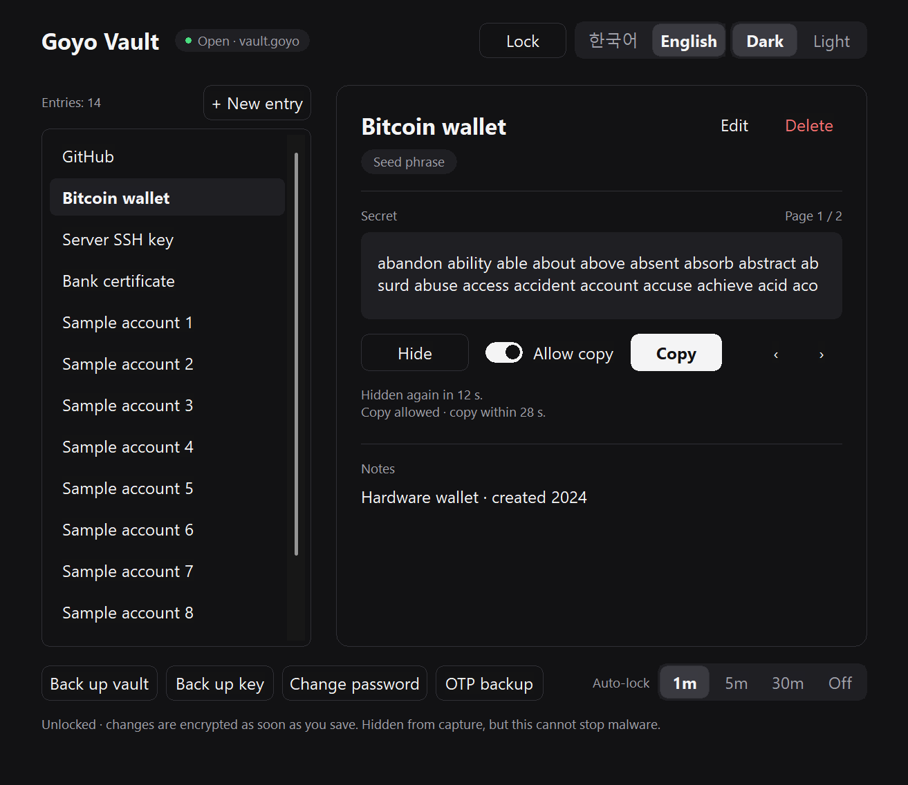
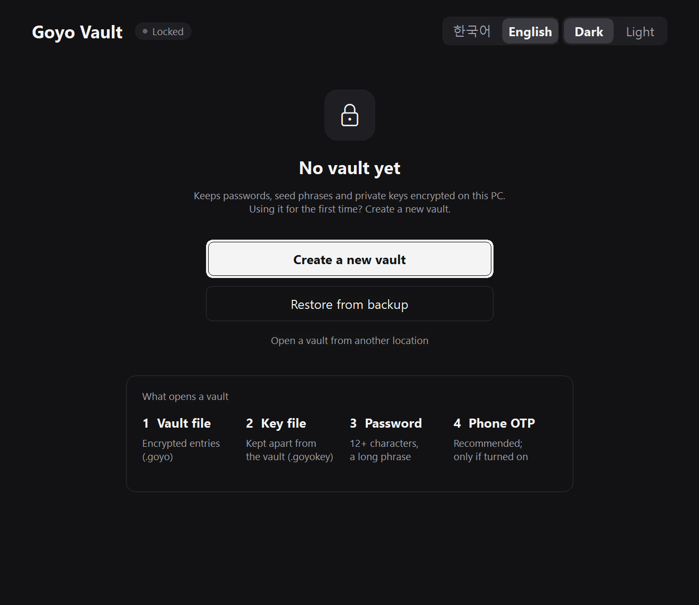
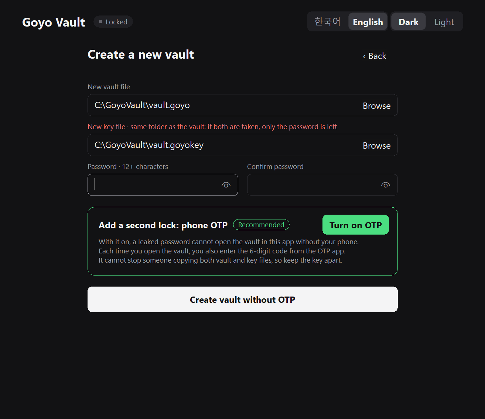
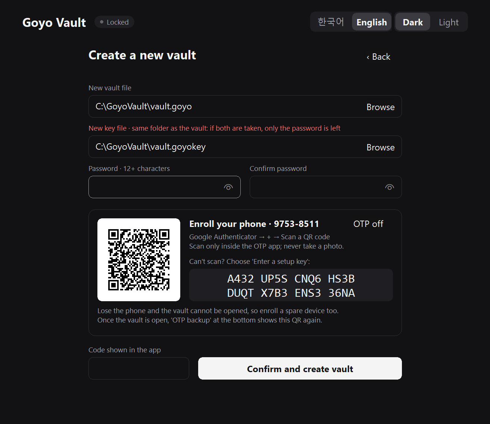
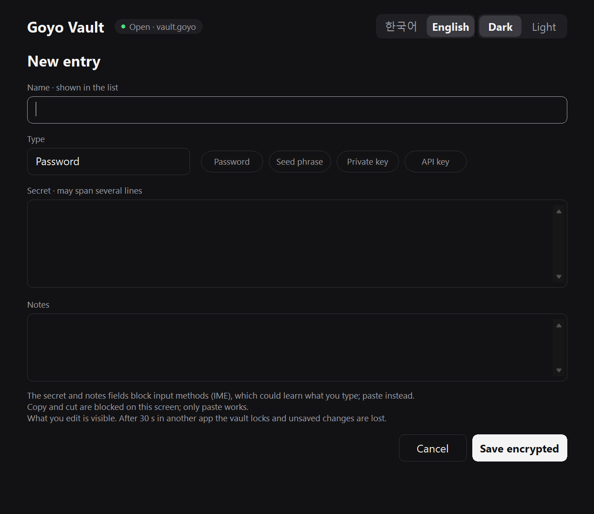
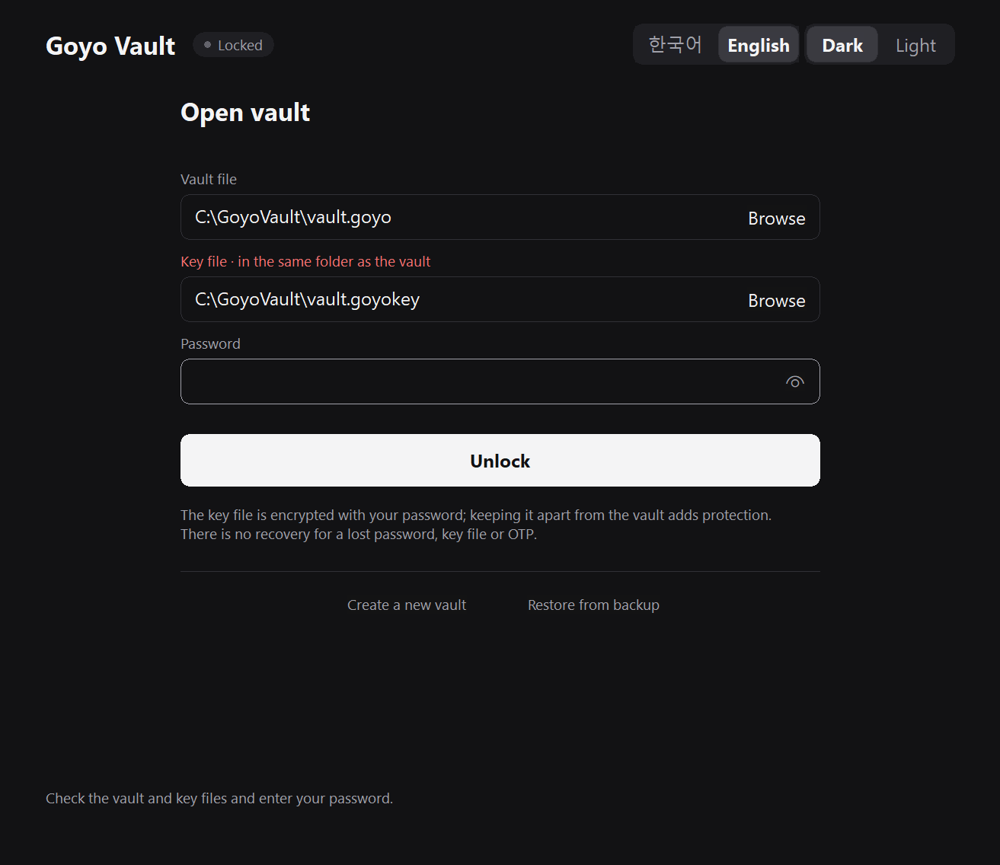
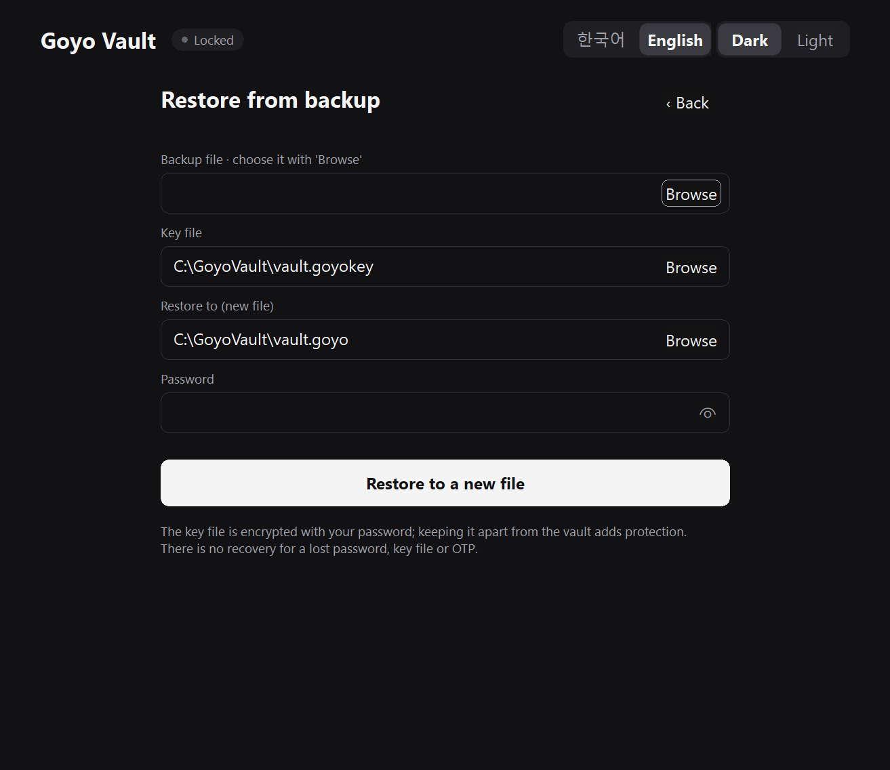
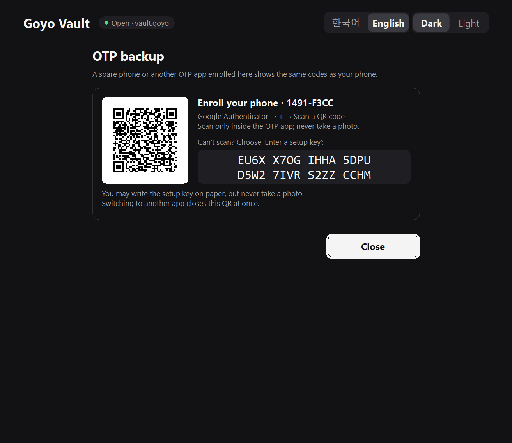
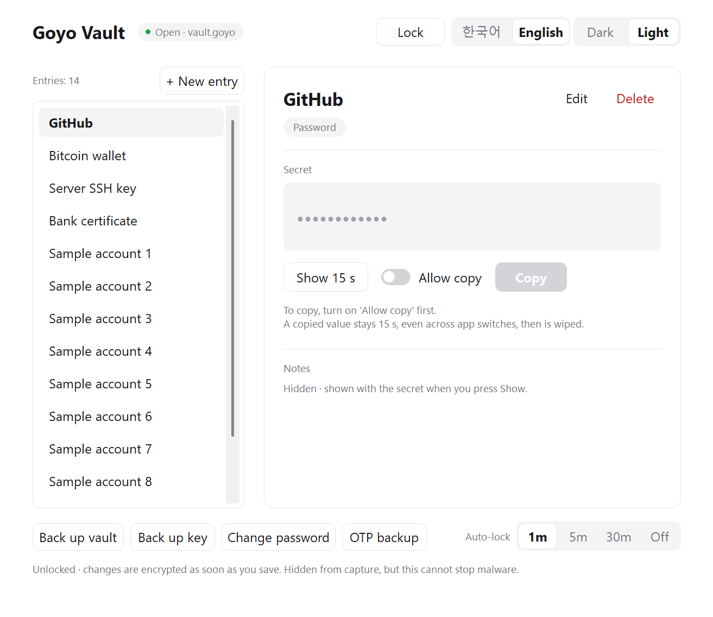

<p align="center"></p>
<h1 align="center">Goyo Vault · 고요 금고</h1>
<p align="center">An offline vault for passwords, seed phrases and private keys that stays on your PC (Windows 11)</p>
<p align="center"><a href="README.md">한국어</a> · <b>English</b></p>



> [!WARNING]
> This is a development release. It has automated tests and AI-assisted code reviews, but **it has not had a professional security audit.** Try creating, backing up and restoring a vault with fake values before you trust it with real secrets.

## What it does

- **The vault app is fully offline:** `goyo-vault.exe` has no network code and starts no other programs. Optionally, a separate tool, `goyo-sync.exe` (add-on ZIP), syncs **only the encrypted vault file** with your own SSH server; the key file and password are never sent. Without it, everything stays offline as before. There is no account and no auto-update.
- **Opening a vault takes** the vault file (`.goyo`), a separate key file (`.goyokey`) and your password. A phone OTP is off by default, but **turning it on is recommended.** Only the two files and the password take part in decryption, so **to someone holding both files, the password is the only barrier**. Keep the key file somewhere else.
- **Secrets stay hidden by default:** show for 15 seconds, copy only after you allow it, and the clipboard is wiped 15 seconds after a copy.
- **Auto-lock** of an open vault, by default after 60 seconds idle (2 minutes on the OTP backup screen) or 30 seconds in another app; on the vault screen you can change it to 5 minutes, 30 minutes or off. Locking the screen, sleep and Windows shutdown always lock it.
- **Screen-capture protection:** the window is excluded from the capture paths Windows supports (ordinary screenshots and screen recordings).
- **A single executable, no installer.** Dark and light themes, Korean and English interface.
- **There is no automatic backup.** You make backups yourself; [Backups: what you must do yourself](#backups-what-you-must-do-yourself) lists what and when. With sync, the server keeps the last 200 encrypted versions, but key and OTP backups are still up to you.

## Security at a glance

|Area|Specification|What it means|
|---|---|---|
|Encryption|**XChaCha20-Poly1305** (256-bit key, tamper detection)|Changing even one byte of a file makes it refuse to open. No plaintext file is ever written.|
|Password handling|**Argon2id**, 256 MiB memory, 3 passes|Every guess costs 256 MiB of memory and about 0.6 s. A typical desktop using all cores manages about 8 guesses per second.|
|Second key|A **key file** holding a random 256-bit key|Someone with only the vault file cannot open it, even with your password.|
|Phone OTP (recommended)|RFC 6238 TOTP, a used code is never accepted again|If your password leaks, nobody can open the vault with this app on this PC without your phone.|
|Randomness|CPU hardware randomness (**RDSEED**)|Keys, nonces and the OTP secret all come from hardware randomness.|
|Network|goyo-vault.exe: **none** (checked before each release) · optional goyo-sync.exe: no network code of its own; sends only ciphertext through Windows' built-in ssh.exe|The vault app has no network code. A pre-release check confirms that no network library is in either executable's DLL list.|
|Memory|Keys, passwords and entries are wiped with `zeroize` after use|On lock and exit the app clears the secrets it manages from memory.|
|Screen|Capture exclusion, hidden by default, auto-lock|The window does not appear in screenshots or recordings; a secret shows for 15 seconds only when you ask.|
|Clipboard|Wiped after 15 seconds, excluded from Win+V history and cloud sync|Copying works only after you turn on "allow copy".|
|Other programs|Window messages blocked, memory access restricted, DLL planting blocked|Other programs cannot read the input fields, fake clicks to make the app copy a secret, or read its memory.|
|Transparency|Open source, pinned dependencies, the same source builds the same executable (`/Brepro`)|Anyone can read the code, build it and compare the result with the release.|
|Verification|139 automated tests, a multi-angle AI security audit and re-checks|All findings and fixes are public in [docs/SECURITY_REVIEW.md](docs/SECURITY_REVIEW.md).|

**How long the password holds out if someone gets both files** (estimates, generously assuming one high-end GPU tries 100 passwords per second)

|Password|1 GPU|100 GPUs|
|---|---|---|
|A common password from leak lists|about 1 day|about 17 minutes|
|A human-chosen 12-character password|about 5 years|about 20 days|
|**4 unrelated random words**|out of reach|about 5,800 years|
|5+ random words, or 12 random characters|out of reach|out of reach|

So **with the key file kept elsewhere and a long password (4–6 unrelated words)**, the vault stays closed even if both files are taken.

Some things the app **cannot stop**: malware on the PC (keyloggers, copying your files), someone who has both files and your password, and a camera pointed at the screen. See [Please read](#please-read) and [Security design and limits](#security-design-and-limits) for the details. And again: this is not a professionally audited product.

## Requirements

- Windows 11, 64-bit, on a CPU with the RDSEED instruction. Most Intel CPUs from the 5th generation (Broadwell) on and all AMD Ryzen CPUs have it.
- (Only if you turn on the OTP) a TOTP app on your phone: Google Authenticator, or any app that uses the same standard (TOTP, 6 digits, 30 seconds).

## Install

Goyo Vault does not ship ready-made executables or ZIPs. **Build it yourself from the source in this repository (`github.com/NA-DEGEN-GIRL/goyo-vault`).** Using an executable or ZIP from anywhere else means trusting whoever made it.

1. Install the build tools: [Rust](https://rustup.rs) (stable, `x86_64-pc-windows-msvc`) with Visual Studio Build Tools' "Desktop development with C++", Git and Python 3.
2. In PowerShell, get the source and build the ZIPs.
   ```powershell
   git clone https://github.com/NA-DEGEN-GIRL/goyo-vault.git
   cd goyo-vault
   python scripts/package_release.py
   ```
   The `dist\` folder then holds the main `GoyoVault-<version>-windows-x64.zip` and the sync add-on `GoyoVault-Sync-<version>-windows-x64.zip`. While building, the script runs the executable protection checks, the DLL planting check and the server script's selftest, and makes no ZIP if any of them fails. The first build takes a few minutes to fetch dependencies. The sync add-on is needed only for [Sync (optional)](#sync-optional).
3. The ZIP contains a `GoyoVault` folder. Extract it to **a folder only you use that is not synced**, for example `C:\Users\<you>\GoyoVault`. Avoid:
   - the inside of the ZIP or a temporary folder: cleaning it up deletes your vault (the app warns at start-up);
   - `Documents`/`Desktop` backed up by OneDrive, and Dropbox or Google Drive folders: the key file ends up in the same cloud account as the vault. To use the vault on several PCs, use [Sync (optional)](#sync-optional), which sends only the encrypted vault file;
   - a new folder directly under `C:\`, shared folders and USB sticks others use: someone else could replace the program.
4. Run `GoyoVault\goyo-vault.exe`. Files you built yourself carry no downloaded-from-the-internet mark, so SmartScreen usually does not warn. The program is not code-signed, so with Smart App Control enforcing it may be blocked.

### Updating

In the source folder, get the new version with `git pull`, rebuild the ZIPs with `python scripts/package_release.py`, and extract the new ZIP **to the same place, overwriting the old files.** Only the program and documents change; the vault (`.goyo`), key (`.goyokey`) and theme setting in that folder stay. Back up the vault and key first.

Every vault made before 0.5.0 uses an OTP and still opens as before. A vault made **without an OTP** in 0.5.0 or later does not open in 0.4.x or earlier.

From 0.8.0, **a vault with sync turned on, and its backups, open only in 0.8.0 or later.** A vault without sync keeps its format and still opens in 0.7.x and older.

> [!NOTE]
> ZIPs before 0.2.0 extracted to a versioned folder such as `GoyoVault-0.1.0`. If you created a vault there, move the vault and key files into the new `GoyoVault` folder, or open them with **Open a vault from another location**.

## How to use it

### 1. First start



With no vault saved yet, you see this screen ("No vault saved yet").

- **Create a new vault** if this is your first time.
- **Restore from backup** to bring over a vault from another PC.
- **Open a vault from another location** for a vault on a USB drive or in another folder.

Switch between **Dark** and **Light** in the top-right corner.

### 2. Create a vault



1. Choose where the **New vault file** and **New key file** go. Both default to the program folder, so the key caption warns in red. **Pick another place for the key, such as a USB drive, with Browse.** In the same folder, anyone who copies the folder only has to guess the password. The app remembers the last vault and key it opened (`goyo-vault.paths`), so a key on a USB drive does not need browsing every time.
2. Enter a **password** twice. It needs at least 12 characters; repeated characters and passwords made only of common words, keyboard walks or number runs (`password1234`, `qwerty123456`, `1q2w3e4r5t6y`) are refused. For seed phrases or private keys use **4–6 unrelated words**. Words from common-password lists such as `dragon` or `sunshine` do not count, so pick uncommon ones. The check only filters the obvious; passing it does not make a password safe. If the key file is stolen, a common password falls to one GPU within a day; four random words are out of reach. Press the eye icon at the right of the field to check what you typed for typos; press it again to hide it.
3. Decide on the OTP in the green **Phone OTP** card. It is off by default, but **turning it on is recommended.** To skip it, press **Create vault without OTP** and you are done.

#### Turning on the OTP (recommended)



With the OTP on, opening the vault also asks for the 6-digit code from your phone's OTP app. If your password leaks (someone looks over your shoulder, or you reused it on a site that was breached), it still cannot open the vault with this app without your phone. **As long as this PC and the vault and key files stay out of other hands, the OTP helps a lot.** It does not stop someone who copied both files (see [Please read](#please-read)). Losing the phone without an OTP backup locks you out, so if you turn it on, also do the **OTP backup** (step 8 below) after creating the vault. **The choice is made when the vault is created and cannot be changed later.**

1. Press **Turn on OTP** to show the QR. The passwords you typed stay; **OTP off** turns it off again.
2. In Google Authenticator tap **+ → Scan a QR code** and point it at the QR on screen. Each vault gets its own entry name, such as `Goyo Vault (3FA2-C1D0)`; the same name appears above the OTP field when you open the vault, so with several vaults you can pick the right code. While you are in another app the QR and key are hidden, and **‹ Back** keeps the same QR when you return. If scanning does not work, choose **Enter a setup key** and type the key shown next to the QR (type: **Time based**). The QR and key in the screenshot are fake examples.
3. Enter the **6-digit code** from the app and press **Confirm and create vault**.

> [!IMPORTANT]
> - Scan the QR **only with the scanner inside your OTP app.** Pointing an ordinary camera or Google Lens at it, or taking a photo, can leave the secret in your photo library or in the cloud.
> - Losing your phone means you cannot open the vault with this app. After creating it, add the OTP to a spare device with **OTP backup** (step 8 below), or turn on Authenticator's own backup.

### 3. Save an entry



Press **+ New entry**, fill in name, type, secret and note, then press **Save encrypted**.

- Type the kind yourself or use the **password · seed phrase · private key · API key** buttons.
- Multi-line keys such as PEM files are kept exactly.
- **Names are always visible in the list,** so never put a secret in the name.
- For safety, the input method editor (IME) is off in the secret and note fields; Korean text has to be pasted there. You can copy a value in another app, but with the default auto-lock (1 minute) **come back within 30 seconds** to paste it; staying away longer locks the vault and clears unsaved edits.

### 4. View and copy


Pick an entry in the list to see it on the right.

- **Show 15 s** reveals the secret and the note for 15 seconds. Press it again to hide them at once.
- **Copy:** turn on **Allow copy**, then press **Copy**. The permission turns itself off after 30 seconds or after one copy.
- A copied value is **wiped from the clipboard after 15 seconds** and is kept out of Win+V clipboard history and cloud clipboard sync.
- Remaining times are shown on screen.

### 5. Lock and open again



**Lock** locks the vault right away. Locking Windows (Win+L), sleep and Windows shutdown always lock it.

Choose any other automatic locking under **Auto-lock** at the bottom right of the vault screen.

|Choice|Locks|
|---|---|
|**1m** (default)|after 60 seconds without use or 30 seconds in another app; 2 minutes while the OTP backup QR is shown|
|**5m**, **30m**|after that long without use. Time in other apps counts as unused.|
|**Off**|never on a timer.|

If it locks too often on a PC only you use, make it longer or turn it off. The trade-off: if you step away without locking the screen, whoever sits down at the PC sees the open vault. With Off, press **Win+L** whenever you leave, and set Windows to lock itself when you are away (for example the screen saver's "On resume, display logon screen"). The choice is stored as `1`, `5`, `30` or `off` in `goyo-vault.autolock` next to the executable. The OTP backup QR closes after 2 minutes without use whatever the setting.

A quick trip to another app (pasting a copied value, a screenshot tool) does not lock it. The moment you switch, though, **Show for 15 s**, **Allow copy**, any password you made visible and the **OTP backup** QR are hidden. The vault window never appears in screen captures anyway.

Screens before a vault is open (open, new vault, restore) keep what you typed and the OTP setup QR when you switch to another app; only a password you made visible is hidden again. They are still cleared after the idle time (5 minutes for a new vault, 60 seconds otherwise) or when you lock Windows.

To open it again, enter your password. If you moved the vault or key file, pick it with **Browse**. For a vault with the OTP on, an OTP field appears to match the chosen key file; enter a **new** code. A code that was already used is refused, so if you just opened the vault, wait for the next code on your phone.

### 6. Back up and restore

Use the buttons at the bottom of the vault screen.

- **Back up vault** saves the encrypted vault to a new file.
- **Back up key** saves the encrypted key file to a new file. Store it **apart** from the vault backup.
- A failed backup is reported in a dialog box. No dialog means the file was saved.
- A backup never overwrites an existing file, so save it under a new, dated name such as `vault-2026-10-18.goyo`.

[Backups: what you must do yourself](#backups-what-you-must-do-yourself) lists what to back up and when.



To restore, press **Restore from backup** on the first-start or open screen. Choose the backup and the key file, enter your password (and the OTP if the vault uses one), and the vault is restored to a new file; the backup itself is not changed. On a new PC the first restore goes to `vault.goyo` by default, and the restored vault is remembered as the last one opened, so the next start offers it directly.

### 7. Change the password

**Change password** on the vault screen asks for the current password and the new one (and a fresh OTP code if the vault uses one), then re-encrypts the key file. **Back up the key again** afterwards.

### 8. OTP backup (in case you lose your phone)



Only vaults with the OTP on have this. Press **OTP backup** at the bottom of the vault screen and enter your current password to see the same QR and setup key as when you created the vault. Add it to a spare phone or another OTP app and it shows the same codes as your phone, so you can still open the vault if the phone is lost. Writing the setup key on paper and keeping it somewhere safe works too.

> [!NOTE]
> Saving the setup key as an entry inside the vault is not a backup: the vault needs the OTP to open, so after losing the phone you could not get that entry out. Move it to another device or to paper **before** the phone is gone.

### 9. Theme and language



Switch the language with **한국어 | English** and the colours with **Dark | Light** in the top-right corner. Whatever you have typed stays. The choices are stored as just `en`/`ko` in `goyo-vault.lang` and `dark`/`light` in `goyo-vault.theme` next to the executable and have nothing to do with your vault. On the first start the app uses Korean if Windows is set to Korean, and English otherwise.

## Backups: what you must do yourself

The app **saves to the vault file immediately** whenever you add, change or delete an entry. But **it never makes copies anywhere else.** To survive a broken PC, a failed disk or an accidental deletion, you need to do the following yourself.

|What|When|How|
|---|---|---|
|**Vault backup** (`.goyo`)|After adding or changing entries, especially a new seed phrase or private key|**Back up vault** at the bottom of the vault screen|
|**Key backup** (`.goyokey`)|**Once** right after creating the vault, and **every time you change the password**|**Back up key** at the bottom of the vault screen|
|**OTP backup** (vaults with the OTP only)|**Once** right after creating the vault|**OTP backup**: enroll a spare phone or write the setup key on paper. Turning on the authenticator app's own backup also works.|
|**Password**|Once, when you create the vault|Memorize it or write it down somewhere safe. **The app has no recovery of any kind.**|
|**Restore drill**|Every few months|**Restore from backup** to a new file; the original is not changed.|

**No need to back up:** `goyo-vault.theme` (theme), `goyo-vault.lang` (language), `goyo-vault.autolock` (auto-lock) and `goyo-vault.paths` (last locations opened) next to the executable hold no secrets and are not needed to open a vault. `.goyolock` is only the app's in-use marker.

**A restore needs:** a vault backup + the key file (the original or a key backup) + the password (+ the OTP if the vault uses one). Without any one of them the vault cannot be restored.

**With sync,** the server keeps the last 200 encrypted versions ('Get from server…' in the settings window or `goyo-sync --fetch`, then Restore). Key and OTP backups are still up to you. The server keeps that history, so it does not replace your vault backups either.

**Where to keep them**
- Keep vault backups and key backups on **different drives**, for example the vault backup on an external disk and the key backup on a USB stick.
- Each is encrypted and safe on its own, but together they leave only the password, so never keep both on one USB stick or in one cloud account.
- After changing the password, make a new key backup and destroy the old ones: an old key copy still opens the vault with the old password.
- Do not let this vault be the only copy of a valuable seed phrase; also keep it on paper or metal.

## Sync (optional)

To use one vault on several PCs, `goyo-sync.exe` from the sync add-on ZIP exchanges **only the encrypted vault file** with your own SSH server (Linux or similar, with python3). Double-click `goyo-sync.exe` to open a settings window that looks like Goyo Vault: check the connection (comparing the host key fingerprint on a first connection), install the server script, choose the vaults to sync, and turn on autostart and background sync in one place; a second PC gets its vault with 'Get from server…'. Setup, troubleshooting and the command line: [docs/SYNC.en.md](docs/SYNC.en.md).

- **Every PC needs 0.8.0 or later.** A synced vault and its backups do not open in 0.7.x or older. Each vault asks at every unlock until you agree, and only vaults you agree for change.
- The key file and password are never sent. Move the key file between PCs by USB.
- When two PCs edit the same entry, both versions are kept. Delete the one you do not need.
- **Deletions spread to the other PCs.** After a mistake, get entries back from the server history (the last 200 versions) or a `pre-merge-*.goyo` copy in the sync folder.
- The server cannot read the vault, but it learns the vault ID, its size, when the contents changed and your IP address. The helper connects about once a minute, so it also learns when each PC is on. OTP-only unlocks are not uploaded, and even when the server takes no upload, a waiting upload is not made again at each unlock, so the server normally does not learn when you open the vault. The exception: when changes are still waiting to go up and a new copy arrives from the server, they go up again after the merge (at the next unlock if the app was closed), so it learns that moment.
- While sync is on, never drop another file in place of `vault.goyo` by hand. Open other copies with Restore from backup.
- After changing the password on one PC, copy the new key file to the others. The data key stays the same, so old key copies keep working.
- "Synced" means "checked with the key to match the copy the server last sent or acknowledged". It neither proves that the server really stored it nor that the server keeps it safe. The same check code (`XXXX-XXXX-XXXX-XXXX`, covering the entries' text too) on two PCs means the same contents.

## Please read

- **Keep the key file separate. This matters most.** With vault and key in the same folder (the default) or in the same cloud account, whoever takes both only has to keep guessing the password, without any OTP. The app warns about such placements in red.
- **There is no recovery.** Lose the vault file, the key file or the password (or the OTP, if you turned it on) and this app cannot open the vault. There is no way around it. With the OTP on, prepare for a lost phone with **OTP backup**.
- **Do not delete `.goyotmp` files carelessly.** If power fails or a USB stick is pulled during a save, a temporary file such as `vault.goyo.<digits>.goyotmp` may be all that is left. It can be the only copy; rename it back. The app points this out when the main file is missing.
- **The OTP is an extra check inside this app.** It is off by default because of the lost-phone risk, but turning it on is recommended. An OTP code changes every 30 seconds and cannot serve as an encryption key, and to check codes the app has to keep the same OTP secret as your phone in the key file. So someone with both files and your password can decrypt the vault without the OTP. What the OTP stops is someone who knows your password opening the vault with this app on this PC. The real extra protection against stolen files is keeping the key file elsewhere.
- **Changing the password does not revoke old key copies.** An old key copy plus the old password still opens later versions of the vault. If you suspect a leak, destroy old copies yourself.
- **Anything you copy can be read by other programs.** Copy only when needed. When you paste into a password or secret field, the app clears the clipboard right away, but it cannot erase what the source app left behind (for example in Win+V history).
- **It cannot protect an infected PC.** A keylogger records the password, and malware running as you can copy the vault and key or replace the program. Malware with administrator rights, kernel attacks and a camera pointed at the screen are also out of reach. Use a hardware wallet for large holdings.

## Security design and limits

<details>
<summary>Details</summary>

**Cryptography**
- **XChaCha20-Poly1305** from RustCrypto: 256-bit key, 192-bit nonce, 128-bit tag. Data and headers are authenticated.
- **Argon2id v1.3** with 256 MiB memory, 3 passes and parallelism 1 derives the key-file encryption key from the password. The key file holds a random data key, plus the OTP secret for vaults with the OTP on.
- Randomness comes from the CPU's **RDSEED** conditioned with SHA-512. Windows CNG, DPAPI, BCrypt random and `getrandom` are not used. The CPU, firmware and any hypervisor are trusted; simple sanity checks do not certify the hardware.
- The file format is documented in [docs/FORMAT.md](docs/FORMAT.md).

**Memory and files**
- On normal exit and on lock, keys, strings, serialization buffers and Argon2 working memory are wiped with `zeroize`. Copies inside Windows input controls and the entry list, graphics memory, CPU registers, the page file or crash dumps are not guaranteed to be removed.
- No plaintext file is ever written. An encrypted temporary file in the same folder is synced, renamed into place and flushed again under its final name. A file lock prevents two instances from using one vault. The lock goes by path, so two hard links to one vault can still be opened twice; it stops cooperating programs, not malware running as you.
- `goyo-vault.theme` (theme), `goyo-vault.lang` (language) and `goyo-vault.paths` (last vault and key locations) next to the program hold no secrets. The paths file does reveal where the key is, so do not share that folder.
- Power-loss safety depends on the drive and file system; FAT/exFAT is not guaranteed. `.goyolock` files, encrypted temporary files left after a crash, and metadata such as file names and paths are not hidden.
- Windows device names such as `CON`, `NUL` or `COM1` are refused as file names, because a backup to `NUL` would look successful and keep nothing.

**Screen, input and clipboard**
- Input fields use the Windows password input scope, and the secret and note fields are detached from the IME. Depending on the input method, Korean may not be typeable in other fields either; paste instead. OS text services, third-party keyboards and voice input cannot be fully prevented from learning what you type. If input protection cannot be set up, that field and saving/unlocking are blocked.
- Input fields and the entry list ignore every window message other programs send them, however it is sent, so another program cannot read the text, infer it from character positions or change the list selection. The main window ignores button clicks and commands that other programs send or post, including while a message box or file dialog is open. It also ignores keyboard or mouse input that arrives while the app is not in front, so the mouse wheel does not scroll the list then. A program running as you can still fake input while the app is in front.
- For the same reason, screen readers such as Narrator cannot read the app's input fields or entry list.
- The eye icon in a password field shows the text only when you press it. While shown, copying, reads by other programs, accessibility reads and screen capture stay blocked, and the IME stays off. Locking, the idle timeout, changing screens and switching to another app hide it again. It cannot stop someone looking over your shoulder.
- Values copied by the app are excluded from Win+V history and cloud sync and marked so that clipboard managers honouring the convention do not record them. If another program holds the clipboard, clearing is retried, and closing waits until it succeeds. Windows shutdown and restart also lock and try to clear it; a forced kill cannot guarantee this cleanup. Values that went through the clipboard can leave copies in Windows' own memory.
- Switching apps keeps a just-copied value for the rest of its 15 seconds so you can paste it. Manual lock, screen lock and sleep clear it immediately. Content another app put on the clipboard in the meantime is left alone.
- Capture exclusion only covers capture paths that Windows supports. It cannot stop a camera.
- The enrollment QR is drawn straight to the window by a built-in encoder. No image file is written, no outside service is used, and the intermediate buffers holding the secret are wiped with `zeroize`.

**Process hardening**
- Every DLL the program loads before it starts running is looked up in System32 only; other Windows DLLs are loaded from System32 only, after the defenses are on. Each release is checked by running the program with fake DLLs, and then real copies of System32 DLLs, placed next to it; the check fails if any is loaded from that folder (`scripts/check_dll_planting.py`).
- Right after start the app disables dynamic code, legacy extension points, non-system fonts and remote or low-integrity image loads; from then on it **loads only Microsoft-signed DLLs** and **forbids child processes**. Third-party IMEs and third-party shell extensions in the file dialog therefore do not run inside the app.
- The optional `goyo-sync.exe` also looks up DLLs in System32 only and turns on the same defenses, except the ban on child processes, because it has to start `ssh.exe`. It holds no secrets, so it skips the memory-access restriction below. It never opens the vault or key file. Like the vault app, its settings window ignores clicks, commands and input that other programs send or post to it.
- Access to the process and all its threads is narrowed so other programs running as you cannot read or write the app's memory or start threads in it to inject code. Threads Windows starts later (for example for a file dialog) get the same restriction within 0.5 seconds. Programs with administrator (debug) rights are not stopped.
- An attached user-mode debugger or a Remote Desktop (RDP) session locks the vault or blocks actions. These are best-effort checks that can be bypassed; they do not detect remote-control tools such as TeamViewer, memory reading or keyloggers, and the app never claims that the PC is "safe".
- Rolling a vault back to an old backup, resetting the retry delay by restarting the app, and malicious apps bypassing the checks cannot be fully prevented without a server or separate trusted hardware. With sync, a server replaying old data cannot delete entries and is reported; a PC receiving its first copy trusts it, so compare the check code.
- 256-bit symmetric keys are used, but no post-quantum certification or guarantee is claimed.

Review notes (in Korean): [docs/SECURITY_REVIEW.md](docs/SECURITY_REVIEW.md).

</details>

## Building from source

You need the stable Rust MSVC x64 toolchain and its linker. No GUI or crypto SDK is used. The only direct dependencies are Rust crates for cryptography and secret handling, pinned in `Cargo.toml` and `Cargo.lock`.

```powershell
cargo test --locked -- --test-threads=1
cargo clippy --all-targets --locked -- -D warnings
cargo build --release --locked
python scripts/check_dependencies.py
target/release/goyo-vault.exe --self-check
target/release/goyo-sync.exe --self-check
```

- `python scripts/package_release.py` builds the two ZIPs used for installing (main and sync add-on). It refuses to run with uncommitted sources or `RUSTFLAGS` set, strips the build machine's paths from the executables (and stops if any remain), and packages only when both executables pass their PE flag and DLL list checks (`scripts/inspect_pe.py --profile vault|sync`) and the DLL planting check (`scripts/check_dll_planting.py`), and the server script's selftest prints `PASS`. The main ZIP holds no network-capable program.
- This version was built and checked with rustc 1.98.1. The `/Brepro` linker option makes builds comparable: the same toolchain and commit should give the same executable.
- `scripts/make_icon.ps1` regenerates the icon; `build.rs` embeds `assets/goyo.ico` into the executable.
- `cargo test ui_preview -- --ignored` renders every screen to `test-output/ui-preview/`. It briefly shows a preview window. `cargo test --bin goyo-sync sync_ui_preview -- --ignored` does the same for the goyo-sync settings window, to `test-output/sync-ui-preview/`.

goyo-vault.exe has no network code, telemetry, auto-update or code that starts other programs. goyo-sync.exe starts only `ssh.exe` and `ssh-keygen.exe` (host key fingerprints) from System32\OpenSSH, and itself (`--background`) for background sync. The C runtime is linked statically.

## License

[MIT](LICENSE-MIT) or [Apache-2.0](LICENSE-APACHE), at your option. Licenses of the libraries used are in [docs/THIRD_PARTY_NOTICES.md](docs/THIRD_PARTY_NOTICES.md).
