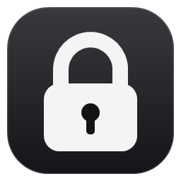
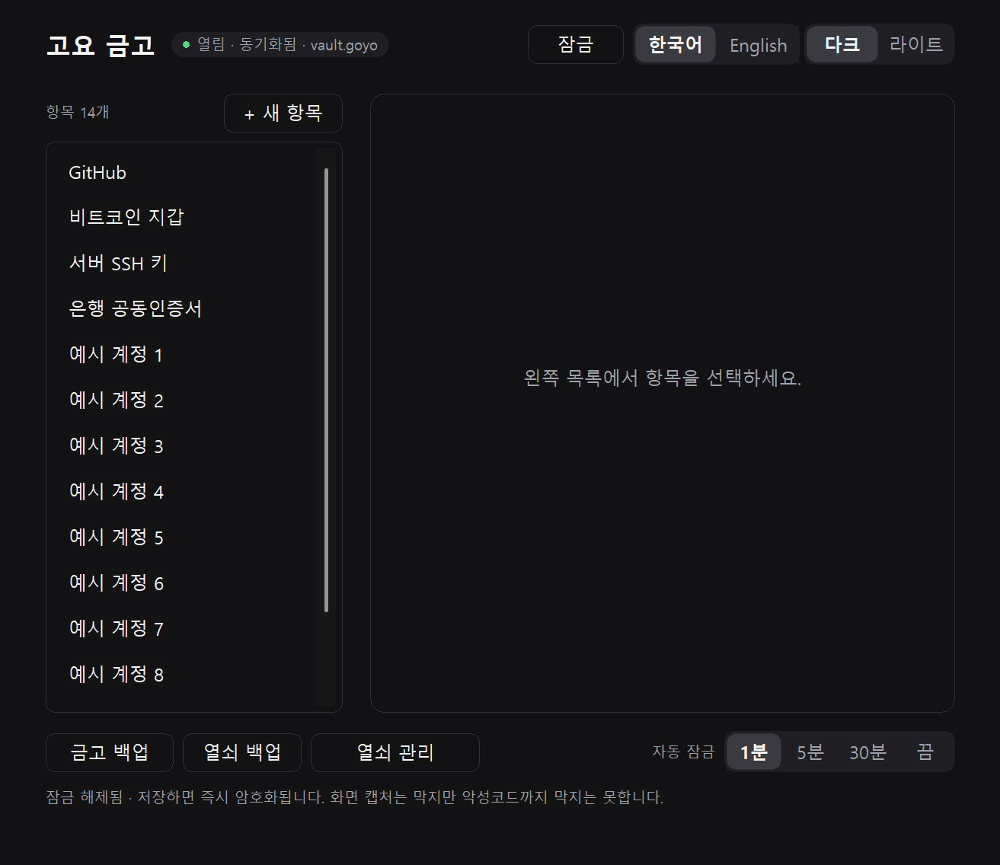
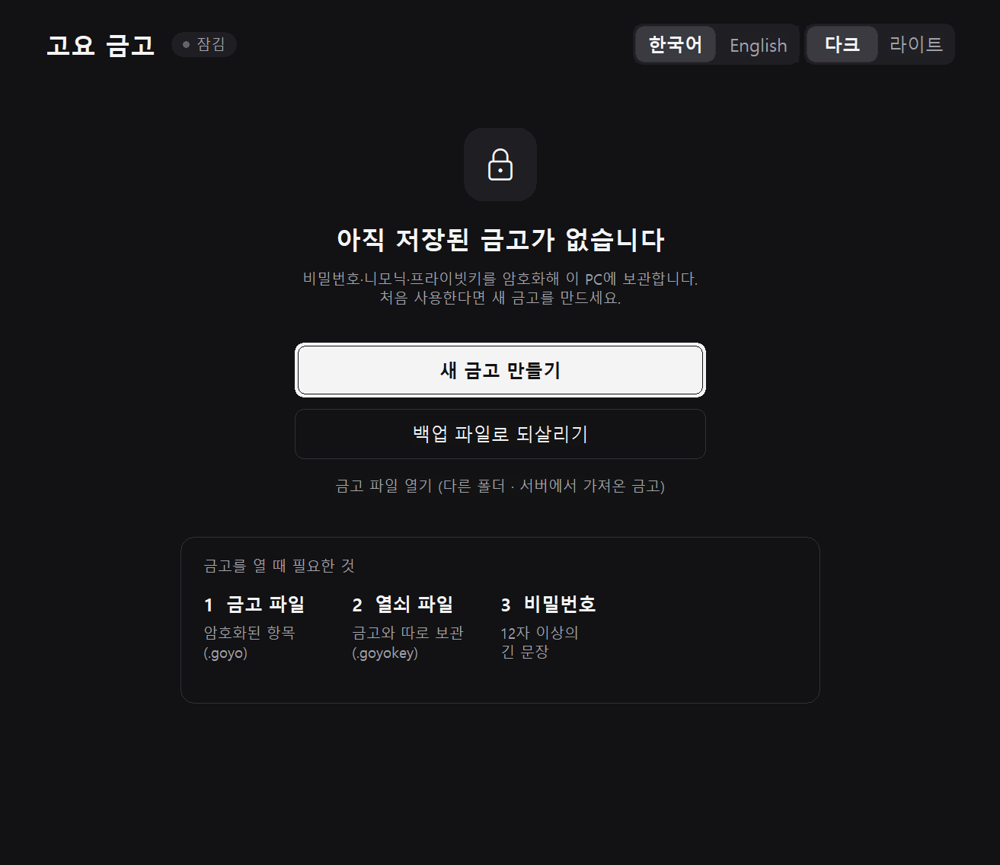
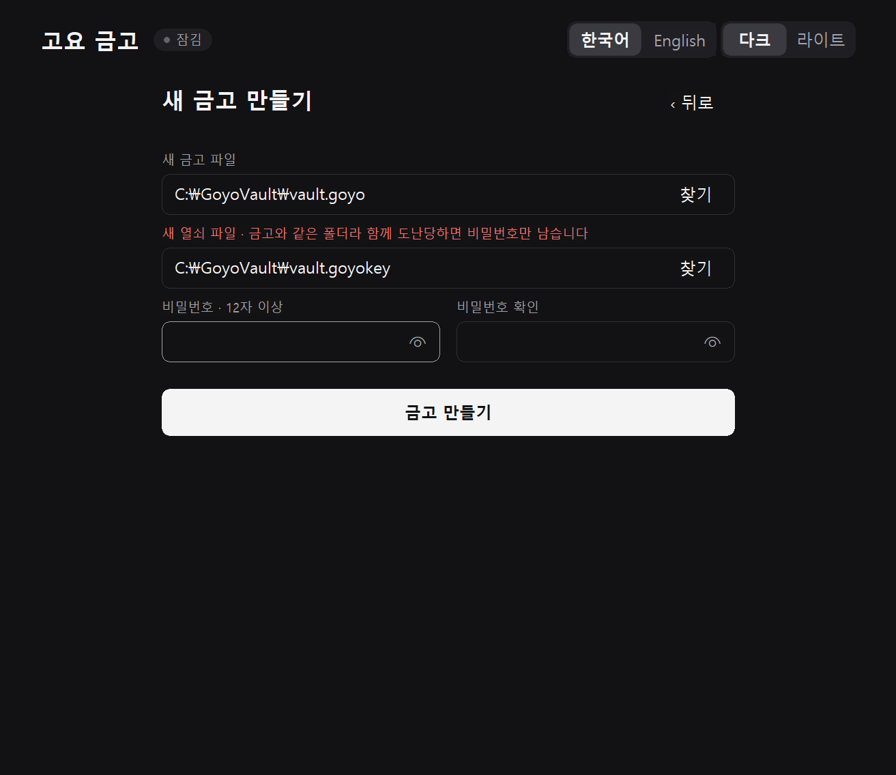
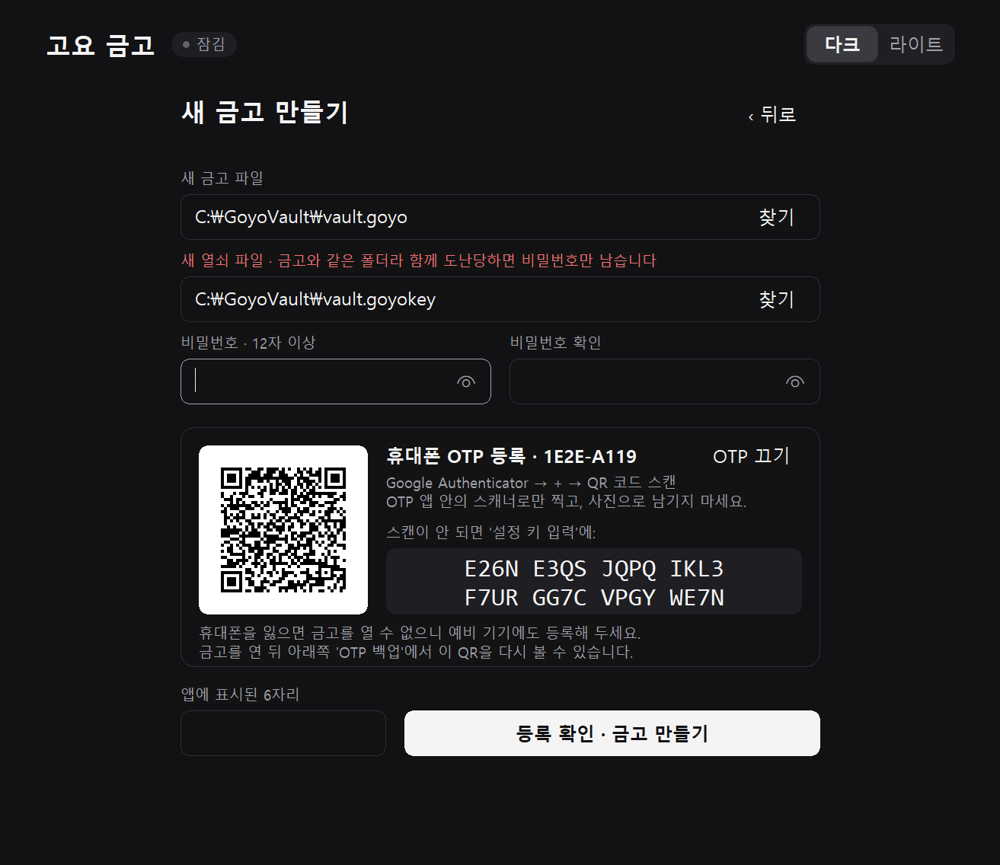
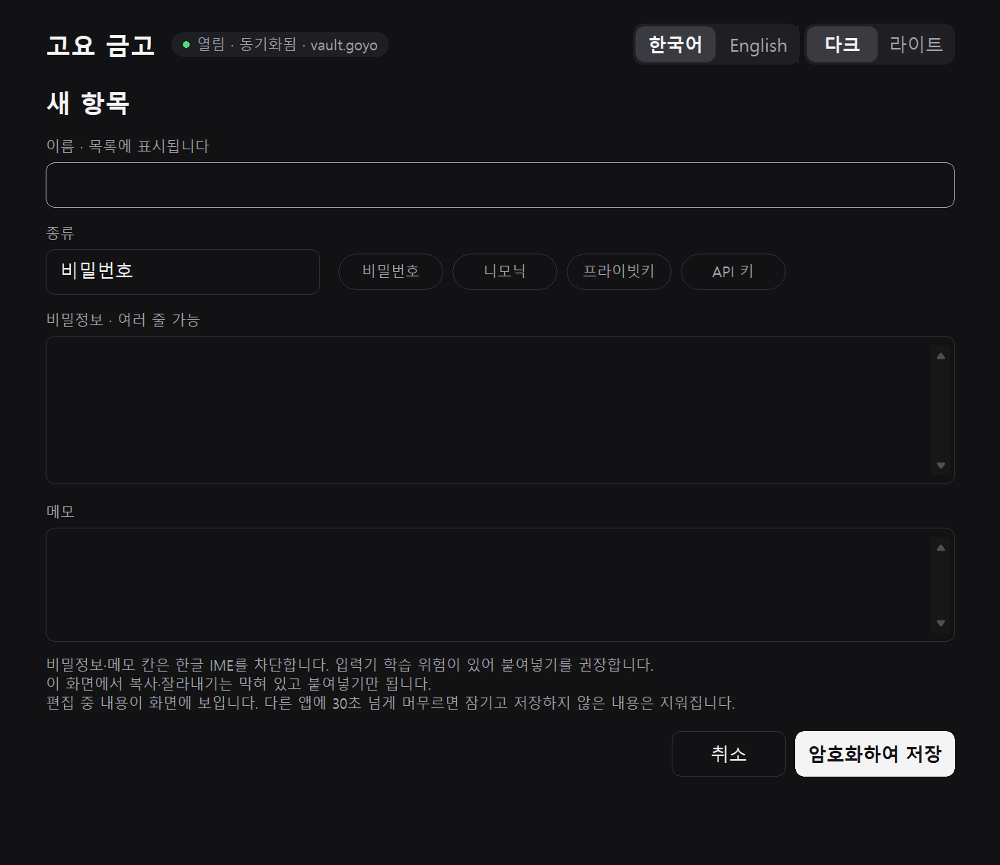
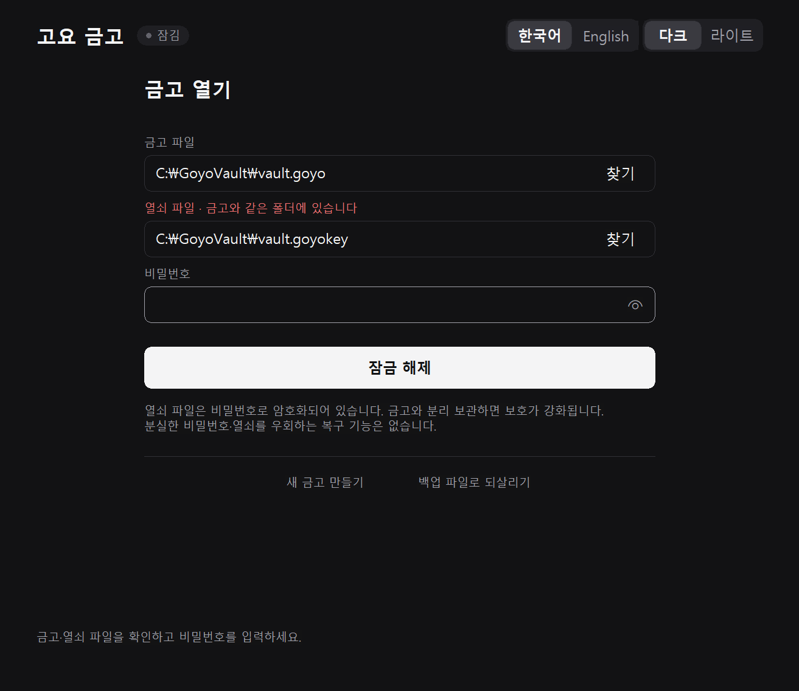
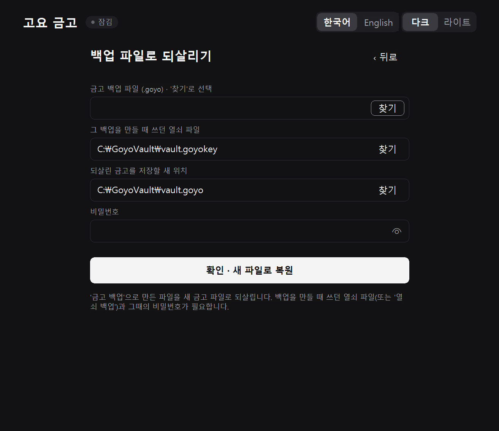
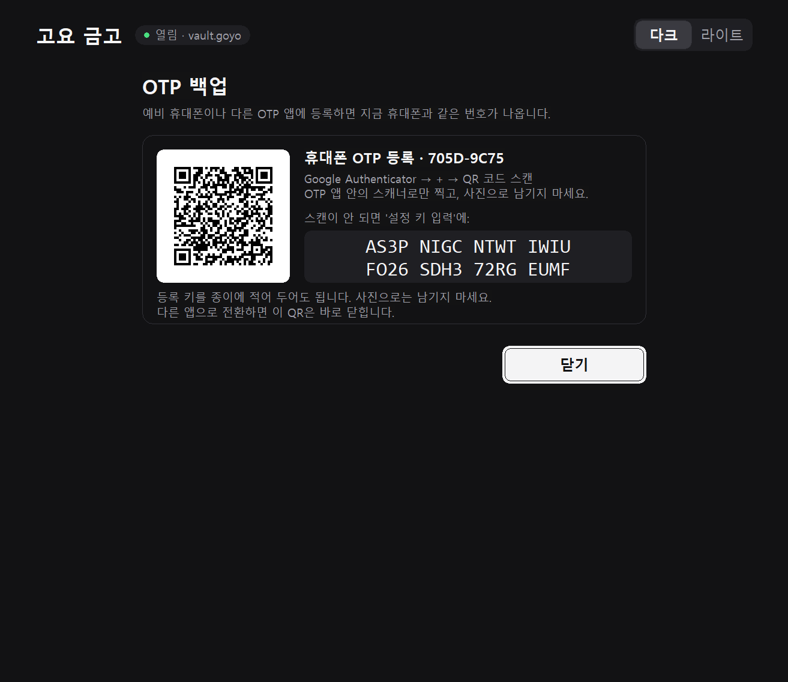
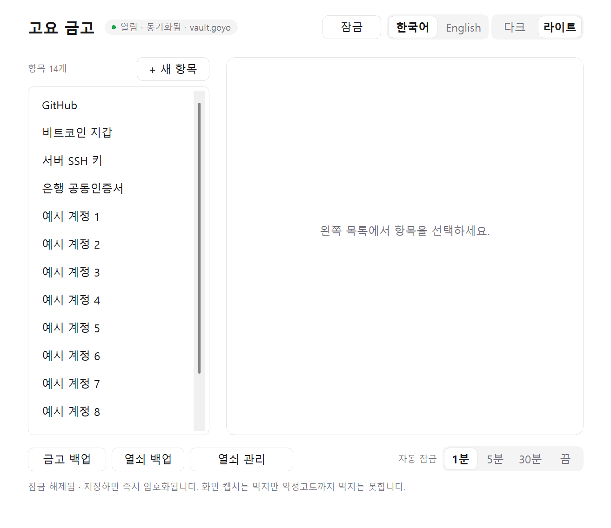

<p align="center"></p>
<h1 align="center">고요 금고 · Goyo Vault</h1>
<p align="center">인터넷 없이 내 PC에서만 쓰는 비밀번호·니모닉·프라이빗키 금고 (Windows 11)</p>
<p align="center"><b>한국어</b> · <a href="README.en.md">English</a></p>



> [!WARNING]
> 개발 버전입니다. 자동 테스트와 AI 코드 검토를 거쳤지만 **전문 보안 감사를 받은 제품은 아닙니다.** 처음에는 가짜 값으로 만들기·백업·복원을 직접 시험해 본 뒤 사용하세요.

## 어떤 프로그램인가요?

- **금고 앱은 완전 오프라인:** `goyo-vault.exe`에는 네트워크 코드도, 다른 프로그램을 실행하는 코드도 없습니다. 원하면 함께 들어 있는 별도 도구 `goyo-sync.exe`로 **암호화된 금고 파일만** 내 SSH 서버와 동기화할 수 있습니다. 열쇠 파일과 비밀번호는 보내지 않습니다. `goyo-sync.exe`를 직접 열어 설정하기 전에는 아무것도 하지 않고, 금고 앱은 그것을 실행할 수 없습니다. 계정과 자동 업데이트는 없습니다.
- **금고를 열 때 필요한 것:** 금고 파일(`.goyo`), 열쇠 파일(`.goyokey`), 비밀번호. 휴대폰 OTP는 기본으로 꺼져 있지만 **켜 두는 것을 권장합니다.** 암호를 푸는 데 쓰이는 건 두 파일과 비밀번호뿐이라, **두 파일을 함께 가져간 사람에게는 비밀번호가 유일한 방어선**입니다. 그래서 열쇠 파일은 금고와 다른 곳에 두세요.
- **비밀값을 기본으로 가립니다:** 15초 보기, 허용한 뒤에만 복사, 복사한 값은 15초 뒤 클립보드에서 지웁니다.
- **자동 잠금:** 금고가 열려 있을 때 기본은 60초 미사용(OTP 백업 화면은 2분)이나 다른 앱에 30초 넘게 머무르면 잠깁니다. 금고 화면에서 5분·30분·끔으로 바꿀 수 있습니다. 화면 잠금, 절전, Windows 종료 때는 설정과 관계없이 잠깁니다.
- **화면 캡처 차단:** Windows가 지원하는 캡처 경로(일반 캡처 프로그램, 화면 녹화)에 금고 창이 찍히지 않습니다.
- **설치 없는 단일 실행 파일**. 다크·라이트 테마와 한국어·영어 화면을 지원합니다.
- **자동 백업은 없습니다.** 백업은 직접 해야 합니다. 무엇을 언제 해야 하는지는 [백업: 직접 해야 하는 것](#백업-직접-해야-하는-것)에 정리했습니다. 동기화를 쓰면 서버가 최근 200개 버전을 암호문으로 보관하지만, 열쇠·OTP 백업은 여전히 직접 해야 합니다.

## 보안 사양 한눈에 보기

|항목|사양|의미|
|---|---|---|
|암호화|**XChaCha20-Poly1305** (256비트 키, 변조 검출)|파일을 한 글자라도 바꾸면 열리지 않습니다. 평문 파일은 만들지 않습니다.|
|비밀번호 처리|**Argon2id**, 메모리 256 MiB, 3회 반복|추측 한 번마다 256 MiB 메모리와 약 0.6초가 듭니다. 일반 데스크톱 전체 코어로 초당 약 8번만 시험할 수 있습니다.|
|두 번째 열쇠|무작위 256비트 키가 든 **열쇠 파일**|금고 파일만 가져간 사람은 비밀번호를 알아도 수학적으로 열 수 없습니다.|
|휴대폰 OTP (권장)|RFC 6238 TOTP, 한 번 쓴 번호 재사용 거부|비밀번호가 새어도 휴대폰이 없으면 이 PC에서 이 앱으로 열 수 없습니다.|
|난수|CPU 하드웨어 난수(**RDSEED**)|키·nonce·OTP 비밀키를 모두 하드웨어 난수로 만듭니다.|
|네트워크|goyo-vault.exe: **없음**(배포 전 검사) · 선택 도구 goyo-sync.exe: 자체 네트워크 코드 없음, Windows 내장 ssh.exe로 암호문만 전송|금고 앱에는 통신 코드가 없습니다. 배포 전 검사가 두 실행 파일의 DLL 목록에 네트워크 라이브러리가 없는지 확인합니다.|
|메모리|키·비밀번호·항목을 쓰고 나면 `zeroize`로 지움|잠금·종료 때 앱이 관리하는 비밀값을 메모리에서 지웁니다.|
|화면|캡처 차단, 기본 가림, 자동 잠금|스크린샷·화면 녹화에 금고 창이 찍히지 않고, 비밀값은 누를 때만 15초 보입니다.|
|클립보드|15초 뒤 자동 삭제, Win+V 기록·클라우드 동기화 제외|복사는 '복사 허용'을 켠 뒤에만 됩니다.|
|다른 프로그램|창 메시지 차단, 메모리 접근 제한, DLL 심기 차단|다른 프로그램이 입력 칸을 읽거나, 가짜 클릭으로 복사시키거나, 메모리를 읽지 못하게 막습니다.|
|투명성|오픈소스, 고정된 의존성, 같은 소스면 같은 실행 파일(`/Brepro`)|누구나 코드를 읽고 직접 빌드해 쓰며, 다른 사람이 빌드한 파일과 비교할 수 있습니다.|
|검증|자동 테스트 139개, 다각도 AI 보안 감사와 재검증|감사 결과와 고친 내용은 [docs/SECURITY_REVIEW.md](docs/SECURITY_REVIEW.md)에 모두 공개합니다.|

**두 파일을 모두 빼앗겼을 때 비밀번호가 버티는 시간** (추정치. 고성능 GPU 한 대가 초당 100번 시험한다고 크게 잡은 값입니다)

|비밀번호|GPU 1대|GPU 100대|
|---|---|---|
|유출 목록에 있는 흔한 비밀번호|약 1일|약 17분|
|사람이 지은 12자 비밀번호|약 5년|약 20일|
|**서로 관계없는 무작위 단어 4개**|사실상 불가능|약 5,800년|
|무작위 단어 5개 이상, 또는 무작위 12자|사실상 불가능|사실상 불가능|

그래서 **열쇠 파일을 따로 두고, 긴 비밀번호(관계없는 단어 4~6개)를 쓰면** 파일을 모두 빼앗겨도 현실적으로 열리지 않습니다.

이 앱이 **막지 못하는 것**도 있습니다. 악성코드에 감염된 PC(키로거, 파일 복사), 금고·열쇠 파일과 비밀번호가 모두 넘어간 경우, 카메라로 화면을 찍는 것입니다. 자세한 설계와 한계는 아래 [꼭 알아 두세요](#꼭-알아-두세요)와 [보안 설계와 한계](#보안-설계와-한계)에 있습니다. 전문 보안 감사를 받은 제품은 아니라는 점도 다시 밝혀 둡니다.

## 준비물

- Windows 11 64비트 PC. CPU가 RDSEED 명령을 지원해야 합니다. 대부분의 Intel 5세대 이후, AMD 라이젠 이후 CPU가 해당합니다.
- (OTP를 켤 때만) 휴대폰 OTP 앱: Google Authenticator. 같은 방식(TOTP, 6자리, 30초)의 다른 OTP 앱도 됩니다.

## 설치

고요 금고는 완성된 실행 파일이나 ZIP을 배포하지 않습니다. **이 저장소(`github.com/NA-DEGEN-GIRL/goyo-vault`)의 소스로 직접 빌드해서 쓰세요.** 다른 곳에서 받은 실행 파일이나 ZIP을 쓰는 것은 그 파일을 만든 사람을 믿는 것과 같습니다.

1. 빌드에 필요한 것을 설치합니다: [Rust](https://rustup.rs)(stable, `x86_64-pc-windows-msvc`)와 Visual Studio Build Tools의 'C++를 사용한 데스크톱 개발', Git, Python 3.
2. PowerShell에서 소스를 받아 ZIP을 만듭니다.
   ```powershell
   git clone https://github.com/NA-DEGEN-GIRL/goyo-vault.git
   cd goyo-vault
   python scripts/package_release.py
   ```
   `dist\` 폴더에 `GoyoVault-<버전>-windows-x64.zip`이 생깁니다. 금고 앱 `goyo-vault.exe`와 동기화 도구 `goyo-sync.exe`가 함께 들어 있습니다. 스크립트는 빌드하면서 실행 파일 보호 검사, DLL 심기 검사, 서버 스크립트 selftest를 하고, 하나라도 실패하면 ZIP을 만들지 않습니다. 처음 빌드는 의존성을 받느라 몇 분 걸립니다.
3. ZIP 안에는 `GoyoVault` 폴더가 들어 있습니다. **나만 쓰고 동기화되지 않는 폴더**에 푸세요. 예: `C:\Users\<내 이름>\GoyoVault`. 피해야 할 곳은 다음과 같습니다.
   - ZIP 안이나 임시 폴더: 정리될 때 금고도 사라집니다(앱이 시작할 때 경고합니다).
   - OneDrive가 백업하는 `문서`·`바탕 화면`, Dropbox·Google Drive 폴더: 열쇠 파일까지 금고와 같은 클라우드 계정에 올라갑니다. 여러 PC에서 쓰려면 암호화된 금고 파일만 보내는 [동기화(선택)](#동기화선택)를 쓰세요.
   - `C:\` 바로 아래 새 폴더, 공유 폴더, 여러 사람이 쓰는 USB: 다른 사용자가 실행 파일을 바꿔치기할 수 있습니다.
4. `GoyoVault\goyo-vault.exe`를 실행합니다. 직접 빌드한 파일은 인터넷에서 받은 표시가 없어 보통 SmartScreen 경고가 나오지 않습니다. 코드 서명이 없는 프로그램이라 '스마트 앱 컨트롤'이 켜진 PC에서는 막힐 수 있습니다.

### 새 버전으로 업데이트

소스 폴더에서 `git pull`로 새 버전을 받고 `python scripts/package_release.py`로 ZIP을 다시 만든 뒤, 새 ZIP을 **처음 풀었던 곳에 그대로 덮어써서** 풉니다. 프로그램과 설명서만 바뀌고, 같은 폴더의 금고(`.goyo`)·열쇠(`.goyokey`) 파일과 테마 설정은 그대로 남습니다. 업데이트 전에는 금고·열쇠 백업을 해 두세요.

0.5.0 이전에 만든 금고는 모두 OTP를 쓰는 금고이고, 지금 버전에서도 그대로 열립니다. 반대로 0.5.0부터 **OTP 없이 만든 금고는 0.4.x 이하 버전에서 열리지 않습니다.**

0.8.0부터 **동기화를 켠 금고와 그 백업은 0.8.0 이상에서만 열립니다.** 동기화를 켜지 않은 금고는 형식이 그대로라 0.7.x 이하에서도 열립니다.

0.9.0부터 **열쇠를 바꾼 금고(비밀번호를 바꿨거나 다른 PC의 새 열쇠 파일을 받은 금고)와 그 뒤의 백업은 0.9.0 이상에서만 열립니다.** 열쇠를 바꾸지 않은 금고는 0.8 형식 그대로라 0.8에서도 열립니다. 동기화하는 금고라면 서버 스크립트와 모든 PC를 먼저 0.9.0으로 업데이트한 뒤 열쇠를 바꾸세요.

> [!NOTE]
> 0.2.0 이전 ZIP은 `GoyoVault-0.1.0`처럼 버전이 붙은 폴더로 풀렸습니다. 그 폴더에 금고를 만들었다면, 새 `GoyoVault` 폴더로 금고·열쇠 파일을 옮기거나 **금고 파일 열기 (다른 폴더 · 서버에서 가져온 금고)**로 여세요.

## 사용법

### 1. 처음 실행



저장된 금고가 없으면 이 화면이 나옵니다.

- 처음 쓰면 **새 금고 만들기**를 누릅니다.
- '금고 백업'으로 만든 백업 파일에서 금고를 되살리려면 **백업 파일로 되살리기**를 누릅니다. 다른 PC에서 쓰던 금고는 금고 파일과 열쇠 파일을 USB로 옮겨 **금고 파일 열기 (다른 폴더 · 서버에서 가져온 금고)**로 열거나, 동기화를 쓰면 goyo-sync의 **이 PC로 가져오기…**로 가져옵니다.
- USB 등 다른 곳에 둔 금고는 **금고 파일 열기 (다른 폴더 · 서버에서 가져온 금고)**로 엽니다.

오른쪽 위 **다크 | 라이트**로 화면 색을 바꿀 수 있습니다.

### 2. 새 금고 만들기



1. **새 금고 파일**과 **새 열쇠 파일** 위치를 정합니다. 기본값은 둘 다 실행 파일 옆이라 열쇠 칸 설명이 빨간 글씨로 경고합니다. **열쇠 파일은 '찾기'로 USB 등 다른 곳을 고르는 것을 권장합니다.** 같은 폴더에 두면 폴더째 가져간 사람은 비밀번호만 알아내면 됩니다. 앱은 마지막으로 연 금고·열쇠 위치를 기억하므로(`goyo-vault.paths`), 열쇠를 USB에 두어도 매번 찾을 필요가 없습니다.
2. **비밀번호**를 두 번 입력합니다. 12자 이상이어야 하고, 같은 글자 반복이나 `password1234`·`qwerty123456`·`1q2w3e4r5t6y`처럼 흔한 단어·키보드 배열·연속 숫자로만 된 비밀번호는 받지 않습니다. 니모닉·개인키를 넣을 거라면 **서로 관계없는 단어 4~6개**를 이어 쓰는 것을 권장합니다. 단, `dragon`·`sunshine`처럼 흔한 비밀번호 목록에 있는 단어는 글자 수로 치지 않으니 흔하지 않은 단어를 고르세요. 이 검사는 기본적인 걸러내기라서, 통과했다고 안전하다는 뜻은 아닙니다. 열쇠 파일을 빼앗긴 경우, 흔한 비밀번호는 GPU 한 대로 하루 안에 풀릴 수 있지만 무작위 단어 4개는 사실상 풀 수 없습니다. 칸 오른쪽의 눈 아이콘을 누르면 입력한 비밀번호를 보고 오타를 확인할 수 있고, 다시 누르면 가려집니다.
3. 아래 초록색 **휴대폰 OTP** 카드에서 OTP를 켤지 정합니다. 기본은 꺼짐이지만 **켜는 것을 권장합니다.** 켜지 않으려면 **OTP 없이 금고 만들기**를 누르면 끝입니다.

#### OTP를 켜는 경우 (권장)



OTP를 켜면 금고를 열 때마다 휴대폰 OTP 앱의 6자리도 입력합니다. 비밀번호가 새어도(어깨 너머로 보거나, 다른 곳에서 같은 비밀번호를 쓰다 유출되는 등) 휴대폰이 없으면 이 앱으로 금고를 열 수 없습니다. **이 PC와 금고·열쇠 파일이 다른 사람 손에 들어가지 않는 한, OTP는 실제로 큰 도움이 됩니다.** 다만 두 파일을 복사해 간 사람은 막지 못합니다(아래 [꼭 알아 두세요](#꼭-알아-두세요) 참고). 휴대폰을 잃으면 OTP 백업 없이는 금고를 열 수 없으니, 켰다면 금고를 만든 뒤 **OTP 백업**(아래 8번)도 해 두세요. **OTP 사용 여부는 금고를 만들 때 정하고, 나중에 바꿀 수 없습니다.**

1. **OTP 켜기**를 누르면 QR이 나옵니다. 입력해 둔 비밀번호는 그대로 남고, **OTP 끄기**로 다시 끌 수 있습니다.
2. 휴대폰 Google Authenticator에서 **+ → QR 코드 스캔**을 누르고 화면의 QR을 비춥니다. OTP 앱에는 `Goyo Vault (3FA2-C1D0)`처럼 금고마다 다른 이름으로 등록됩니다. 같은 이름은 금고를 열 때 OTP 칸 위에도 표시되니, 금고가 여러 개라면 이름으로 맞는 항목을 고르세요. 다른 앱으로 전환하는 동안에는 QR과 등록 키가 가려지고, **뒤로**를 눌렀다 돌아와도 같은 QR이 유지됩니다. 스캔이 안 되면 **설정 키 입력**을 골라 QR 옆의 등록 키를 입력합니다(종류: **시간 기준**). 스크린샷의 QR과 키는 예시용 가짜 값입니다.
3. 앱에 나온 **6자리 번호**를 입력하고 **등록 확인 · 금고 만들기**를 누릅니다.

> [!IMPORTANT]
> - QR은 **OTP 앱 안의 스캐너로만** 찍으세요. 일반 카메라나 구글 렌즈로 찍거나 사진으로 남기면, 비밀키가 사진첩이나 클라우드에 남을 수 있습니다.
> - 휴대폰을 잃으면 이 앱으로는 금고를 열 수 없습니다. 금고를 만든 뒤 **OTP 백업**(아래 8번)으로 예비 기기에도 등록해 두거나, Authenticator 자체 백업을 켜 두세요.

### 3. 항목 저장



**+ 새 항목**을 누르고 이름·종류·비밀정보·메모를 입력한 뒤 **암호화하여 저장**을 누릅니다.

- 종류는 직접 쓰거나 **비밀번호 · 니모닉 · 프라이빗키 · API 키** 버튼으로 채웁니다.
- 여러 줄짜리 키(PEM 등)도 그대로 저장됩니다.
- **이름은 목록에 항상 보이니** 이름에 비밀값을 넣지 마세요.
- 보안을 위해 비밀정보·메모 칸에서는 한글 입력기가 꺼집니다. 한글은 미리 복사해 두었다가 붙여넣으세요. 다른 앱에서 값을 복사해 와도 되지만, 자동 잠금이 기본값(1분)이면 **30초 안에 돌아와** 붙여넣으세요. 그보다 오래 머무르면 금고가 잠기고 저장하지 않은 내용은 지워집니다.

### 4. 보기·복사


목록에서 항목을 고르면 오른쪽에 상세 정보가 나옵니다.

- **15초 보기:** 비밀정보와 메모를 15초 동안 보여 줍니다. 다시 누르면 바로 가립니다. 종류가 **니모닉** 인 항목은 단어를 번호와 함께 한 줄에 8개씩 보여 줍니다(12단어는 8+4, 24단어는 세 줄). 저장된 글은 그대로이고, 단어가 길면 글자를 줄이며, 24단어를 넘으면 페이지를 넘깁니다.
- **복사:** **복사 허용** 스위치를 켠 뒤 **복사**를 누릅니다. 허용은 30초 뒤, 또는 한 번 복사하면 꺼집니다.
- 복사한 값은 **15초 뒤 클립보드에서 지워집니다.** Win+V 클립보드 기록과 클라우드 동기화에도 남지 않습니다.
- 남은 시간은 화면에 표시됩니다.

### 5. 잠금과 다시 열기



**잠금** 버튼으로 바로 잠글 수 있습니다. Windows 화면 잠금(Win+L), 절전, Windows 종료 때는 언제나 잠깁니다.

그 밖의 자동 잠금은 금고 화면 오른쪽 아래 **자동 잠금**에서 고릅니다.

|선택|잠기는 때|
|---|---|
|**1분** (기본)|60초 동안 쓰지 않거나 다른 앱에 30초 넘게 머무를 때. OTP 백업 QR을 띄운 동안은 2분|
|**5분**, **30분**|그 시간 동안 쓰지 않을 때. 다른 앱에 있는 시간도 쓰지 않은 시간으로 셉니다.|
|**끔**|시간이 지나도 잠기지 않습니다.|

혼자 쓰는 PC에서 자주 잠겨 불편하면 길게 하거나 끌 수 있습니다. 대신 화면을 잠그지 않고 자리를 비우면, 그 사이 PC 앞에 앉은 사람이 열린 금고를 그대로 볼 수 있습니다. 끔을 골랐다면 자리를 뜰 때마다 **Win+L**을 누르고, Windows도 자리를 비운 사이 스스로 잠기도록(예: 화면 보호기의 '다시 시작할 때 로그온 화면 표시') 설정해 두세요. 선택은 실행 파일 옆 `goyo-vault.autolock`(`1`·`5`·`30`·`off`)에 저장됩니다. OTP 백업 QR은 설정과 관계없이 2분 동안 쓰지 않으면 닫힙니다.

다른 앱으로 잠깐 갔다 오는 것(복사한 값 붙여넣기, 스크린샷 도구 등)으로는 잠기지 않습니다. 대신 전환하는 순간 **15초 보기**, **복사 허용**, 보이게 해 둔 비밀번호, **OTP 백업** QR은 바로 가려집니다. 금고 창은 원래 화면 캡처에 찍히지 않습니다.

금고를 열기 전 화면(금고 열기, 새 금고 만들기, 백업 파일로 되살리기)은 다른 앱으로 전환해도 입력하던 내용과 OTP 등록 QR이 그대로 남고, 보이게 해 둔 비밀번호만 다시 가려집니다. 이 화면들도 미사용 시간(새 금고 5분, 나머지 60초)이 지나거나 Windows 화면을 잠그면 지워집니다.

다시 열 때는 비밀번호를 입력합니다. 금고나 열쇠 파일을 다른 곳으로 옮겼다면 **찾기**로 고릅니다. OTP를 켠 금고는 고른 열쇠 파일에 맞춰 OTP 칸이 함께 나오며, **새** OTP 번호를 입력합니다. 한 번 쓴 OTP 번호는 다시 받지 않으니, 방금 열었다면 휴대폰에 다음 번호가 나올 때까지 기다리세요.

### 6. 백업과 복원

금고 화면 아래쪽 버튼을 씁니다.

- **금고 백업:** 암호화된 금고 파일을 새 파일로 저장합니다.
- **열쇠 백업:** 암호화된 열쇠 파일을 새 파일로 저장합니다. 금고 백업과 **다른 곳**에 보관하세요.
- 백업이 실패하면 확인 창으로 알려 줍니다. 확인 창 없이 지나갔다면 저장된 것입니다.
- 백업은 기존 파일을 덮어쓰지 않으니, `vault-2026-10-18.goyo`처럼 날짜를 넣은 새 이름으로 저장하세요.

언제 무엇을 백업해야 하는지는 [백업: 직접 해야 하는 것](#백업-직접-해야-하는-것)에 정리했습니다.



복원하려면 시작 화면이나 열기 화면에서 **백업 파일로 되살리기**를 누릅니다. **금고 백업 파일 (.goyo)**('금고 백업'으로 만든 파일)과 **그 백업을 만들 때 쓰던 열쇠 파일**을 고르고, **되살린 금고를 저장할 새 위치**를 정한 뒤 비밀번호(OTP를 켠 금고는 OTP도)를 입력하면 새 파일로 복원합니다. goyo-sync로 서버에서 가져온 금고는 복원하지 않고 그대로 엽니다: 열쇠 파일을 USB로 금고 옆에 두거나, 보안 키 빌드에서 서버의 열쇠 파일을 쓰면 **서버에서 가져온 금고** 화면이 나옵니다([SECURITY_KEY.md](docs/SECURITY_KEY.md)의 '새 PC'). 원래 백업은 바뀌지 않습니다. 새 PC에서 처음 복원하면 기본 위치가 `vault.goyo`이고, 복원한 금고는 마지막으로 연 금고로 기억되어 다음 실행 때 바로 열기 화면에 나옵니다.

### 7. 열쇠 관리: 비밀번호 변경과 새 열쇠 파일 받기

금고 화면 아래 **열쇠 관리**에서 비밀번호를 바꾸고, 다른 PC에서 바꾼 열쇠 파일을 받고, 열쇠를 백업합니다. 0.9.0부터 열쇠를 바꾸면 금고의 **데이터 키 자체가 바뀝니다.**

**비밀번호 변경.** **비밀번호 변경…**에서 현재 비밀번호와 새 비밀번호를 입력합니다. OTP를 켠 금고는 새 OTP 번호도 입력합니다. 무엇이 바뀌는지 한 번 묻고 진행합니다.

- 비밀번호를 바꾸면 새 데이터 키로 금고를 다시 암호화하고 새 열쇠 파일을 씁니다. 다른 PC는 그 열쇠 파일을 '열쇠 관리 › 새 열쇠 파일 받기'로 받을 때까지 동기화를 멈춥니다. 그 PC의 열쇠 파일 위에 덮어쓰지 마세요.
- 금고 파일 하나를 여러 PC가 함께 쓰면서(USB나 공유 폴더) 열쇠 파일은 PC마다 따로 둔 경우에는 다릅니다. 한 PC에서 비밀번호를 바꾸면 금고 파일이 새 열쇠로 저장되므로, 다른 PC의 열쇠 파일로는 더 열리지 않습니다. 바꾼 PC의 새 열쇠 파일을 USB로 옮겨 그 파일로 여세요. 그 새 열쇠 파일을 잃으면 어느 PC에서도 이 금고를 열 수 없으니, 바꾼 뒤 바로 '열쇠 백업'을 하세요.
- 열쇠를 바꾼 금고와 그 뒤의 백업은 **0.8 이하에서 열리지 않습니다.** 열쇠는 한 번에 한 PC에서만 바꾸세요.
- 끝나면 새 열쇠 파일을 지금 백업할지 묻고, 상태 줄에 새 열쇠 확인 코드를 보입니다.
- 바꾸는 동안 언제 꺼지거나 USB가 빠져도 열쇠 파일과 금고 파일은 열리는 짝으로 남습니다. 다음에 열 때 끝나지 않은 변경을 마저 끝내거나, 예전 비밀번호로 예전 열쇠로 엽니다("지난 열쇠 변경이 끝나지 않아 예전 열쇠로 열었습니다"). 어느 비밀번호로 열어야 할지 앱이 알 수 있으면 인증에 실패했을 때 알려 줍니다.

**새 열쇠 파일 받기.** 다른 PC에서 바꾼 열쇠 파일을 USB로 가져와 **새 열쇠 파일 받기…**로 고른 뒤, 이 PC의 현재 비밀번호(와 새 OTP 번호)를 입력하고 **열기**를 누릅니다. 이 PC의 열쇠 파일 자리에 직접 복사하지 마세요.

- 받을 파일이 이 PC의 열쇠 파일에서 이어진 새 버전이면 그대로 받습니다. 두 PC에서 따로 열쇠를 바꿔 갈라졌거나 이 PC에만 있는 것이 빠져 있으면, 두 파일을 합친 열쇠 파일을 새 데이터 키로 씁니다. 그때는 다른 PC가 이 PC의 새 열쇠 파일을 받아야 합니다. PC가 셋 이상이면 같은 파일을 두 PC에서 따로 받지 말고, 가장 새 결과를 PC에서 PC로 옮기세요.
- 받을 파일이 다른 비밀번호로 잠겨 있으면 그 비밀번호를 묻습니다. 받기 전에 무엇을 하는지(그대로 받을 때는 결과의 열쇠 확인 코드도) 보여 주고, 합칠 때는 앞으로 쓸 비밀번호를 고르게 합니다. 끝나면 어느 비밀번호로 여는지 알려 주고, 새 열쇠 파일을 백업할지 묻습니다.
- 이 PC의 것보다 오래된 파일, 이미 같은 파일, 다른 금고의 파일, 이 PC가 기록한 제거가 빠진 파일은 받지 않습니다.

**열쇠 확인 코드.** 열쇠를 바꾼 금고는 **열쇠 관리**에 `E3 · 7F2A-90C4-1B5E-D836` 같은 코드를 보입니다(E 뒤는 열쇠 파일의 수정 번호). 두 PC의 코드가 같으면 같은 열쇠 파일입니다. 다른 PC에서 새 열쇠 파일을 받은 뒤 비교하세요. 코드로 열쇠를 알아낼 수는 없습니다.

**열쇠 관리에 나오는 경고와 버튼.**

- **예전 열쇠 파일:** 이 PC가 전에 쓴 것보다 오래된 열쇠 파일로 열면 빨간 글씨로 알리고, 그동안 동기화(합치기와 올리기)와 열쇠 변경을 멈춥니다. 이때 '새 열쇠 파일 받기'는 이 PC가 마지막으로 쓴 열쇠 파일에서 이어지는 파일만 받고, 아래의 서버 사본 덮어쓰기는 나오지 않습니다. 직접 예전 백업으로 되돌린 것이 맞을 때만 **이 열쇠 파일이 맞습니다**를 누르세요. 비밀번호(와 OTP)를 다시 확인한 뒤 지금 열쇠 파일을 기준으로 삼습니다. 동기화하는 금고에서는 그 뒤에도 서버 사본이 더 나중의 열쇠(대개 이 PC가 전에 올린 것)로 저장되어 있으면 동기화가 다시 멈춥니다. 그 사본을 이 PC가 올렸다면 아래의 서버 사본 덮어쓰기를 쓰세요.
- **서버 사본을 이 PC 상태로 덮어쓰기…:** 다른 PC가 열쇠를 바꾼 서버 사본 때문에 동기화가 멈췄는데 그 PC의 열쇠 파일을 받을 수 없을 때(그 PC가 고장 나고 열쇠 백업도 없을 때), 또는 서버 사본이 위조된 것이 확실할 때만 씁니다. 덮은 사본은 합치지 않고 서버 기록에만 남습니다. 열쇠를 바꾼 PC가 살아 있다면 덮어쓰지 말고 그 PC의 열쇠 파일을 받으세요. 그 PC는 나중에 이 PC의 사본을 예전 열쇠 사본으로 보고 다시 덮어씁니다.
- **끝나지 않은 열쇠 변경 버리기…:** 아래 '이 PC의 열쇠 기록'을 보세요.

**예전 사본.** 열쇠를 바꿔도(비밀번호 변경, 보안 키 켜기·끄기·빼기) 바꾸기 전에 만든 사본(금고 백업, 합치기 전 사본, 서버의 최근 200개 기록)은 그때의 열쇠 파일과 비밀번호(와 그때 등록된 키)로 계속 열립니다. 열쇠 교체가 보호하는 것은 그 뒤에 저장하는 내용입니다. 현재 열쇠 파일도 최근 63개 데이터 키와 처음 데이터 키를 담고 있어 예전 백업을 복원할 수 있습니다. OTP 비밀키는 바뀌지 않으므로 예전 열쇠 사본에서도 읽힙니다. 노출이 의심되어 바꾸는 것이라면 금고 안의 비밀(실제 비밀번호·키)도 바꾸세요.

예전 백업은 '백업 파일로 되살리기'로 새 파일에 되살리세요. 예전 열쇠로 저장된 금고 파일을 그냥 제자리에 넣으면, 이 PC가 마지막으로 쓴 열쇠가 아닌 한 열지 않습니다(예전 열쇠 사본을 가진 사람이 바꿔 넣는 것을 막기 위해서입니다). 예전 열쇠 파일을 제자리에 넣으면 이 PC는 '예전 열쇠 파일'이라고 경고하고 동기화와 열쇠 변경을 멈춥니다. 예전 열쇠 파일과 그 비밀번호를 가진 사람이 그 파일로 새 열쇠 파일을 만들어 넣어도, 이 PC가 마지막으로 쓴 열쇠 파일에서 이어진 것이 아니면 열지 않습니다. 그때의 열쇠 파일로 복원한 금고는 이 PC가 본 것과 다른 열쇠 파일을 쓰므로, 그 금고에서는 열쇠를 바꾸거나 서버에 올리지 않습니다. 항목을 확인하는 데 쓰세요. 지금 열쇠 파일로 복원한 금고에서도 열쇠를 바꾸거나 새 열쇠 파일을 받지 않습니다. 원래 금고 파일이 같은 열쇠 파일을 쓰므로, 바꾸면 원래 금고 파일이 예전 키로 남아 '복원'으로만 열리기 때문입니다. 복원한 파일을 계속 쓰려면 잠근 뒤 그 파일을 로그인으로 여세요. 이 모든 것은 이 PC에 그 금고의 열쇠 기록이 있을 때 이야기입니다([이 PC의 열쇠 기록](#이-pc의-열쇠-기록)).

### 8. OTP 백업 (휴대폰 분실 대비)



OTP를 켠 금고에만 있는 기능입니다. 금고 화면 아래 **OTP 백업**을 누르고 현재 비밀번호를 입력하면, 처음 만들 때와 같은 QR과 등록 키가 다시 나옵니다. 예비 휴대폰이나 다른 OTP 앱에 등록해 두면 지금 휴대폰과 같은 번호가 나오므로, 휴대폰을 잃어도 그 기기로 금고를 열 수 있습니다. 등록 키를 종이에 적어 안전한 곳에 둬도 됩니다.

> [!NOTE]
> 등록 키를 금고 안에 항목으로 저장해 두는 것은 백업이 되지 않습니다. 금고를 열려면 OTP가 필요하므로, 휴대폰을 잃으면 그 항목도 꺼낼 수 없습니다. **휴대폰을 잃기 전에** 다른 기기나 종이로 옮겨 두세요.

### 9. 화면 테마와 언어



오른쪽 위 **한국어 | English**로 화면 언어를, **다크 | 라이트**로 색을 바꿉니다. 바꿔도 입력하던 내용은 그대로 남습니다. 선택은 실행 파일 옆 `goyo-vault.lang`(`ko`·`en`)과 `goyo-vault.theme`(`dark`·`light`)에만 저장되며, 금고 내용과 무관합니다. 처음 실행할 때는 Windows 표시 언어가 한국어면 한국어, 아니면 영어로 시작합니다.

## 백업: 직접 해야 하는 것

앱은 항목을 저장·수정·삭제할 때마다 **금고 파일에 바로 저장**합니다. 하지만 **다른 곳에 사본을 만드는 자동 백업은 없습니다.** PC 고장, 디스크 손상, 실수로 지운 경우에 대비하려면 아래를 직접 해야 합니다.

|무엇을|언제|어떻게|
|---|---|---|
|**금고 백업** (`.goyo`)|항목을 추가·수정할 때마다. 특히 새 니모닉·개인키를 넣었을 때|금고 화면 아래 **금고 백업**|
|**열쇠 백업** (`.goyokey`)|금고를 만든 직후 **한 번**, 그리고 **열쇠를 바꿀 때마다**(비밀번호 변경, 새 열쇠 파일 받기. 바꾼 직후 앱이 묻습니다)|**열쇠 관리**나 금고 화면 아래의 **열쇠 백업**|
|**OTP 백업** (OTP를 켠 금고만)|금고를 만든 직후 **한 번**|**OTP 백업**으로 예비 휴대폰에 등록하거나 등록 키를 종이에 적기. Authenticator 자체 백업을 켜 두는 것도 방법입니다.|
|**비밀번호**|금고를 만들 때 한 번|외우거나 종이에 적어 안전한 곳에. **앱 안에는 어떤 복구 수단도 없습니다.**|
|**복원 연습**|몇 달에 한 번|**백업 파일로 되살리기**로 새 파일에 복원해 보기. 원본은 바뀌지 않습니다.|

**백업하지 않아도 되는 것:** 실행 파일 옆 `goyo-vault.theme`(테마), `goyo-vault.lang`(언어), `goyo-vault.autolock`(자동 잠금)과 `goyo-vault.paths`(마지막으로 연 위치)에는 비밀이 없고, 없어도 금고를 여는 데 지장이 없습니다. `.goyolock`도 앱이 쓰는 잠금 표시라 백업할 필요가 없습니다. `%LOCALAPPDATA%\GoyoVault\goyo-vault.keys`(이 PC의 열쇠 기록)도 비밀이 없고 PC마다 따로 두는 것이라 백업하지 않습니다.

**복원에 필요한 것:** 금고 백업 + 열쇠 파일(원본이나 열쇠 백업) + 비밀번호(+ OTP를 켰다면 OTP). 이 중 하나라도 없으면 복원할 수 없습니다.

**동기화를 쓰면** 서버가 최근 200개 버전을 암호문으로 보관합니다(`goyo-sync --fetch`로 받은 뒤 '백업 파일로 되살리기'로 새 이름에). 열쇠·OTP 백업은 여전히 직접 해야 합니다. 서버 기록은 서버가 지키는 것이라 금고 백업을 대신하지도 않습니다.

**어디에 둘까**
- 금고 백업과 열쇠 백업은 **서로 다른 저장장치**에 둡니다. 예: 금고 백업은 외장 디스크, 열쇠 백업은 USB.
- 둘 다 암호화되어 있어 각각은 안전합니다. 다만 둘이 한곳에 모이면 비밀번호만 남으니, 한 USB나 한 클라우드 계정에 함께 두지 마세요.
- 비밀번호를 바꾸거나 새 열쇠 파일을 받으면 새 열쇠 파일을 바로 백업하세요. 예전 열쇠 백업으로는 그 뒤에 저장한 내용을 열 수 없지만, 예전 금고 백업은 그때의 열쇠 사본으로 계속 열립니다.
- 큰 자산의 니모닉은 이 금고만 믿지 말고 종이나 금속판에도 따로 보관하세요.

## 동기화(선택)

여러 PC에서 같은 금고를 쓰려면 함께 들어 있는 `goyo-sync.exe`로 **암호화된 금고 파일만** 내 SSH 서버(python3가 있는 Linux 등)와 주고받을 수 있습니다. `goyo-sync.exe`를 더블클릭하면 고요 금고와 같은 모양의 설정 창이 열립니다. 서버 연결 확인(처음 연결이면 호스트 키 지문 확인), 서버 스크립트 설치, 동기화할 금고 고르기, 자동 시작과 백그라운드 동기화 시작을 한곳에서 하고, 두 번째 PC는 '이 PC로 가져오기…'로 금고를 가져옵니다. 설치·설정·문제 해결과 명령줄 사용법은 [docs/SYNC.md](docs/SYNC.md)에 있습니다.

- **모든 PC에 0.8.0 이상이 필요합니다.** 동기화를 켠 금고와 그 백업은 0.7.x 이하에서 열리지 않습니다. 금고를 열 때마다 동의할 때까지 묻고, 동의한 금고만 바뀝니다. 열쇠를 바꾸려면 서버 스크립트와 모든 PC를 먼저 0.9.0으로 업데이트하세요.
- 열쇠 파일과 비밀번호는 보내지 않습니다. 열쇠 파일은 PC끼리 USB로 옮기세요.
- 두 PC에서 같은 항목을 고치면 두 버전을 모두 남깁니다. 필요 없는 쪽을 지우세요.
- **삭제는 다른 PC에도 퍼집니다.** 실수로 지웠다면 서버 기록(최근 200개 버전)이나 동기화 폴더의 `pre-merge-*.goyo`에서 되찾습니다.
- 서버는 내용을 볼 수 없지만 금고 ID, 크기, 내용이 바뀐 시각, 접속한 IP는 압니다. 도우미가 약 1분마다 접속하므로 각 PC가 언제 켜져 있는지도 압니다. OTP만 바뀐 열기는 올리지 않고, 서버가 업로드를 받지 않아도 기다리는 업로드를 열 때마다 새로 만들지 않으므로, 서버는 보통 언제 금고를 열었는지 모릅니다. 예외: 아직 올라가지 않은 변경이 있을 때 서버에서 새 사본이 오면, 합친 뒤(닫혀 있었다면 다음에 열 때) 다시 올리므로 그 시각은 압니다.
- 동기화 중에는 `vault.goyo`를 손으로 바꿔 넣지 마세요. 다른 사본은 '백업 파일로 되살리기'로 여세요.
- 한 PC에서 비밀번호를 바꾸면 새 데이터 키로 금고를 다시 암호화하므로, 다른 PC는 그 PC의 새 열쇠 파일을 USB로 가져와 '열쇠 관리 › 새 열쇠 파일 받기'로 받을 때까지 동기화를 멈춥니다. 그 PC의 열쇠 파일 위에 덮어쓰지 마세요. 멈춤, 갈라짐, 서버 사본 덮어쓰기는 [docs/SYNC.md](docs/SYNC.md)의 '열쇠를 바꾼 뒤'에 있습니다.
- '동기화됨'은 "서버가 마지막으로 보냈거나 받았다고 답한 사본과 같은지 열쇠로 확인했다"는 뜻입니다. 서버가 실제로 저장했다는 증명도, 안전하게 보관된다는 보증도 아닙니다. 두 PC의 확인 코드(`XXXX-XXXX-XXXX-XXXX`, 항목의 글까지 포함)가 같으면 같은 내용입니다.

## 이 PC의 열쇠 기록

0.9.0부터 고요 금고는 이 PC에서 본 각 금고의 열쇠 파일 상태를 `%LOCALAPPDATA%\GoyoVault\goyo-vault.keys`에 적어 둡니다. 앱 폴더 밖에 쓰는 첫 파일이고, PC마다, Windows 사용자마다 따로 있습니다. 0.8 열쇠 파일만 쓰는 금고(열쇠를 바꾼 적 없는 금고)는 기록이 없습니다.

- **비밀은 없습니다.** 금고 ID, 열쇠 파일의 수정 번호와 상태 태그, 열쇠 ID의 앞부분, 이 PC에서 본 열쇠 변경과 제거 기록, 열쇠 백업 여부, 그리고 열쇠를 바꾸는 동안에는 새 열쇠 파일의 경로가 들어 있습니다. 비밀번호, 데이터 키, 열쇠 확인 코드는 없습니다. 인증된 기록이 아니라서, 이 폴더에 쓸 수 있는 같은 사용자 권한의 코드는 바꿀 수 있습니다.
- **하는 일:** 금고 폴더나 열쇠 USB만 바꿀 수 있는 사람에 맞서는 두 번째 기준입니다. 예전 열쇠 파일로 되돌린 것('예전 열쇠 파일' 경고), 이 PC의 열쇠 파일과 갈라진 열쇠 파일, 수정 번호가 비정상적으로 큰 열쇠 파일, 이 PC가 기록한 제거가 빠진 열쇠 파일을 비밀번호를 묻기 전에 알아봅니다. 열쇠를 바꾸다 꺼졌을 때는 그 변경을 이 PC의 것으로 알아보고 마저 끝내거나, 어느 비밀번호로 열어야 하는지 알려 줍니다.
- 같은 폴더에 잠금 파일 `goyo-vault.keys.lock`과, 쓰는 동안 `goyo-vault.keys.<16자리>.tmp`가 생길 수 있습니다. 앱이 정리합니다. 이 폴더를 쓸 수 없으면 이번 세션 동안만 기억하고 상태 줄에 알리며, 더 새로운 고요 금고가 쓴 기록은 고치지 않습니다.
- **다른 위치의 열쇠 파일에 저장되었을 수 있는 열쇠 변경:** 열쇠를 바꾸던 중 꺼진 뒤 다른 열쇠 파일 사본으로 열면, 그 변경이 저장되었을 열쇠 파일로 한 번 열 때까지 열쇠 변경과 새 열쇠 파일 받기를 멈춥니다. 그 파일을 영영 잃었다면 '열쇠 관리'의 **끝나지 않은 열쇠 변경 버리기…**가 비밀번호(와 OTP)를 다시 확인한 뒤 멈춤을 풉니다. 나중에 찾은 그 파일은 다른 열쇠 파일처럼 다룹니다(갈라졌다면 '새 열쇠 파일 받기'로 합치세요).
- **지우면** 이 PC의 **모든** 금고 기록이 사라집니다. 다음에 여는 열쇠 파일부터 다시 기준을 잡으므로 그 전의 되돌림과 갈라짐은 알아보지 못하고, 진행 중이던 열쇠 변경을 이 PC의 것으로 알아보지 못하며, 마지막 열쇠 변경이 이미 끝났다는 표시도 잊어 그 변경 전 금고 파일을 제자리에 넣으면 다시 묻습니다. 보안 키 금고(실험 빌드)는 다음 잠금 해제 때 다른 PC의 열쇠 확인 코드를 다시 확인해야 합니다.
- **마지막 방법:** 이 기록 때문에 맞는 열쇠 파일이 열리지 않고("갈라진 다른 열쇠 파일입니다", "키 제거 기록이 빠져 있습니다", "보안 키 열쇠 파일로 열었습니다") 다른 방법이 없다면, 고요 금고 창을 모두 닫고 위 폴더의 `goyo-vault.keys`와 `goyo-vault.keys.`로 시작하는 `.tmp` 파일을 지운 뒤 다시 여세요. 잃는 것은 바로 위와 같습니다. "수정 번호가 비정상적으로 큽니다"는 보통 위조된 열쇠 파일이니, 기록을 지우지 말고 다른 열쇠 파일(열쇠 백업, 다른 PC)을 쓰세요.

## 보안 키(실험 기능)

소스에는 열쇠 파일을 비밀번호와 보안 키(YubiKey 등 FIDO2) 둘 다로 잠그는 실험 기능이 있지만, **설치에 쓰는 ZIP(`package_release.py`가 만드는 기본 빌드)에는 들어 있지 않고 실제 보안 키로는 일부만 검증했습니다(YubiKey 5C NFC).** 기본 빌드는 보안 키로 잠긴 열쇠 파일을 비밀번호를 묻기 전에 거부하고, 비밀번호가 틀렸다고 하지 않습니다. 직접 빌드하는 방법(`cargo build --release --locked --bins --features security-key`), 키 여러 개 등록과 짝 맺기, PIN, 키를 잃었을 때 모든 PC에서 할 일, 열쇠 파일 동기화와 그 대가, 남은 위험, 실제 키 점검표(일부 실행)는 [docs/SECURITY_KEY.md](docs/SECURITY_KEY.md)에 있습니다. 서버 설정은 [docs/SYNC.md](docs/SYNC.md)의 '열쇠 파일 동기화'를 보세요.

|방식|빌드|서버가 가진 것|
|---|---|---|
|보안 키 없음(이 README의 방식)|기본(설치 ZIP)|암호화된 금고 파일뿐. 열쇠 파일은 PC 밖으로 나가지 않습니다.|
|보안 키, 열쇠 파일은 PC에만|보안 키 빌드(실험)|암호화된 금고 파일뿐|
|보안 키 + 열쇠 파일 동기화|보안 키 빌드(실험)|금고 파일과 올린 모든 열쇠 파일. 서버에 닿는 사람에게는 열쇠 파일이 더 이상 따로 지켜지는 요소가 아닙니다.|

## 꼭 알아 두세요

- **열쇠 파일은 따로 보관하세요. 가장 중요합니다.** 금고와 열쇠가 같은 폴더(기본값)나 같은 클라우드 계정에 있으면, 둘을 함께 가져간 사람은 OTP 없이 비밀번호만 계속 추측하면 됩니다. 앱은 이런 배치를 빨간 글씨로 경고합니다.
- **잃어버리면 복구할 방법이 없습니다.** 금고 파일, 열쇠 파일, 비밀번호 중 하나라도 잃으면(OTP를 켰다면 OTP도) 이 앱으로는 열 수 없고, 우회하는 기능도 없습니다. OTP를 켰다면 휴대폰 분실에 **OTP 백업**으로 미리 대비하세요.
- **`.goyotmp` 파일은 지우지도, 이름을 바꾸지도 마세요.** 저장 중 전원이 끊기거나 USB가 빠지면, 원래 파일 대신 `vault.goyo.<32자리 16진수>.goyotmp` 같은 임시 파일만 남을 수 있고 그 파일이 유일한 사본일 수 있습니다. 앱이 다음에 금고를 열 때 스스로 복구합니다. 금고 파일이 없으면 이 금고의 열쇠로 열리는 임시 파일에서, 열쇠 파일이 없거나 손상되었으면 같은 금고의 임시 열쇠 파일로 열고 원래 이름으로 되돌립니다. 비밀번호를 바꾸던 중 끊겼다면 새 비밀번호로 먼저 열어 보고, 안 되면 예전 비밀번호로 여세요. 열린 뒤에는 더 필요 없는 임시 파일을 지우고, 판단할 수 없는 것은 그대로 둡니다. 자동으로 복구하지 못하면 앱이 화면에서 알려 줍니다.
- **OTP는 이 앱 안에서의 추가 확인입니다.** 휴대폰 분실 위험 때문에 기본은 꺼져 있지만 켜 두기를 권장합니다. OTP 번호는 30초마다 바뀌어 암호화 키로 쓸 수 없고, 앱이 번호를 확인하려면 휴대폰과 같은 OTP 비밀키를 열쇠 파일에 저장해야 합니다. 그래서 금고·열쇠 파일과 비밀번호를 모두 가진 사람은 OTP 없이도 복호화할 수 있습니다. OTP가 막는 것은 비밀번호를 아는 사람이 이 PC에서 이 앱으로 여는 경우입니다. 파일 도난에 대한 실질적인 추가 보호는 "열쇠 파일을 따로 두는 것"입니다.
- **열쇠를 바꿔도 바꾸기 전의 사본은 예전 열쇠로 열립니다.** 비밀번호를 바꾸면 데이터 키가 바뀌어 예전 열쇠 사본과 예전 비밀번호로는 그 뒤에 저장한 내용을 열 수 없지만, 바꾸기 전의 금고 백업과 서버 기록은 그대로 열립니다. 노출이 의심되면 금고 안의 비밀도 바꾸세요('7. 열쇠 관리'의 '예전 사본').
- **복사한 값은 다른 프로그램이 읽을 수 있습니다.** 복사는 꼭 필요할 때만 쓰세요. 비밀번호 칸이나 비밀정보 칸에 붙여넣은 값은 앱이 클립보드에서 바로 지우지만, 원래 복사한 앱이 남긴 기록(Win+V 등)은 지우지 못합니다.
- **감염된 PC는 지켜 주지 못합니다.** 키로거는 비밀번호를 그대로 기록하고, 같은 사용자 권한의 악성코드는 금고·열쇠 파일을 복사하거나 실행 파일을 바꿔치기할 수 있습니다. 관리자 권한 악성코드, 커널 공격, 카메라로 화면을 찍는 것도 막을 수 없습니다. 큰 자산은 하드웨어 지갑을 권장합니다.

## 보안 설계와 한계

<details>
<summary>자세히 보기</summary>

**암호화**
- RustCrypto의 **XChaCha20-Poly1305**: 256비트 키, 192비트 nonce, 128비트 인증 태그. 데이터와 헤더의 변조를 검사합니다.
- **Argon2id v1.3**, 메모리 256 MiB, 반복 3, 병렬도 1로 비밀번호에서 열쇠 파일 암호화 키를 만듭니다. 열쇠 파일에는 무작위 데이터 키가, OTP를 켠 금고는 OTP 비밀키도 함께 들어 있습니다.
- **열쇠 변경(0.9.0):** 비밀번호를 바꾸거나 갈라진 열쇠 파일을 합치면 새 무작위 데이터 키를 만들어 금고를 다시 암호화하고, 열쇠 파일(`GOYOKE03`)에는 최근 63개와 처음 데이터 키를 둡니다(예전 백업 복원용). 열쇠 파일의 상태(수정 번호와 태그)를 금고 파일 머리글에도 적어, 다른 열쇠로 저장된 사본을 키를 유도하기 전에 구분합니다. 새 열쇠 파일과 금고 파일은 쓰기 전에 메모리에서 다시 열어 검증하고, 이 PC의 열쇠 기록 → 금고 파일(예전 키) → 열쇠 파일 → 금고 파일(새 키) → 기록 순으로 써서 어느 순간에 꺼져도 열리는 짝이 남습니다. 형식은 [docs/FORMAT.md](docs/FORMAT.md)의 '열쇠 변경'에 있습니다.
- CPU **RDSEED**와 SHA-512로 난수를 만듭니다. Windows CNG, DPAPI, BCrypt 난수, `getrandom`은 쓰지 않습니다. CPU·펌웨어·가상화 계층은 신뢰 대상이며, 간단한 오류 검사가 하드웨어 인증을 대신하지는 않습니다.
- 파일 형식은 [docs/FORMAT.md](docs/FORMAT.md)에 있습니다.

**메모리와 파일**
- 정상 종료·잠금 시 관리 중인 키, 문자열, 직렬화 버퍼, Argon2 작업 메모리를 `zeroize`로 지웁니다. Windows 입력 컨트롤과 항목 목록, 그래픽 메모리, CPU 레지스터, 페이지파일, 크래시 덤프에 남은 사본까지 지운다고 보장하지는 않습니다.
- 평문 파일을 만들지 않습니다. 같은 폴더에 암호화된 임시 파일을 쓰고 동기화한 뒤 이름을 바꾸고, 바뀐 이름으로 다시 디스크에 기록합니다. 동시 실행은 파일 잠금으로 막습니다. 파일 잠금은 경로 기준이라, 같은 금고에 만든 하드 링크로 두 번 여는 것은 막지 못합니다. 협조적인 앱끼리의 충돌 방지일 뿐, 같은 권한의 악성코드를 막지는 않습니다.
- 실행 파일 옆의 `goyo-vault.theme`(테마), `goyo-vault.lang`(언어)과 `goyo-vault.paths`(마지막으로 연 금고·열쇠 위치)에는 비밀이 없습니다. 다만 `paths` 파일은 열쇠 위치를 알려 주므로, 그 폴더를 다른 사람과 공유하지 마세요.
- 전원이 끊겼을 때의 안전성은 저장장치와 파일 시스템에 달려 있습니다. 특히 FAT/exFAT은 보장하지 않습니다. `.goyolock`, 장애 후 남은 암호화 임시 파일, 파일명·경로 같은 메타데이터는 숨기지 않습니다.
- `CON`·`NUL`·`COM1` 같은 Windows 장치 이름은 파일 이름으로 쓸 수 없습니다. `NUL`에 백업하면 성공한 것처럼 보이지만 아무것도 남지 않기 때문입니다.

**화면·입력·클립보드**
- 입력란에 Windows 암호 입력 범위를 설정하고, 비밀정보·메모 칸은 입력기(IME)를 분리합니다. 입력기 종류에 따라 이름·종류·경로 칸도 한글 직접 입력이 제한될 수 있습니다. 그때는 붙여넣기를 쓰세요. OS 입력 서비스, 타사 키보드, 음성 입력의 학습·개인화 저장까지 완전히 통제할 수는 없습니다. 입력 보호 설정이 실패하면 해당 칸과 저장·인증을 막습니다.
- 입력 칸과 항목 목록은 다른 프로그램이 보내는 창 메시지를 보내는 방식과 관계없이 모두 무시합니다. 그래서 다른 프로그램은 글자를 읽거나, 글자 위치로 내용을 추측하거나, 목록 선택을 바꿀 수 없습니다. 메인 창도 다른 프로그램이 보내거나 대기열에 넣은 버튼 클릭·명령을 무시합니다. 메시지 상자나 파일 선택창이 열려 있는 동안에도 마찬가지입니다. 앱이 뒤에 있을 때 들어온 키보드·마우스 입력도 무시하므로, 앱이 뒤에 있으면 마우스 휠로 목록을 스크롤할 수 없습니다. 앱이 맨 앞에 있을 때 같은 사용자 권한의 프로그램이 입력을 흉내 내는 것까지 완전히 막지는 못합니다.
- 같은 이유로 화면 낭독 프로그램(내레이터 등)은 이 앱의 입력 칸과 항목 목록을 읽지 못합니다.
- 비밀번호 칸의 눈 아이콘은 본인이 누를 때만 글자를 보여 줍니다. 보이는 동안에도 복사, 다른 프로그램의 텍스트 읽기, 접근성 읽기, 화면 캡처는 그대로 막히고 입력기도 꺼진 상태입니다. 잠금, 미사용 시간 초과, 화면 전환, 다른 앱으로 전환할 때 다시 가려집니다. 옆 사람이 화면을 보는 것까지 막지는 못하니 주변을 확인하고 쓰세요.
- 앱에서 복사한 값은 Win+V 기록과 클라우드 동기화에서 제외하고, 이 표시를 따르는 클립보드 관리 프로그램에도 기록하지 말라고 표시합니다. 다른 앱이 클립보드를 점유하면 지우기를 계속 재시도하고, 종료도 지울 때까지 기다립니다. Windows 종료·재시작 때도 잠그고 지우기를 시도하지만, 강제 종료 때는 보장하지 못합니다. 클립보드를 거친 값은 Windows 내부 메모리에 사본이 남을 수 있습니다.
- 다른 앱으로 전환해도 방금 복사한 값은 붙여넣기를 위해 남은 15초 동안 유지합니다. 수동 잠금, 화면 잠금, 절전 때는 즉시 지웁니다. 그 사이 다른 앱이 클립보드를 바꿨다면 그 내용은 지우지 않습니다.
- Windows 캡처 제외는 Windows가 지원하는 캡처 경로에만 적용됩니다. 카메라로 화면을 찍는 것은 막지 못합니다.
- OTP 등록 QR은 앱 안의 자체 인코더로 화면에 직접 그립니다. 이미지 파일을 만들지 않고 외부 서비스도 쓰지 않으며, 비밀키가 담긴 중간 버퍼도 `zeroize`로 지웁니다.

**프로세스 보호**
- 실행 파일이 시작 전에 불러오는 DLL은 모두 System32에서만 찾습니다. 나머지 Windows DLL은 보호 설정 뒤에 System32에서만 불러옵니다. 배포 전에 실행 파일 옆에 가짜 DLL과 진짜 System32 DLL 사본을 차례로 두고 실행해, 하나라도 그 폴더에서 불러오면 실패하는 검사(`scripts/check_dll_planting.py`)를 거칩니다.
- 시작 직후 동적 코드 생성, 레거시 확장 지점, 시스템 외 글꼴, 원격·낮은 무결성 이미지 로드를 막습니다. 이후로는 **Microsoft 서명 DLL만** 불러오고 **하위 프로세스 생성**을 막습니다. 그래서 타사 입력기와 파일 선택창의 타사 셸 확장은 이 앱 안에서 동작하지 않습니다.
- 선택 도구 `goyo-sync.exe`도 DLL을 System32에서만 찾고 같은 보호를 켜지만, `ssh.exe`를 실행해야 하므로 하위 프로세스 금지만 빠집니다. 비밀을 다루지 않으므로 아래의 메모리 접근 제한은 하지 않습니다. 금고·열쇠 파일은 열지 않습니다. 설정 창은 금고 앱처럼 다른 프로그램이 보내거나 대기열에 넣은 클릭·명령·입력을 무시합니다.
- 같은 사용자 권한으로 실행 중인 다른 프로그램이 이 앱의 메모리를 읽거나 쓰고, 스레드를 만들어 코드를 주입하지 못하도록 프로세스와 모든 스레드의 접근 권한을 좁힙니다. Windows가 나중에 만드는 스레드(파일 선택창 등)에도 0.5초 안에 같은 제한을 겁니다. 관리자 권한(디버그 권한)을 가진 프로그램은 막지 못합니다.
- 사용자 모드 디버거 연결과 원격 데스크톱(RDP) 세션을 감지하면 잠그거나 작업을 막습니다. 최선 노력 검사라 우회할 수 있고, TeamViewer 같은 원격 제어 도구, 메모리 읽기, 키로거를 탐지하지는 못합니다. 화면에 "안전함" 같은 판정을 표시하지도 않습니다.
- 오래된 백업으로 되돌리는 롤백 공격, 앱 재시작으로 시도 제한을 초기화하는 것, 악성 앱의 검사 우회는 서버나 별도 신뢰 하드웨어 없이는 완전히 막을 수 없습니다. 동기화를 쓰면 서버가 예전 데이터를 보내도 항목이 지워지지 않고 경고가 표시됩니다. 처음 받는 PC는 그 사본을 믿으므로 확인 코드를 비교하세요. 0.9.0부터는 이 PC의 열쇠 기록이 예전 열쇠 파일로 되돌린 것을 알아보고 경고하지만, 그 기록까지 바꿀 수 있는 같은 사용자 권한의 코드는 막지 못합니다.
- 256비트 대칭키를 쓰지만 양자내성 인증이나 양자 공격에 대한 보장을 표방하지 않습니다.

검토 기록은 [docs/SECURITY_REVIEW.md](docs/SECURITY_REVIEW.md)에 있습니다.

</details>

## 직접 빌드하기

Rust stable MSVC x64 툴체인과 링커가 필요합니다. 이 버전은 rustc 1.98.1로 빌드해 확인했고, 링커 옵션 `/Brepro` 덕분에 같은 툴체인으로 같은 커밋을 빌드하면 같은 실행 파일이 나오는지 비교할 수 있습니다. GUI·암호화용 별도 SDK는 쓰지 않습니다. 직접 의존성은 암호화·비밀값 처리용 Rust 라이브러리뿐이며, 버전은 `Cargo.toml`과 `Cargo.lock`에 고정했습니다.

```powershell
cargo test --locked -- --test-threads=1
cargo clippy --all-targets --locked -- -D warnings
cargo build --release --locked
python scripts/check_dependencies.py
target/release/goyo-vault.exe --self-check
target/release/goyo-sync.exe --self-check
```

- 설치에 쓰는 ZIP은 `python scripts/package_release.py`로 만듭니다. 커밋되지 않은 소스나 `RUSTFLAGS`가 있으면 멈추고, 실행 파일에서 빌드한 PC의 경로를 지우며(남아 있으면 멈춤), 두 실행 파일이 각각의 PE 보호 플래그·DLL 목록 검사(`scripts/inspect_pe.py --profile vault|sync`)와 DLL 심기 검사(`scripts/check_dll_planting.py`)를 통과하고 서버 스크립트의 selftest가 `PASS`여야 패키징합니다. ZIP에 들어가는 프로그램은 `goyo-vault.exe`, `goyo-sync.exe`, 서버 스크립트뿐입니다.
- **Windows Defender·SmartScreen이 막을 때.** 방금 빌드한 서명 없는 실행 파일을 Microsoft Defender가 실행이나 복사를 막거나 격리할 수 있습니다(`파일에 바이러스 또는 기타 사용자 동의 없이 설치된 소프트웨어가 있기 때문에…` 같은 오류, 또는 파일이 사라짐). 서명이 없고 새로 만들어진 파일이라 평판이 없어서 생기는 일입니다. 'Windows 보안 → 바이러스 및 위협 방지 → 보호 기록'에서 그 항목이 **직접 빌드한 바로 그 파일**(`target\release\…` 또는 복사한 `GoyoVault\…`)인지 경로와 시간을 확인한 뒤, 맞을 때만 '복원'이나 '장치에서 허용'을 고르세요. 다른 파일이거나 확실하지 않으면 허용하지 말고 소스를 다시 받아 빌드하세요. 직접 판단해 빌드 폴더를 검사 제외로 둘 수도 있지만, 제외한 폴더의 다른 파일도 검사되지 않으므로 이 저장소 폴더처럼 범위를 좁게 정하세요. SmartScreen이나 '스마트 앱 컨트롤'이 실행을 막는 경우도 같은 원인입니다(위 '설치' 4단계).
- 아이콘은 `scripts/make_icon.ps1`로 다시 만들 수 있습니다. `build.rs`가 `assets/goyo.ico`를 실행 파일에 넣습니다.
- 화면 미리보기는 `cargo test ui_preview -- --ignored`로 만듭니다. 결과는 `test-output/ui-preview/`에 저장되며, 이때 미리보기 창이 잠깐 화면에 뜹니다. goyo-sync 설정 창은 `cargo test --bin goyo-sync sync_ui_preview -- --ignored`로 `test-output/sync-ui-preview/`에 만듭니다.

goyo-vault.exe에는 런타임 네트워크 코드, 원격 분석, 자동 업데이트, 외부 프로세스 실행 코드가 없습니다. goyo-sync.exe는 System32\OpenSSH의 `ssh.exe`·`ssh-keygen.exe`(호스트 키 지문 확인)와, 백그라운드 동기화를 위한 자기 자신(`--background`)만 실행합니다. CRT는 정적으로 링크합니다.

## 라이선스

[MIT](LICENSE-MIT) 또는 [Apache-2.0](LICENSE-APACHE) 중 선택. 사용한 라이브러리의 라이선스는 [docs/THIRD_PARTY_NOTICES.md](docs/THIRD_PARTY_NOTICES.md)에 있습니다.
