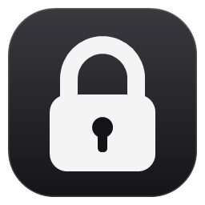
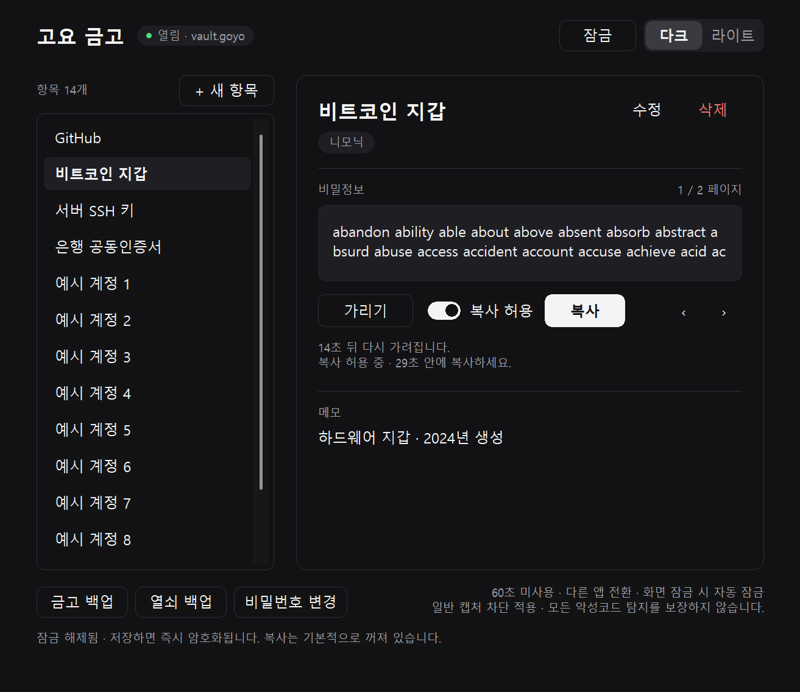
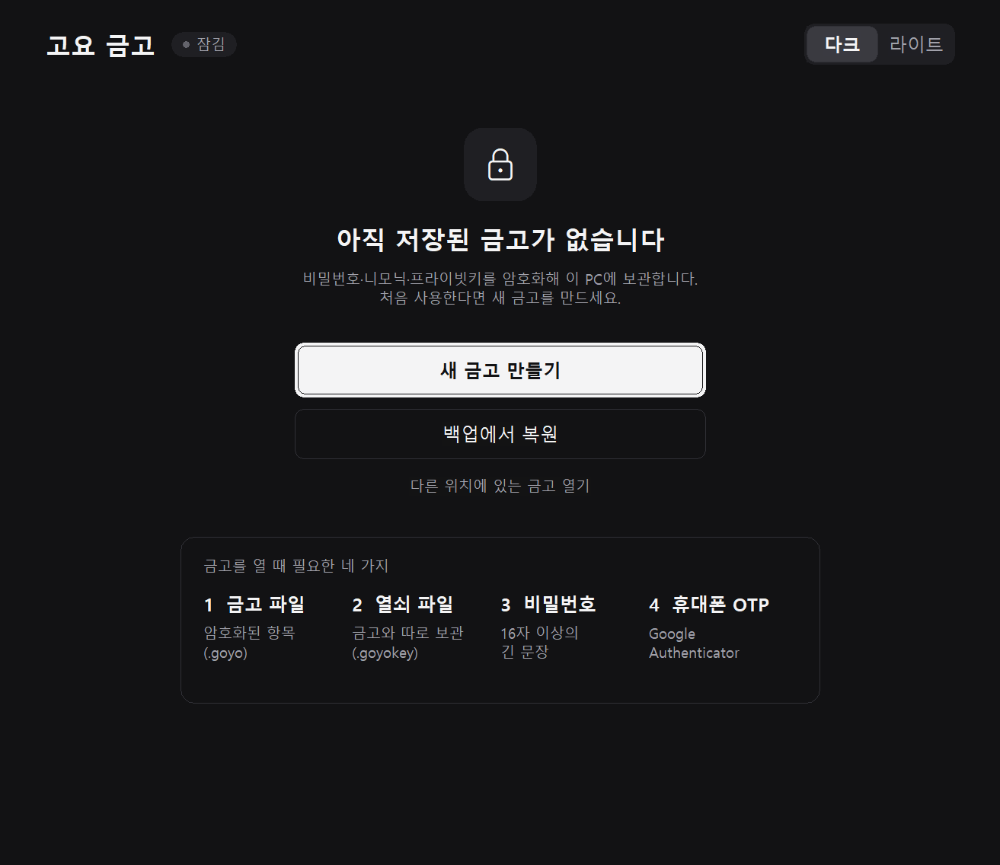
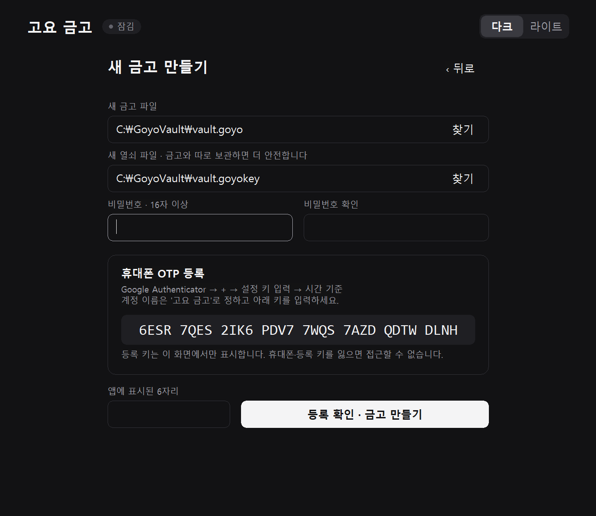
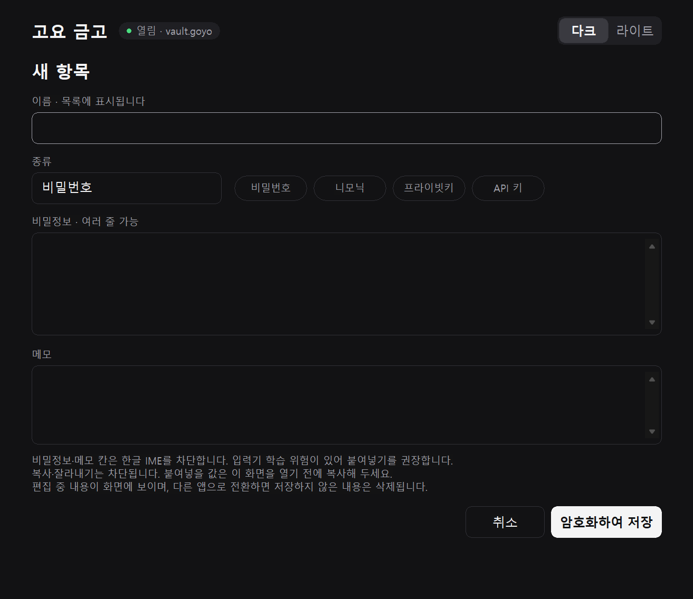
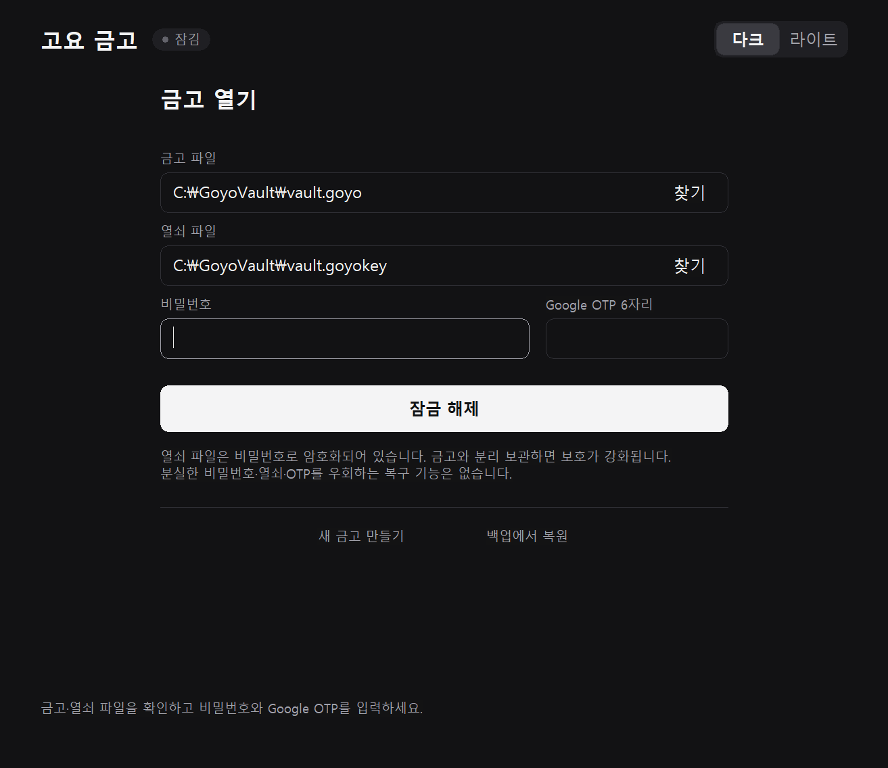
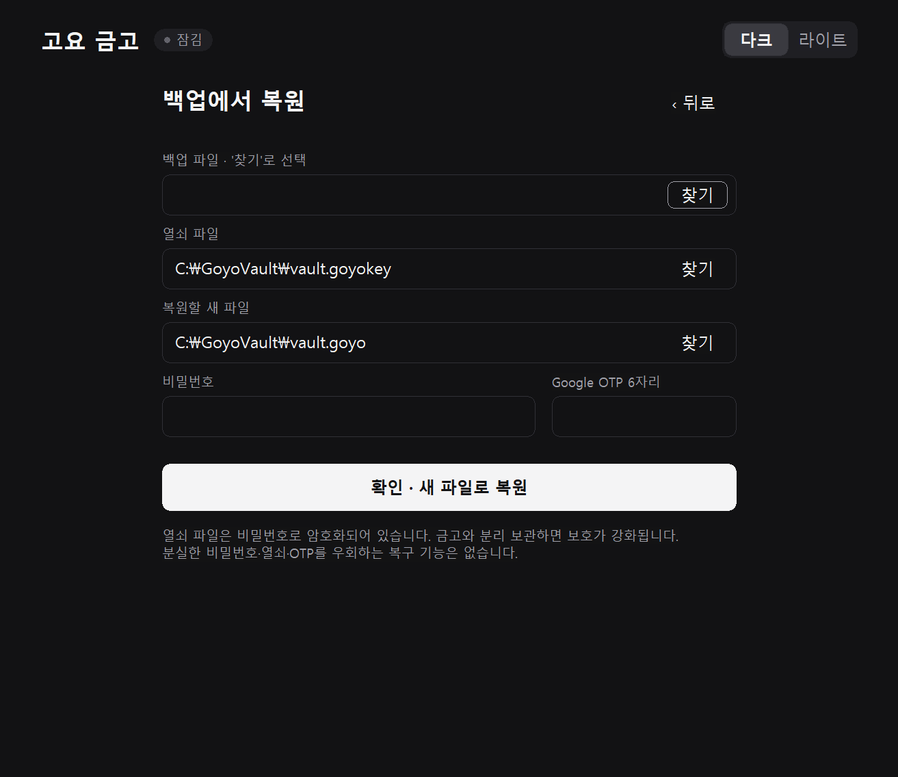
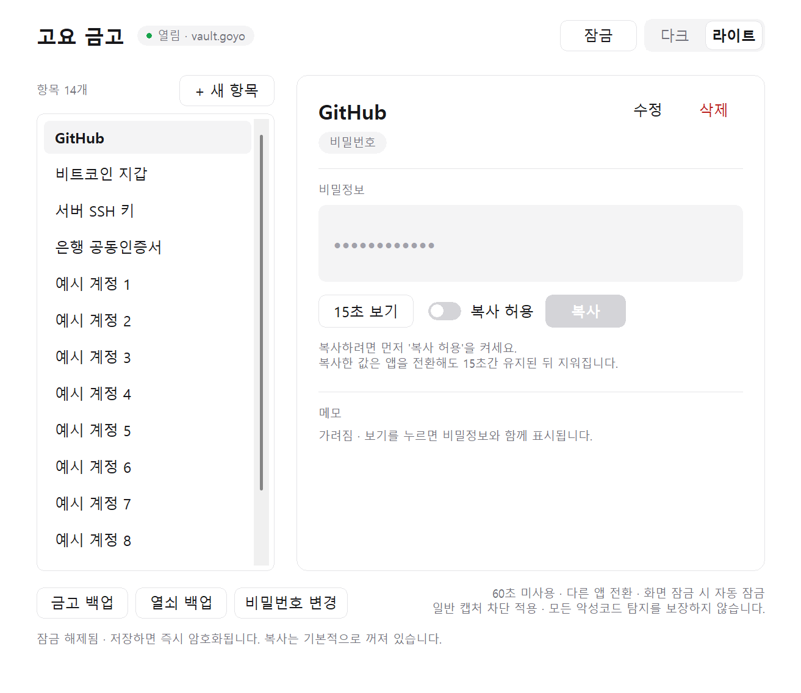

<p align="center"></p>
<h1 align="center">고요 금고 · Goyo Vault</h1>
<p align="center">인터넷 없이 내 PC에서만 쓰는 비밀번호·니모닉·프라이빗키 금고 (Windows 11)</p>
<p align="center"><b>한국어</b> · <a href="README.en.md">English</a></p>



> [!WARNING]
> 개발 버전입니다. 자동 테스트와 AI 코드 검토를 거쳤지만 **전문 보안 감사를 받은 제품은 아닙니다.** 처음에는 가짜 값으로 만들기·백업·복원을 직접 시험해 본 뒤 사용하세요.

## 어떤 프로그램인가요?

- **완전 오프라인:** 네트워크 코드가 없습니다. 서버·계정·동기화·자동 업데이트도 없습니다.
- **네 가지가 모두 있어야 열립니다:** 금고 파일(`.goyo`), 열쇠 파일(`.goyokey`), 비밀번호, 휴대폰 OTP.
- **비밀값을 기본으로 가립니다:** 15초 보기, 허용한 뒤에만 복사, 복사한 값은 15초 뒤 클립보드에서 지웁니다.
- **자동 잠금:** 60초 미사용, 다른 앱으로 전환, 화면 잠금, 절전 때 잠깁니다.
- **화면 캡처 차단:** 일반 캡처 프로그램과 화면 녹화에 금고 창이 찍히지 않습니다.
- **설치 없는 단일 실행 파일**, 다크·라이트 테마를 지원합니다.

## 준비물

- Windows 11 64비트 PC. CPU가 RDSEED 명령을 지원해야 합니다. 대부분의 Intel 5세대 이후, AMD 라이젠 이후 CPU가 해당합니다.
- 휴대폰 OTP 앱: Google Authenticator. 같은 방식(TOTP, 6자리, 30초)의 다른 OTP 앱도 됩니다.

## 설치

1. [Releases](https://github.com/NA-DEGEN-GIRL/goyo-vault/releases)에서 `GoyoVault-<버전>-windows-x64.zip`을 받습니다.
2. **계속 보관할 폴더**(예: `문서\GoyoVault`)에 압축을 풉니다. ZIP 안에서 바로 실행하지 마세요. 금고 파일이 기본적으로 실행 파일 옆에 저장되므로, 임시 폴더가 정리되면 금고도 사라질 수 있습니다.
3. `goyo-vault.exe`를 실행합니다. 코드 서명이 없는 프로그램이라 Windows SmartScreen 경고가 나올 수 있습니다. 이때 **추가 정보 → 실행**을 누르세요. 받은 파일이 맞는지는 ZIP 안의 `SHA256SUMS.txt`와 비교해 확인할 수 있습니다.

## 사용법

### 1. 처음 실행



저장된 금고가 없으면 이 화면이 나옵니다.

- 처음 쓰면 **새 금고 만들기**를 누릅니다.
- 다른 PC에서 쓰던 금고를 옮겨 오려면 **백업에서 복원**을 누릅니다.
- USB 등 다른 곳에 둔 금고는 **다른 위치에 있는 금고 열기**로 엽니다.

오른쪽 위 **다크 | 라이트**로 화면 색을 바꿀 수 있습니다.

### 2. 새 금고 만들기



1. **새 금고 파일**과 **새 열쇠 파일** 위치를 확인합니다. 기본값은 실행 파일 옆입니다. 열쇠 파일은 나중에 USB처럼 금고와 다른 곳에 두면 더 안전합니다.
2. **비밀번호**를 두 번 입력합니다. 16자 이상이어야 하고, 같은 글자를 반복한 비밀번호는 받지 않습니다. 짧고 복잡한 암호보다 길고 외우기 쉬운 문장을 권장합니다.
3. 휴대폰 Google Authenticator에서 **+ → 설정 키 입력**을 누릅니다. 계정 이름은 `고요 금고`, 키는 화면에 보이는 등록 키, 종류는 **시간 기준**으로 등록합니다.
4. 앱에 나온 **6자리 번호**를 입력하고 **등록 확인 · 금고 만들기**를 누릅니다.

> [!IMPORTANT]
> 등록 키는 이 화면에서만 보입니다. 휴대폰을 잃어버렸을 때를 대비해 Authenticator 자체 백업을 켜거나, 등록 키를 종이에 적어 안전한 곳에 보관하세요.

### 3. 항목 저장



**+ 새 항목**을 누르고 이름·종류·비밀정보·메모를 입력한 뒤 **암호화하여 저장**을 누릅니다.

- 종류는 직접 쓰거나 **비밀번호 · 니모닉 · 프라이빗키 · API 키** 버튼으로 채웁니다.
- 여러 줄짜리 키(PEM 등)도 그대로 저장됩니다.
- **이름은 목록에 항상 보이니** 이름에 비밀값을 넣지 마세요.
- 보안을 위해 비밀정보·메모 칸에서는 한글 입력기가 꺼집니다. 한글은 미리 복사해 두었다가 붙여넣으세요. 다른 앱으로 전환하면 편집 중인 내용이 지워지므로, **붙여넣을 값은 이 화면을 열기 전에 복사**해 두세요.

### 4. 보기·복사


목록에서 항목을 고르면 오른쪽에 상세 정보가 나옵니다.

- **15초 보기:** 비밀정보와 메모를 15초 동안 보여 줍니다. 다시 누르면 바로 가립니다.
- **복사:** **복사 허용** 스위치를 켠 뒤 **복사**를 누릅니다. 허용은 30초 뒤, 또는 한 번 복사하면 꺼집니다.
- 복사한 값은 **15초 뒤 클립보드에서 지워집니다.** Win+V 클립보드 기록과 클라우드 동기화에도 남지 않습니다.
- 남은 시간은 화면에 표시됩니다.

### 5. 잠금과 다시 열기



60초 동안 쓰지 않거나, 다른 앱으로 전환하거나, 화면을 잠그거나, 절전에 들어가면 자동으로 잠깁니다. **잠금** 버튼으로 바로 잠글 수도 있습니다.

다시 열 때는 비밀번호와 **새** OTP 번호를 입력합니다. 한 번 쓴 OTP 번호는 다시 받지 않으니, 방금 열었다면 휴대폰에 다음 번호가 나올 때까지 기다리세요. 금고나 열쇠 파일을 다른 곳으로 옮겼다면 **찾기**로 고릅니다.

### 6. 백업과 복원

금고 화면 아래쪽 버튼을 씁니다.

- **금고 백업:** 암호화된 금고 파일을 새 파일로 저장합니다.
- **열쇠 백업:** 암호화된 열쇠 파일을 새 파일로 저장합니다. 금고 백업과 **다른 곳**에 보관하세요.



복원하려면 시작 화면이나 열기 화면에서 **백업에서 복원**을 누릅니다. 백업 파일과 열쇠 파일을 고르고 비밀번호와 OTP를 입력하면 새 파일로 복원합니다. 원래 백업은 바뀌지 않습니다. 새 PC에서 처음 복원하면 기본 위치가 `vault.goyo`라서, 다음 실행부터 바로 열기 화면이 나옵니다.

### 7. 비밀번호 변경

금고 화면의 **비밀번호 변경**에서 현재 비밀번호, 새 비밀번호, 새 OTP를 입력합니다. 변경하면 열쇠 파일을 새 비밀번호로 다시 암호화합니다. 변경 후에는 **열쇠를 다시 백업**하세요.

### 8. 화면 테마



오른쪽 위에서 다크·라이트를 고릅니다. 선택은 실행 파일 옆 `goyo-vault.theme` 파일에 `dark` 또는 `light`로만 저장되며, 금고 내용과 무관합니다.

## 꼭 알아 두세요

- **잃어버리면 복구할 방법이 없습니다.** 금고 파일, 열쇠 파일, 비밀번호, OTP 중 하나라도 잃으면 열 수 없습니다. 우회하는 기능도 없습니다.
- **열쇠 파일은 따로 보관하세요.** 금고와 열쇠가 같은 폴더에 있으면 둘을 함께 잃거나 함께 도난당할 수 있습니다.
- **OTP는 이 앱 안에서의 추가 확인입니다.** 금고·열쇠 파일과 비밀번호를 모두 가진 공격자는 OTP 없이도 복호화할 수 있습니다. 파일 도난에 대한 실질적인 추가 보호는 "열쇠 파일을 따로 두는 것"입니다.
- **비밀번호를 바꿔도 예전 열쇠 사본은 계속 유효합니다.** 예전 열쇠 사본과 예전 비밀번호로 이후 금고도 열 수 있습니다. 유출이 의심되면 예전 사본을 직접 폐기하세요.
- **복사한 값은 다른 프로그램이 읽을 수 있습니다.** 복사는 꼭 필요할 때만 쓰세요. 비밀번호 칸이나 비밀정보 칸에 붙여넣은 값은 앱이 클립보드에서 바로 지우지만, 원래 복사한 앱이 남긴 기록(Win+V 등)은 지우지 못합니다.
- **감염된 PC는 지켜 주지 못합니다.** 키로거, 관리자 권한 악성코드, 커널 공격, 카메라로 화면을 찍는 것은 막을 수 없습니다.

## 보안 설계와 한계

<details>
<summary>자세히 보기</summary>

**암호화**
- RustCrypto의 **XChaCha20-Poly1305**: 256비트 키, 192비트 nonce, 128비트 인증 태그. 데이터와 헤더의 변조를 검사합니다.
- **Argon2id v1.3**, 메모리 256 MiB, 반복 3, 병렬도 1로 비밀번호에서 열쇠 파일 암호화 키를 만듭니다. 열쇠 파일에는 무작위 데이터 키와 OTP 비밀키가 들어 있습니다.
- CPU **RDSEED**와 SHA-512로 난수를 만듭니다. Windows CNG, DPAPI, BCrypt 난수, `getrandom`은 쓰지 않습니다. CPU·펌웨어·가상화 계층은 신뢰 대상이며, 간단한 오류 검사가 하드웨어 인증을 대신하지는 않습니다.
- 파일 형식은 [docs/FORMAT.md](docs/FORMAT.md)에 있습니다.

**메모리와 파일**
- 정상 종료·잠금 시 관리 중인 키, 문자열, 직렬화 버퍼, Argon2 작업 메모리를 `zeroize`로 지웁니다. Windows 입력 컨트롤, 그래픽 메모리, CPU 레지스터, 페이지파일, 크래시 덤프에 남은 사본까지 지운다고 보장하지는 않습니다.
- 평문 파일을 만들지 않습니다. 같은 폴더에 암호화된 임시 파일을 쓰고 동기화한 뒤 이름을 바꿉니다. 동시 실행은 파일 잠금으로 막습니다. 파일 잠금은 협조적인 앱끼리의 충돌 방지일 뿐, 같은 권한의 악성코드를 막지는 않습니다.
- 전원이 끊겼을 때의 안전성은 저장장치와 파일 시스템에 달려 있습니다. 특히 FAT/exFAT은 보장하지 않습니다. `.goyolock`, 장애 후 남은 암호화 임시 파일, 파일명·경로 같은 메타데이터는 숨기지 않습니다.
- `CON`·`NUL`·`COM1` 같은 Windows 장치 이름은 파일 이름으로 쓸 수 없습니다. `NUL`에 백업하면 성공한 것처럼 보이지만 아무것도 남지 않기 때문입니다.

**화면·입력·클립보드**
- 입력란에 Windows 암호 입력 범위를 설정하고, 비밀정보·메모 칸은 입력기(IME)를 분리합니다. 입력기 종류에 따라 이름·종류·경로 칸도 한글 직접 입력이 제한될 수 있습니다. 그때는 붙여넣기를 쓰세요. OS 입력 서비스, 타사 키보드, 음성 입력의 학습·개인화 저장까지 완전히 통제할 수는 없습니다. 입력 보호 설정이 실패하면 해당 칸과 저장·인증을 막습니다.
- 앱에서 복사한 값은 Win+V 기록과 클라우드 동기화에서 제외하고, 이 표시를 따르는 클립보드 관리 프로그램에도 기록하지 말라고 표시합니다. 다른 앱이 클립보드를 점유하면 지우기를 계속 재시도하고, 종료도 지울 때까지 기다립니다. 강제 종료나 시스템 종료 때는 이 정리를 보장하지 못합니다.
- 다른 앱으로 전환하면 금고는 잠기지만, 방금 복사한 값은 붙여넣기를 위해 남은 15초 동안 유지합니다. 수동 잠금, 화면 잠금, 절전 때는 즉시 지웁니다. 그 사이 다른 앱이 클립보드를 바꿨다면 그 내용은 지우지 않습니다.
- Windows 캡처 제외는 Windows가 지원하는 캡처 경로에만 적용됩니다.

**프로세스 보호**
- 시작할 때 동적 코드 생성, 레거시 확장 지점, 시스템 외 글꼴, 원격·낮은 무결성 이미지 로드를 막습니다. **Microsoft 서명 DLL만** 불러오고 **하위 프로세스 생성**을 막습니다. 그래서 타사 입력기, 파일 선택창의 타사 셸 확장, 실행 중 주입되는 타사 DLL은 이 앱 안에서 동작하지 않습니다.
- 디버거, 원격 세션, 캡처 보호 이상을 검사하면 잠그거나 작업을 막습니다. 다만 일반 악성코드나 키로거를 완전히 탐지하는 기능은 아닙니다. 화면에 "안전함" 같은 판정을 표시하지도 않습니다.
- 오래된 백업으로 되돌리는 롤백 공격, 앱 재시작으로 시도 제한을 초기화하는 것, 악성 앱의 검사 우회는 서버나 별도 신뢰 하드웨어 없이는 완전히 막을 수 없습니다.
- 256비트 대칭키를 쓰지만 양자내성 인증이나 양자 공격에 대한 보장을 표방하지 않습니다.

검토 기록은 [docs/SECURITY_REVIEW.md](docs/SECURITY_REVIEW.md)에 있습니다.

</details>

## 직접 빌드하기

Rust stable MSVC x64 툴체인과 링커가 필요합니다. GUI·암호화용 별도 SDK는 쓰지 않습니다. 직접 의존성은 암호화·비밀값 처리용 Rust 라이브러리뿐이며, 버전은 `Cargo.toml`과 `Cargo.lock`에 고정했습니다.

```powershell
cargo test --locked -- --test-threads=1
cargo clippy --all-targets --locked -- -D warnings
cargo build --release --locked
python scripts/check_dependencies.py
target/release/goyo-vault.exe --self-check
```

- 배포용 ZIP은 `python scripts/package_release.py`로 만듭니다. 이 스크립트는 실행 파일에서 빌드한 PC의 경로를 지우고, 사용자 이름이나 경로가 남아 있으면 패키징을 멈춥니다.
- 아이콘은 `scripts/make_icon.ps1`로 다시 만들 수 있습니다. `build.rs`가 `assets/goyo.ico`를 실행 파일에 넣습니다.
- 화면 미리보기는 `cargo test ui_preview -- --ignored`로 만듭니다. 결과는 `test-output/ui-preview/`에 저장되며, 이때 미리보기 창이 잠깐 화면에 뜹니다.

런타임 네트워크 코드, 원격 분석, 자동 업데이트, 외부 프로세스 실행 코드는 없습니다. CRT는 정적으로 링크합니다.

## 라이선스

[MIT](LICENSE-MIT) 또는 [Apache-2.0](LICENSE-APACHE) 중 선택. 사용한 라이브러리의 라이선스는 [docs/THIRD_PARTY_NOTICES.md](docs/THIRD_PARTY_NOTICES.md)에 있습니다.
