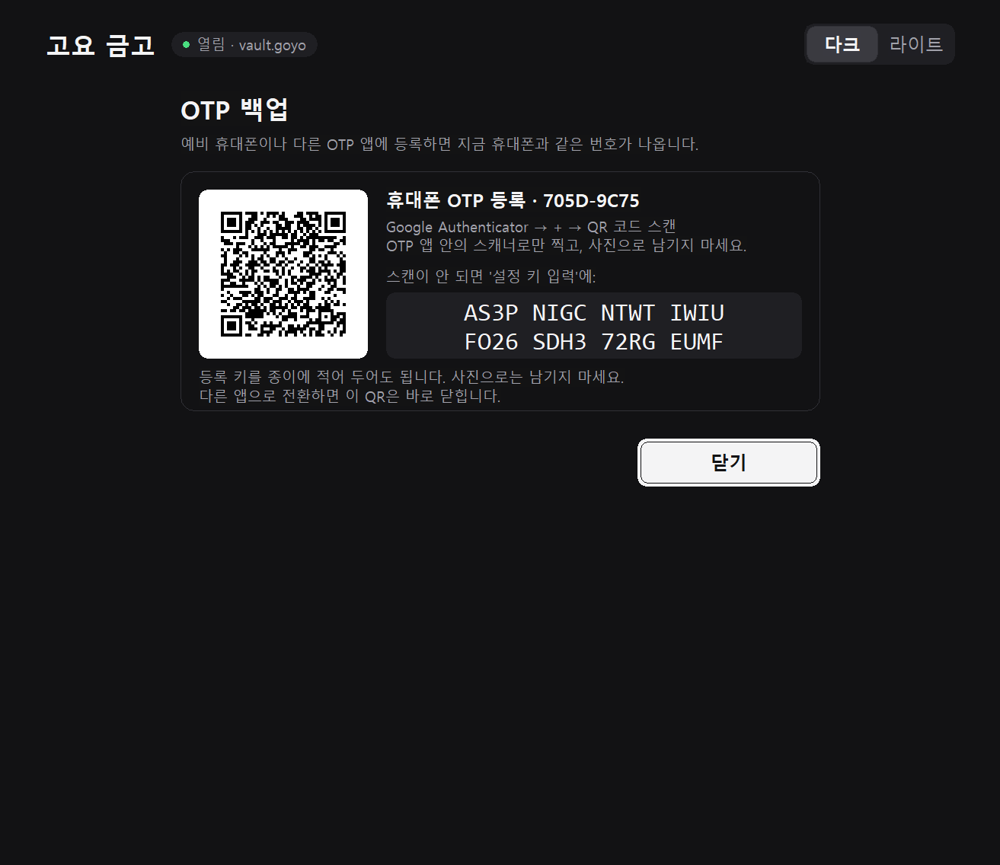

<p align="center"></p>
<h1 align="center">고요 금고 · Goyo Vault</h1>
<p align="center">인터넷 없이 내 PC에서만 쓰는 비밀번호·니모닉·프라이빗키 금고 (Windows 11)</p>
<p align="center"><b>한국어</b> · <a href="README.en.md">English</a></p>


> [!WARNING]
> 개발 버전입니다. 자동 테스트와 AI 코드 검토를 거쳤지만 **전문 보안 감사를 받은 제품은 아닙니다.** 처음에는 가짜 값으로 만들기·백업·복원을 직접 시험해 본 뒤 사용하세요.

## 어떤 프로그램인가요?

- **완전 오프라인:** 네트워크 코드가 없습니다. 서버·계정·동기화·자동 업데이트도 없습니다.
- **앱은 네 가지를 모두 요구합니다:** 금고 파일(`.goyo`), 열쇠 파일(`.goyokey`), 비밀번호, 휴대폰 OTP. 다만 OTP는 앱 안의 확인이라, **두 파일을 함께 가져간 사람에게는 비밀번호가 유일한 방어선**입니다. 그래서 열쇠 파일은 금고와 다른 곳에 두세요.
- **비밀값을 기본으로 가립니다:** 15초 보기, 허용한 뒤에만 복사, 복사한 값은 15초 뒤 클립보드에서 지웁니다.
- **자동 잠금:** 금고가 열려 있을 때 60초 미사용(OTP 백업 화면은 2분), 다른 앱에 30초 넘게 머무름, 화면 잠금, 절전, Windows 종료 때 잠깁니다.
- **화면 캡처 차단:** Windows가 지원하는 캡처 경로(일반 캡처 프로그램, 화면 녹화)에 금고 창이 찍히지 않습니다.
- **설치 없는 단일 실행 파일**, 다크·라이트 테마를 지원합니다.

## 준비물

- Windows 11 64비트 PC. CPU가 RDSEED 명령을 지원해야 합니다. 대부분의 Intel 5세대 이후, AMD 라이젠 이후 CPU가 해당합니다.
- 휴대폰 OTP 앱: Google Authenticator. 같은 방식(TOTP, 6자리, 30초)의 다른 OTP 앱도 됩니다.

## 설치

1. [Releases](https://github.com/NA-DEGEN-GIRL/goyo-vault/releases)에서 `GoyoVault-<버전>-windows-x64.zip`을 받습니다.
2. **실행 전에 받은 파일이 진짜인지 확인하세요.** 공식 배포처는 이 저장소(`github.com/NA-DEGEN-GIRL/goyo-vault`)뿐입니다. PowerShell에서 `Get-FileHash .\GoyoVault-<버전>-windows-x64.zip`을 실행해 릴리스 설명에 적힌 SHA-256과 같은지 봅니다. ZIP 안의 `SHA256SUMS.txt`는 파일 손상 확인용일 뿐, ZIP을 바꿔치기한 사람이 함께 고칠 수 있으니 위조 확인은 되지 않습니다.
3. ZIP 안에는 `GoyoVault` 폴더가 들어 있습니다. **나만 쓰고 동기화되지 않는 폴더**에 푸세요. 예: `C:\Users\<내 이름>\GoyoVault`. 피해야 할 곳은 다음과 같습니다.
   - ZIP 안이나 임시 폴더: 정리될 때 금고도 사라집니다(앱이 시작할 때 경고합니다).
   - OneDrive가 백업하는 `문서`·`바탕 화면`, Dropbox·Google Drive 폴더: 금고와 열쇠가 같은 클라우드 계정에 올라갑니다.
   - `C:\` 바로 아래 새 폴더, 공유 폴더, 여러 사람이 쓰는 USB: 다른 사용자가 실행 파일을 바꿔치기할 수 있습니다.
4. `GoyoVault\goyo-vault.exe`를 실행합니다. 코드 서명이 없는 프로그램이라 Windows SmartScreen 경고가 나올 수 있습니다. 2번에서 해시를 확인했다면 **추가 정보 → 실행**을 누르세요. '스마트 앱 컨트롤'이 켜진 PC에서는 서명 없는 프로그램이 아예 막힐 수 있습니다.

### 새 버전으로 업데이트

새 ZIP을 **처음 풀었던 곳에 그대로 덮어써서** 풉니다. 프로그램과 설명서만 바뀌고, 같은 폴더의 금고(`.goyo`)·열쇠(`.goyokey`) 파일과 테마 설정은 그대로 남습니다. 업데이트 전에는 금고·열쇠 백업을 해 두세요.

> [!NOTE]
> 0.2.0 이전 ZIP은 `GoyoVault-0.1.0`처럼 버전이 붙은 폴더로 풀렸습니다. 그 폴더에 금고를 만들었다면, 새 `GoyoVault` 폴더로 금고·열쇠 파일을 옮기거나 **다른 위치에 있는 금고 열기**로 여세요.

## 사용법

### 1. 처음 실행


저장된 금고가 없으면 이 화면이 나옵니다.

- 처음 쓰면 **새 금고 만들기**를 누릅니다.
- 다른 PC에서 쓰던 금고를 옮겨 오려면 **백업에서 복원**을 누릅니다.
- USB 등 다른 곳에 둔 금고는 **다른 위치에 있는 금고 열기**로 엽니다.

오른쪽 위 **다크 | 라이트**로 화면 색을 바꿀 수 있습니다.

### 2. 새 금고 만들기


1. **새 금고 파일**과 **새 열쇠 파일** 위치를 정합니다. 기본값은 둘 다 실행 파일 옆이라 열쇠 칸 설명이 빨간 글씨로 경고합니다. **열쇠 파일은 '찾기'로 USB 등 다른 곳을 고르는 것을 권장합니다.** 같은 폴더에 두면 폴더째 가져간 사람은 비밀번호만 알아내면 됩니다. 앱은 마지막으로 연 금고·열쇠 위치를 기억하므로(`goyo-vault.paths`), 열쇠를 USB에 두어도 매번 찾을 필요가 없습니다.
2. **비밀번호**를 두 번 입력합니다. 12자 이상이어야 하고, 같은 글자 반복이나 `password1234`·`qwerty123456`·`1q2w3e4r5t6y`처럼 흔한 단어·키보드 배열·연속 숫자로만 된 비밀번호는 받지 않습니다. 니모닉·개인키를 넣을 거라면 **서로 관계없는 단어 4~6개**를 이어 쓰는 것을 권장합니다. 단, `dragon`·`sunshine`처럼 흔한 비밀번호 목록에 있는 단어는 글자 수로 치지 않으니 흔하지 않은 단어를 고르세요. 이 검사는 기본적인 걸러내기라서, 통과했다고 안전하다는 뜻은 아닙니다. 열쇠 파일을 빼앗긴 경우, 흔한 비밀번호는 GPU 한 대로 하루 안에 풀릴 수 있지만 무작위 단어 4개는 사실상 풀 수 없습니다. 칸 오른쪽의 눈 아이콘을 누르면 입력한 비밀번호를 보고 오타를 확인할 수 있고, 다시 누르면 가려집니다.
3. 휴대폰 Google Authenticator에서 **+ → QR 코드 스캔**을 누르고 화면의 QR을 비춥니다. OTP 앱에는 `Goyo Vault (3FA2-C1D0)`처럼 금고마다 다른 이름으로 등록됩니다. 같은 이름은 금고를 열 때 OTP 칸 위에도 표시되니, 금고가 여러 개라면 이름으로 맞는 항목을 고르세요. 다른 앱으로 전환하는 동안에는 QR과 등록 키가 가려지고, **뒤로**를 눌렀다 돌아와도 같은 QR이 유지됩니다. 스캔이 안 되면 **설정 키 입력**을 골라 QR 옆의 등록 키를 입력합니다(종류: **시간 기준**). 스크린샷의 QR과 키는 예시용 가짜 값입니다.
4. 앱에 나온 **6자리 번호**를 입력하고 **등록 확인 · 금고 만들기**를 누릅니다.

> [!IMPORTANT]
> - QR은 **OTP 앱 안의 스캐너로만** 찍으세요. 일반 카메라나 구글 렌즈로 찍거나 사진으로 남기면, 비밀키가 사진첩이나 클라우드에 남을 수 있습니다.
> - 휴대폰을 잃으면 이 앱으로는 금고를 열 수 없습니다. 금고를 만든 뒤 **OTP 백업**(아래 8번)으로 예비 기기에도 등록해 두거나, Authenticator 자체 백업을 켜 두세요.

### 3. 항목 저장


**+ 새 항목**을 누르고 이름·종류·비밀정보·메모를 입력한 뒤 **암호화하여 저장**을 누릅니다.

- 종류는 직접 쓰거나 **비밀번호 · 니모닉 · 프라이빗키 · API 키** 버튼으로 채웁니다.
- 여러 줄짜리 키(PEM 등)도 그대로 저장됩니다.
- **이름은 목록에 항상 보이니** 이름에 비밀값을 넣지 마세요.
- 보안을 위해 비밀정보·메모 칸에서는 한글 입력기가 꺼집니다. 한글은 미리 복사해 두었다가 붙여넣으세요. 다른 앱에서 값을 복사해 와도 되지만, **30초 안에 돌아와** 붙여넣으세요. 그보다 오래 머무르면 금고가 잠기고 저장하지 않은 내용은 지워집니다.

### 4. 보기·복사


목록에서 항목을 고르면 오른쪽에 상세 정보가 나옵니다.

- **15초 보기:** 비밀정보와 메모를 15초 동안 보여 줍니다. 다시 누르면 바로 가립니다.
- **복사:** **복사 허용** 스위치를 켠 뒤 **복사**를 누릅니다. 허용은 30초 뒤, 또는 한 번 복사하면 꺼집니다.
- 복사한 값은 **15초 뒤 클립보드에서 지워집니다.** Win+V 클립보드 기록과 클라우드 동기화에도 남지 않습니다.
- 남은 시간은 화면에 표시됩니다.

### 5. 잠금과 다시 열기


60초 동안 쓰지 않거나, 다른 앱에 30초 넘게 머무르거나, 화면을 잠그거나, 절전에 들어가면 자동으로 잠깁니다. **잠금** 버튼으로 바로 잠글 수도 있습니다.

다른 앱으로 잠깐 갔다 오는 것(복사한 값 붙여넣기, 스크린샷 도구 등)으로는 잠기지 않습니다. 대신 전환하는 순간 **15초 보기**, **복사 허용**, 보이게 해 둔 비밀번호, **OTP 백업** QR은 바로 가려집니다. 금고 창은 원래 화면 캡처에 찍히지 않습니다.

금고를 열기 전 화면(금고 열기, 새 금고 만들기, 백업에서 복원)은 다른 앱으로 전환해도 입력하던 내용과 OTP 등록 QR이 그대로 남고, 보이게 해 둔 비밀번호만 다시 가려집니다. 이 화면들도 미사용 시간(새 금고 5분, 나머지 60초)이 지나거나 Windows 화면을 잠그면 지워집니다.

다시 열 때는 비밀번호와 **새** OTP 번호를 입력합니다. 한 번 쓴 OTP 번호는 다시 받지 않으니, 방금 열었다면 휴대폰에 다음 번호가 나올 때까지 기다리세요. 금고나 열쇠 파일을 다른 곳으로 옮겼다면 **찾기**로 고릅니다.

### 6. 백업과 복원

금고 화면 아래쪽 버튼을 씁니다.

- **금고 백업:** 암호화된 금고 파일을 새 파일로 저장합니다.
- **열쇠 백업:** 암호화된 열쇠 파일을 새 파일로 저장합니다. 금고 백업과 **다른 곳**에 보관하세요.
- 백업이 실패하면 확인 창으로 알려 줍니다. 확인 창 없이 지나갔다면 저장된 것입니다.

**백업 원칙**
- 금고 백업과 열쇠 백업을 **서로 다른 저장장치 두 곳 이상**에 둡니다. 한 USB에 둘 다 넣으면 그 USB 하나로 비밀번호만 남습니다.
- 항목을 추가·수정했을 때, 특히 새 니모닉을 넣었을 때마다 금고 백업을 새로 만듭니다.
- 몇 달에 한 번은 **실제로 복원해 봅니다**(새 파일로 복원되므로 원본은 안전합니다).
- 큰 자산의 니모닉은 이 금고만 믿지 말고 종이나 금속판에도 따로 보관하세요.


복원하려면 시작 화면이나 열기 화면에서 **백업에서 복원**을 누릅니다. 백업 파일과 열쇠 파일을 고르고 비밀번호와 OTP를 입력하면 새 파일로 복원합니다. 원래 백업은 바뀌지 않습니다. 새 PC에서 처음 복원하면 기본 위치가 `vault.goyo`이고, 복원한 금고는 마지막으로 연 금고로 기억되어 다음 실행 때 바로 열기 화면에 나옵니다.

### 7. 비밀번호 변경

금고 화면의 **비밀번호 변경**에서 현재 비밀번호, 새 비밀번호, 새 OTP를 입력합니다. 변경하면 열쇠 파일을 새 비밀번호로 다시 암호화합니다. 변경 후에는 **열쇠를 다시 백업**하세요.

### 8. OTP 백업 (휴대폰 분실 대비)



금고 화면 아래 **OTP 백업**을 누르고 현재 비밀번호를 입력하면, 처음 만들 때와 같은 QR과 등록 키가 다시 나옵니다. 예비 휴대폰이나 다른 OTP 앱에 등록해 두면 지금 휴대폰과 같은 번호가 나오므로, 휴대폰을 잃어도 그 기기로 금고를 열 수 있습니다. 등록 키를 종이에 적어 안전한 곳에 둬도 됩니다.

> [!NOTE]
> 등록 키를 금고 안에 항목으로 저장해 두는 것은 백업이 되지 않습니다. 금고를 열려면 OTP가 필요하므로, 휴대폰을 잃으면 그 항목도 꺼낼 수 없습니다. **휴대폰을 잃기 전에** 다른 기기나 종이로 옮겨 두세요.

### 9. 화면 테마


오른쪽 위에서 다크·라이트를 고릅니다. 선택은 실행 파일 옆 `goyo-vault.theme` 파일에 `dark` 또는 `light`로만 저장되며, 금고 내용과 무관합니다.

## 꼭 알아 두세요

- **열쇠 파일은 따로 보관하세요. 가장 중요합니다.** 금고와 열쇠가 같은 폴더(기본값)나 같은 클라우드 계정에 있으면, 둘을 함께 가져간 사람은 OTP 없이 비밀번호만 계속 추측하면 됩니다. 앱은 이런 배치를 빨간 글씨로 경고합니다.
- **잃어버리면 복구할 방법이 없습니다.** 금고 파일, 열쇠 파일, 비밀번호, OTP 중 하나라도 잃으면 이 앱으로는 열 수 없고, 우회하는 기능도 없습니다. 휴대폰 분실에는 **OTP 백업**으로 미리 대비하세요.
- **`.goyotmp` 파일을 함부로 지우지 마세요.** 저장 중 전원이 끊기거나 USB가 빠지면, 원래 파일 대신 `vault.goyo.<숫자>.goyotmp` 같은 임시 파일만 남을 수 있습니다. 그때는 그 파일이 유일한 사본일 수 있으니 이름을 원래대로 바꿔 보세요. 앱도 파일이 없을 때 이 경우를 알려 줍니다.
- **OTP는 이 앱 안에서의 추가 확인입니다.** 금고·열쇠 파일과 비밀번호를 모두 가진 공격자는 OTP 없이도 복호화할 수 있습니다. 파일 도난에 대한 실질적인 추가 보호는 "열쇠 파일을 따로 두는 것"입니다.
- **비밀번호를 바꿔도 예전 열쇠 사본은 계속 유효합니다.** 예전 열쇠 사본과 예전 비밀번호로 이후 금고도 열 수 있습니다. 유출이 의심되면 예전 사본을 직접 폐기하세요.
- **복사한 값은 다른 프로그램이 읽을 수 있습니다.** 복사는 꼭 필요할 때만 쓰세요. 비밀번호 칸이나 비밀정보 칸에 붙여넣은 값은 앱이 클립보드에서 바로 지우지만, 원래 복사한 앱이 남긴 기록(Win+V 등)은 지우지 못합니다.
- **감염된 PC는 지켜 주지 못합니다.** 키로거는 비밀번호를 그대로 기록하고, 같은 사용자 권한의 악성코드는 금고·열쇠 파일을 복사하거나 실행 파일을 바꿔치기할 수 있습니다. 관리자 권한 악성코드, 커널 공격, 카메라로 화면을 찍는 것도 막을 수 없습니다. 큰 자산은 하드웨어 지갑을 권장합니다.

## 보안 설계와 한계

<details>
<summary>자세히 보기</summary>

**암호화**
- RustCrypto의 **XChaCha20-Poly1305**: 256비트 키, 192비트 nonce, 128비트 인증 태그. 데이터와 헤더의 변조를 검사합니다.
- **Argon2id v1.3**, 메모리 256 MiB, 반복 3, 병렬도 1로 비밀번호에서 열쇠 파일 암호화 키를 만듭니다. 열쇠 파일에는 무작위 데이터 키와 OTP 비밀키가 들어 있습니다.
- CPU **RDSEED**와 SHA-512로 난수를 만듭니다. Windows CNG, DPAPI, BCrypt 난수, `getrandom`은 쓰지 않습니다. CPU·펌웨어·가상화 계층은 신뢰 대상이며, 간단한 오류 검사가 하드웨어 인증을 대신하지는 않습니다.
- 파일 형식은 [docs/FORMAT.md](docs/FORMAT.md)에 있습니다.

**메모리와 파일**
- 정상 종료·잠금 시 관리 중인 키, 문자열, 직렬화 버퍼, Argon2 작업 메모리를 `zeroize`로 지웁니다. Windows 입력 컨트롤, 그래픽 메모리, CPU 레지스터, 페이지파일, 크래시 덤프에 남은 사본까지 지운다고 보장하지는 않습니다.
- 평문 파일을 만들지 않습니다. 같은 폴더에 암호화된 임시 파일을 쓰고 동기화한 뒤 이름을 바꾸고, 바뀐 이름으로 다시 디스크에 기록합니다. 동시 실행은 파일 잠금으로 막습니다. 파일 잠금은 경로 기준이라, 같은 금고에 만든 하드 링크로 두 번 여는 것은 막지 못합니다. 협조적인 앱끼리의 충돌 방지일 뿐, 같은 권한의 악성코드를 막지는 않습니다.
- 실행 파일 옆의 `goyo-vault.theme`(테마)와 `goyo-vault.paths`(마지막으로 연 금고·열쇠 위치)에는 비밀이 없습니다. 다만 `paths` 파일은 열쇠 위치를 알려 주므로, 그 폴더를 다른 사람과 공유하지 마세요.
- 전원이 끊겼을 때의 안전성은 저장장치와 파일 시스템에 달려 있습니다. 특히 FAT/exFAT은 보장하지 않습니다. `.goyolock`, 장애 후 남은 암호화 임시 파일, 파일명·경로 같은 메타데이터는 숨기지 않습니다.
- `CON`·`NUL`·`COM1` 같은 Windows 장치 이름은 파일 이름으로 쓸 수 없습니다. `NUL`에 백업하면 성공한 것처럼 보이지만 아무것도 남지 않기 때문입니다.

**화면·입력·클립보드**
- 입력란에 Windows 암호 입력 범위를 설정하고, 비밀정보·메모 칸은 입력기(IME)를 분리합니다. 입력기 종류에 따라 이름·종류·경로 칸도 한글 직접 입력이 제한될 수 있습니다. 그때는 붙여넣기를 쓰세요. OS 입력 서비스, 타사 키보드, 음성 입력의 학습·개인화 저장까지 완전히 통제할 수는 없습니다. 입력 보호 설정이 실패하면 해당 칸과 저장·인증을 막습니다.
- 입력 칸과 항목 목록은 다른 프로그램이 보내는 창 메시지를 보내는 방식과 관계없이 모두 무시합니다. 그래서 다른 프로그램은 글자를 읽거나, 글자 위치로 내용을 추측하거나, 목록 선택을 바꿀 수 없습니다. 메인 창도 다른 프로그램이 보내거나 대기열에 넣은 버튼 클릭·명령을 무시합니다. 메시지 상자나 파일 선택창이 열려 있는 동안에도 마찬가지입니다. 앱이 뒤에 있을 때 들어온 키보드·마우스 입력도 무시하므로, 앱이 뒤에 있으면 마우스 휠로 목록을 스크롤할 수 없습니다. 앱이 맨 앞에 있을 때 같은 사용자 권한의 프로그램이 입력을 흉내 내는 것까지 완전히 막지는 못합니다.
- 같은 이유로 화면 낭독 프로그램(내레이터 등)은 이 앱의 입력 칸과 항목 목록을 읽지 못합니다.
- 비밀번호 칸의 눈 아이콘은 본인이 누를 때만 글자를 보여 줍니다. 보이는 동안에도 복사, 다른 프로그램의 텍스트 읽기, 접근성 읽기, 화면 캡처는 그대로 막히고 입력기도 꺼진 상태입니다. 잠금, 미사용 시간 초과, 화면 전환, 다른 앱으로 전환할 때 다시 가려집니다. 옆 사람이 화면을 보는 것까지 막지는 못하니 주변을 확인하고 쓰세요.
- 앱에서 복사한 값은 Win+V 기록과 클라우드 동기화에서 제외하고, 이 표시를 따르는 클립보드 관리 프로그램에도 기록하지 말라고 표시합니다. 다른 앱이 클립보드를 점유하면 지우기를 계속 재시도하고, 종료도 지울 때까지 기다립니다. Windows 종료·재시작 때도 잠그고 지우기를 시도하지만, 강제 종료 때는 보장하지 못합니다. 클립보드를 거친 값은 Windows 내부 메모리에 사본이 남을 수 있습니다.
- 다른 앱으로 전환해도 방금 복사한 값은 붙여넣기를 위해 남은 15초 동안 유지합니다. 수동 잠금, 화면 잠금, 절전 때는 즉시 지웁니다. 그 사이 다른 앱이 클립보드를 바꿨다면 그 내용은 지우지 않습니다.
- Windows 캡처 제외는 Windows가 지원하는 캡처 경로에만 적용됩니다. 카메라로 화면을 찍는 것은 막지 못합니다.
- OTP 등록 QR은 앱 안의 자체 인코더로 화면에 직접 그립니다. 이미지 파일을 만들지 않고 외부 서비스도 쓰지 않으며, 비밀키가 담긴 중간 버퍼도 `zeroize`로 지웁니다.

**프로세스 보호**
- 실행 파일이 시작 전에 불러오는 DLL은 모두 System32에서만 찾습니다. 나머지 Windows DLL은 보호 설정 뒤에 System32에서만 불러옵니다. 배포 전에 실행 파일 옆에 가짜 DLL과 진짜 System32 DLL 사본을 차례로 두고 실행해, 하나라도 그 폴더에서 불러오면 실패하는 검사(`scripts/check_dll_planting.py`)를 거칩니다.
- 시작 직후 동적 코드 생성, 레거시 확장 지점, 시스템 외 글꼴, 원격·낮은 무결성 이미지 로드를 막습니다. 이후로는 **Microsoft 서명 DLL만** 불러오고 **하위 프로세스 생성**을 막습니다. 그래서 타사 입력기와 파일 선택창의 타사 셸 확장은 이 앱 안에서 동작하지 않습니다.
- 같은 사용자 권한으로 실행 중인 다른 프로그램이 이 앱의 메모리를 읽거나 쓰고, 스레드를 만들어 코드를 주입하지 못하도록 프로세스와 모든 스레드의 접근 권한을 좁힙니다. Windows가 나중에 만드는 스레드(파일 선택창 등)에도 0.5초 안에 같은 제한을 겁니다. 관리자 권한(디버그 권한)을 가진 프로그램은 막지 못합니다.
- 사용자 모드 디버거 연결과 원격 데스크톱(RDP) 세션을 감지하면 잠그거나 작업을 막습니다. 최선 노력 검사라 우회할 수 있고, TeamViewer 같은 원격 제어 도구, 메모리 읽기, 키로거를 탐지하지는 못합니다. 화면에 "안전함" 같은 판정을 표시하지도 않습니다.
- 오래된 백업으로 되돌리는 롤백 공격, 앱 재시작으로 시도 제한을 초기화하는 것, 악성 앱의 검사 우회는 서버나 별도 신뢰 하드웨어 없이는 완전히 막을 수 없습니다.
- 256비트 대칭키를 쓰지만 양자내성 인증이나 양자 공격에 대한 보장을 표방하지 않습니다.

검토 기록은 [docs/SECURITY_REVIEW.md](docs/SECURITY_REVIEW.md)에 있습니다.

</details>

## 직접 빌드하기

Rust stable MSVC x64 툴체인과 링커가 필요합니다. 배포 파일은 rustc 1.98.1로 만들었고, 링커 옵션 `/Brepro` 덕분에 같은 툴체인으로 같은 커밋을 빌드하면 같은 실행 파일이 나오는지 비교할 수 있습니다. GUI·암호화용 별도 SDK는 쓰지 않습니다. 직접 의존성은 암호화·비밀값 처리용 Rust 라이브러리뿐이며, 버전은 `Cargo.toml`과 `Cargo.lock`에 고정했습니다.

```powershell
cargo test --locked -- --test-threads=1
cargo clippy --all-targets --locked -- -D warnings
cargo build --release --locked
python scripts/check_dependencies.py
target/release/goyo-vault.exe --self-check
```

- 배포용 ZIP은 `python scripts/package_release.py`로 만듭니다. 커밋되지 않은 소스나 `RUSTFLAGS`가 있으면 멈추고, 실행 파일에서 빌드한 PC의 경로를 지우며(남아 있으면 멈춤), PE 보호 플래그·DLL 목록 검사(`scripts/inspect_pe.py`)와 DLL 심기 검사(`scripts/check_dll_planting.py`)를 통과해야 패키징합니다.
- 아이콘은 `scripts/make_icon.ps1`로 다시 만들 수 있습니다. `build.rs`가 `assets/goyo.ico`를 실행 파일에 넣습니다.
- 화면 미리보기는 `cargo test ui_preview -- --ignored`로 만듭니다. 결과는 `test-output/ui-preview/`에 저장되며, 이때 미리보기 창이 잠깐 화면에 뜹니다.

런타임 네트워크 코드, 원격 분석, 자동 업데이트, 외부 프로세스 실행 코드는 없습니다. CRT는 정적으로 링크합니다.

## 라이선스

[MIT](LICENSE-MIT) 또는 [Apache-2.0](LICENSE-APACHE) 중 선택. 사용한 라이브러리의 라이선스는 [docs/THIRD_PARTY_NOTICES.md](docs/THIRD_PARTY_NOTICES.md)에 있습니다.
